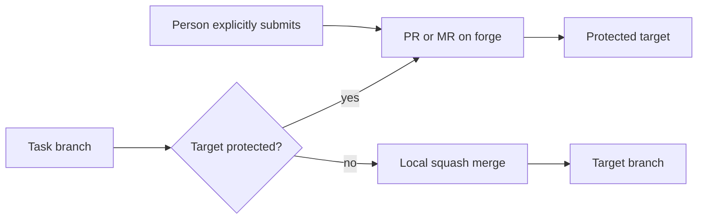

# Forges




Lazy works with GitHub and GitLab through their command-line tools, `gh` and `glab`, which run on the host under your login (`[remote] driver = "github"` or `"gitlab"`). With the default `local` driver there is no forge and lazy never touches a remote. Task containers never hold forge credentials, so agents cannot reach the forge themselves.

In Lazy Teams, a project admin sets the forge under **Settings → Configuration**:

```toml
[remote]
driver = "github"
git_remote = "origin"
```

Lazy then uses the `origin` remote for task branches and GitHub for pull
requests.

## When a pull request exists

A PR or MR exists only when:

- a task is accepted into a **protected** branch, a branch the forge itself reports as protected. Lazy asks the forge; see [Protected branches](../protected-branches.md) for lazy's own approval gate, which is separate; or
- a person explicitly submits a task (`lazy submit`, the dashboard's Submit button, or Teams), including a task stacked on another task.

Lazy never opens a PR for a task stacked on another task unless a person explicitly asks.

## What lazy reads

- the state of a task's PR (open, merged, closed), so a task merged or closed on the forge is reflected in lazy;
- review status, including approvals and comments, which are imported into the task. Comments from public repositories are not imported unless you opt in (`github_dangerously_sync_comments_in_public_repos_and_open_yourself_to_prompt_injection` / the GitLab equivalent);
- CI status and failed jobs.

With `[daemon] auto_react_comments` and `auto_react_ci` (both on by default), new comments and CI failures on a submitted task's PR start a turn on the task, within the `auto_react_*` limits.

## What lazy writes

Lazy writes three things to a PR:

1. it **creates** the PR/MR on submit;
2. it keeps the **lazy-owned section of the description** current;
3. it **approves** it, only when `[remote] auto_approve` is on and the target is protected, because the forge then refuses the merge without an approval.

Besides these, lazy only **closes** a PR it tracks (when the task is rejected or closed, or its work was merged locally) and **retargets** one when its task's parent changes. It posts no comments: reviews, accept reasons and agent turns stay on the task.

Lazy also pushes: the daemon pushes task branches after turns (`github_auto_push` / `gitlab_auto_push`, on by default) and pushes the parent branch as part of accepting.

## Where an accept merges

- Into a **protected** branch on a forge: the PR is merged on the forge.
- Into **any other branch** (every task branch, and any unprotected named branch) or with the local driver: lazy squash-merges locally and the work lands on that branch without a PR. If a PR was open for the task, lazy closes it afterwards.

See [Review and accept](../explanation/review-and-accept.md) and [`[remote]`](../lazy-toml.md#remote).
