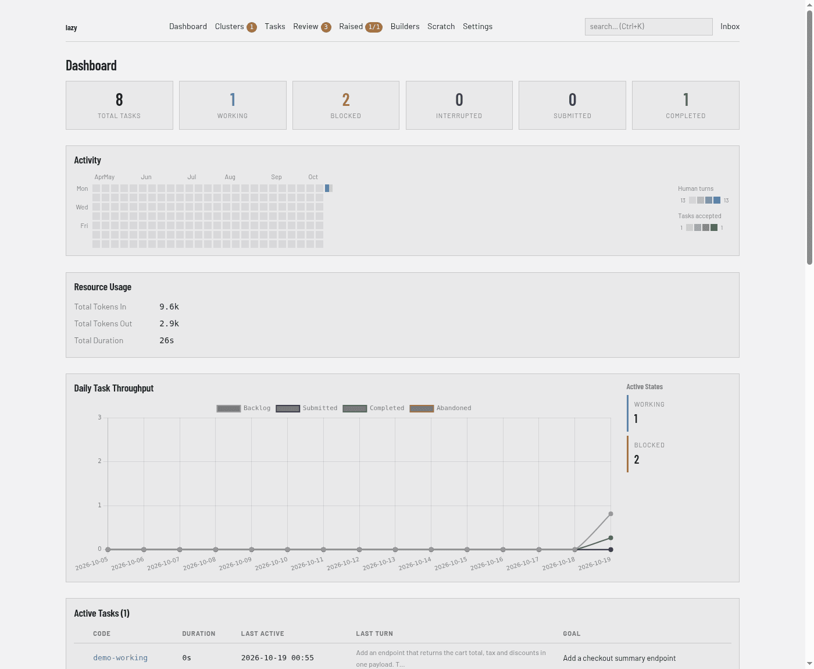

# The daemon, the task container and the proxy

Lazy is not one program that you run and that exits. Each project has a
long-running **daemon** that owns everything, and every other part of lazy is a
client of it. This page explains that split, where an agent actually runs, and
how the **proxy** lets an agent call a model without ever holding your real
credential.

## Why it exists

Task state is shared by several things at once: the CLI you type into, the
dashboard in your browser, agents calling lazy's tools, and background work such
as keeping task statuses current. If each of them wrote to the store itself they
would race, and a rule implemented in one would drift from the same rule in
another. So there is one owner. Rules live in one place, and what you see in the
CLI is what the dashboard and the agents see.

## The daemon owns state

Each project gets its own daemon process; only one runs per project. It is
started for you when a command needs it, and you can manage it directly:

```bash
lazy daemon status
lazy daemon logs
lazy daemon restart
```

The daemon holds the task store, decides what each status change means, launches
and watches agents, and does the periodic housekeeping that keeps statuses
honest. Everything else is a client that asks it to do things:

- **The CLI** parses what you type and prints the result.
- **The dashboard** is served by the daemon itself, on the port and interface
  set in the `[server]` section of [`lazy.toml`](../lazy-toml.md).
- **The agent's tools** (see [MCP tools](../mcp-tools.md)) go through the daemon.
- **The supervisor** is the small process lazy starts next to an agent to run
  it, watch it and report back to the daemon.

By default the daemon listens on loopback only, so none of this is reachable
from other machines unless you change `[server] bind`.

## The task container

Each task's agent runs in a Docker container of its own, on a git
worktree for that task. The container is where the agent can install packages, run builds and
edit files without touching anything else on your machine. Lazy's own binary is
mounted in at launch rather than baked into the image. See
[The agent container](../agent-container.md) for the default image, giving your
project its own image, and how lazy protects the worktree's git metadata.

Anything an agent can read it could also leak.
That is why credentials are kept out of it.

## The proxy and credential injection

All of an agent's model traffic goes through a proxy the daemon runs on your
machine. The proxy is always on; the agent is always handed the proxy's address
and never talks to the model provider directly.

At launch the daemon gives the agent a **placeholder** in the environment
variable where the real credential would normally go. The placeholder is a
random per-task value shaped like the real credential, so the agent's tooling
accepts it. When a request arrives, the proxy looks the placeholder up, learns
which task and role it belongs to, and swaps in the real credential just before
the request leaves your machine.

What that buys you:

- The container's environment, its logs and anything a prompt-injected agent
  could send out contain only a placeholder, which cannot authenticate to the provider directly. It is still a live token for the proxy until it is revoked; see [Just-in-time credential injection](../proxy-jit-credentials.md).
- A placeholder is revoked when the task ends, and on native Linux Docker it is
  also tied to its own container's network address (not on Docker Desktop, rootless or remote Docker).
- The proxy knows who is calling from the placeholder, not from anything the
  agent says about itself, so it can attribute usage and choose the upstream.

Your real credentials stay with the daemon, in your operating system's secure
storage; see [Credentials](../credentials.md) for how to set them and
[Just-in-time credential injection](../proxy-jit-credentials.md) for the full
flow, lifetimes and what the proxy will and will not forward.

The proxy is also a place to extend lazy. A project can add a request plugin
that sees each outbound request; see [Proxy request plugins](../proxy-plugins.md)
(plugins from a repository are currently not run).

## How it shows up

- **Dashboard:** it is the daemon's own web interface, so it always shows the
  same state as the CLI. Its home page counts the project's tasks by status:

  

- **CLI:** `lazy daemon status|logs|restart` manage the daemon.

## Limits

- A placeholder protects your real credential, not your repository: the agent
  can still read and change everything in its worktree.
- Pinning a placeholder to its container only works where the container's
  gateway is an address of the host itself, that is, native Docker. Docker
  Desktop, rootless runtimes and remote Docker hosts do not pin.
- A daemon will not start on a `lazy.toml` that does not load. A running daemon
  keeps using the last good config if the file breaks later.
