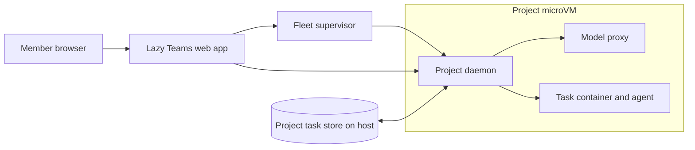

# Lazy Teams

> **Lazy Teams is in private alpha.** It is not yet generally released, and details can change.

Lazy Teams is a web application your team runs on a server you control. It puts the same tasks, reviews and agents you use from the command line behind a browser, so several people can work on one project together.

## Why it exists

The `lazy` command line works on one project on one machine, for one person. A team needs the same work visible to everyone, without each person keeping a daemon running on their laptop. Lazy Teams keeps each project running on a machine of its own and gives every member a browser view of it.

## How it works

Lazy Teams has three building blocks.

**A team** is the group of people and the projects they share. Each person is a member of a team with one of three roles:

- **Owner**: everything, including changing owners.
- **Admin**: manages members, projects and integrations.
- **Member**: sees the team and uses its projects.

Only an owner can grant or revoke the owner role, and a team always keeps at least one owner.

**A project** is one git repository registered in a team. A project has a desired state of running or stopped, and it is provisioned in steps (pending, provisioning, ready, or failed). Admins create and configure projects; members use them.

**A project's machine** is where the work happens. When the server has hardware virtualization, each project gets its own microVM. The project's repository is cloned inside that VM, the lazy daemon for the project runs there, and every agent turn runs inside it. The VM runs the same version of lazy as the Lazy Teams install. Without hardware virtualization, the install still runs but cannot run agent turns. The [self-hosting guide](../self-hosting-lazy-teams.md) covers the requirements.

The web application does not do the project's work itself. It records what you want (for example, that a project should be running), and the project's daemon does the work. Tasks, turns and reviews behave as described in the other explanation pages.

## How it shows up per surface

- **Lazy Teams**: the browser is the main interface. Members create tasks, choose agents, review diffs and accept work. See [Agents in Lazy Teams](../lazy-teams-agents.md), [Builders](../lazy-teams-builders.md) and [Reviewing a task](../lazy-teams-task-review.md).
- **Command line**: you can still run `lazy` against a Teams project from a clone of its repository. See [Teams login](../teams-login.md).

## Whose work and whose credentials

Everything a person does in Teams is attributed to that member, and an agent's turn is attributed to whoever asked for it. See [Identity](../identity.md). Each task bills the model account of the person who starts it, so every member connects their own credential. See [Credentials](../credentials.md).

## Limits

- Teams is in private alpha. Install it by following [Self-hosting Lazy Teams](../self-hosting-lazy-teams.md).
- Roles are per team. There are no per-project roles.
- Agent turns need hardware virtualization on the server.
