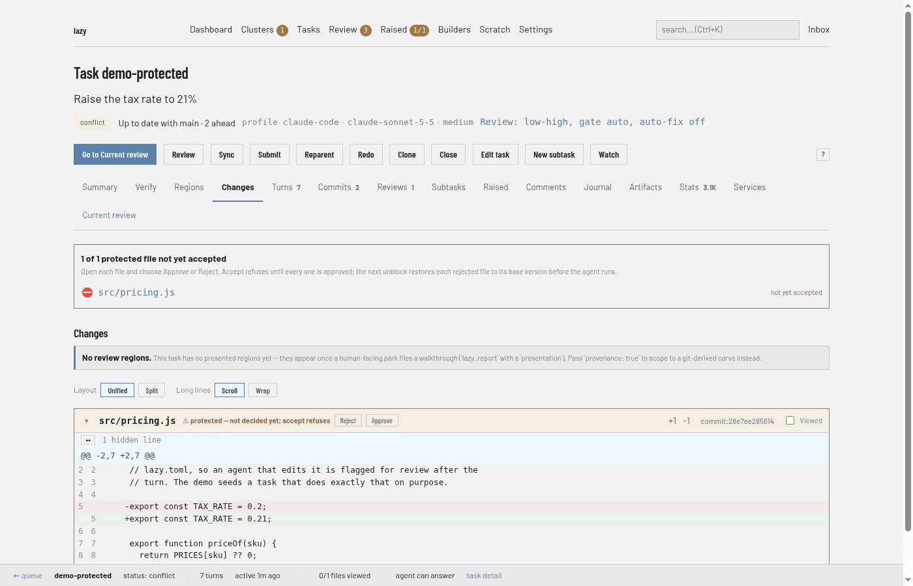

# Review and accept

Lazy puts a review between an agent's work and your branch, and makes the merge itself a single, recoverable step. This page explains why, and what you can rely on.

## Why it exists

An agent that has just written a change is a poor judge of it, and you cannot read every diff. So lazy reviews each task before you merge it, and treats `lazy accept` as the one deliberate act that puts the work on its target branch. Accept is built so a crash or a failed push never leaves you with merged work that lazy still calls unfinished.

## Review modes

`[review] mode` in `lazy.toml` chooses how a task is reviewed. Each task carries its own mode, and you can set it when you create or start a task:

```
lazy create --goal "…" --review separate
```

| Mode | Who reads the work |
| --- | --- |
| `low_high` (default) | The writing agent reviews its own work in the same session, then revises |
| `separate` | A reviewer in a new, read-only session |
| `off` | Nobody |

A review is recorded on the task in the same shape in every mode. Whether it holds your accept is set by `[review] gate`, which takes `auto` (the mode decides), `always` or `never`. A review you ask for yourself with `lazy review` always counts. The reasoning behind the default and the cost trade-offs are in [the review paradigm](../review-paradigm.md); the phases of the default mode are in [the low-high loop](../low-high-loop.md); the separate reviewer is described in [agent reviews](../review.md). Review turns are read-only: they report, they do not change the branch.

## What accept checks first

Before anything merges, accept refuses if:

- an open blocking [raised item](../raised-items.md) is unresolved;
- a review that gates the merge found issues the agent has not yet worked on;
- the task touches [protected files](../protected-branches.md), which you approve at accept;
- a configured accept check fails. See [the accept check](../accept-check.md).

The dashboard shows what is in the way before you press Accept. A task's **Current review** tab lists the open blocking raised items and the queued comments that have not reached the agent under "Before you can accept":


For protected files, the **Changes** tab shows a banner and puts **Approve** and **Reject** buttons on each file:



All of these happen before the merge, so a refusal changes nothing and the task keeps its status.

## The merge is the commit point

Once the merge lands, the task is accepted. Lazy records that straight away (the accept reason as a comment, the session as accepted, the task as `complete`) and nothing that can fail runs in between.

Everything after that is follow-through: reparenting the task's children, fast-forwarding the target, pushing the parent branch, closing a pull request that was open for the task, tagging the accept, notifying the parent task, and cleaning up. Each step can be repeated safely. If one fails, the task stays `complete`, the steps that depend on it wait, and the daemon retries in the background. The accept command also reports what is still pending and exits non-zero, and a system message appears if it keeps failing.

If the process dies mid-accept, the task is left in `merging`. The daemon does not roll it back. It checks whether the work already landed and, if not, repeats the accept from the reason and approvals you gave. After three failed automatic attempts it stops, files a system message, and hands the task back to you: re-run `lazy accept`, or reject or close it.

## In each surface

- Daemon dashboard: the Accept button on a task's Current review tab, which shows the refusals above it. See [the web review surface](../web-review.md).
- CLI: `lazy accept <task>`, with the reason and approvals prompted or passed as flags. See [the state machine](../state-machine.md) for the statuses involved.
- Lazy Teams (private alpha): a member accepts from the task page in the browser. See [reviewing tasks in Lazy Teams](../lazy-teams-task-review.md).

## Limits

- A review is a second reader, not a proof of correctness.
- The `merging` status and the retries describe lazy's own record. A push that keeps failing still needs you to fix its cause.
- Protected-branch approval is friction, not a security boundary. See [protected branches](../protected-branches.md).
