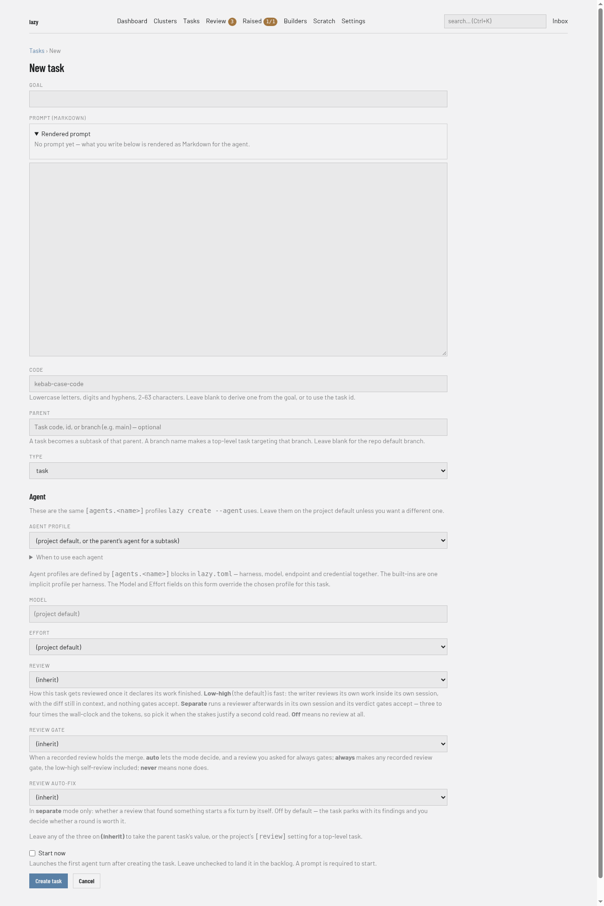
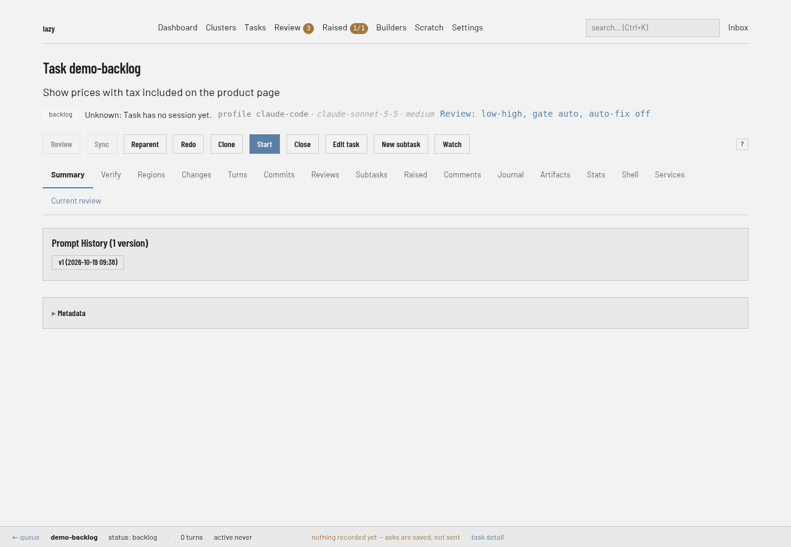
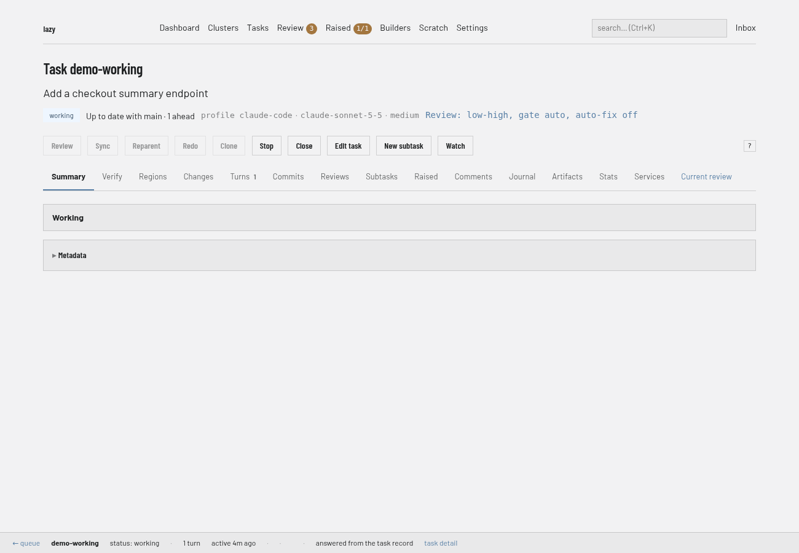
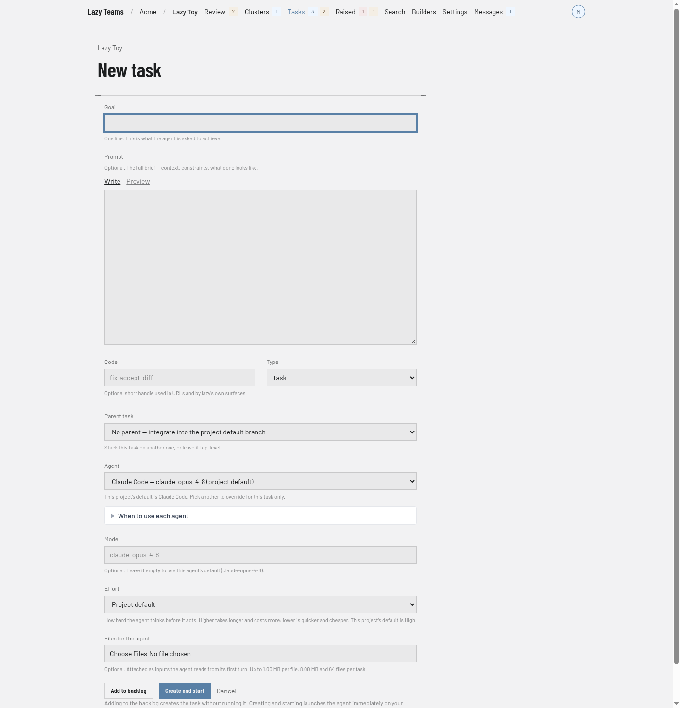

# How to create and start a task

You need this whenever you want an agent to start on a piece of work. A task has a goal and a prompt; creating it and starting it are two separate steps, and you can do both at once.

For what a task is and how its turns work, see [Tasks and turns](../explanation/tasks-and-turns.md).

### Dashboard

1. Open the dashboard with `lazy dashboard`, go to **Tasks** and choose **New task**.

   

2. Fill in **Goal** and **Prompt**. **Code**, **Parent**, **Type**, **Agent profile**, **Model**, **Effort** and the three **Review** settings are optional.

   

3. Tick **Start now** to launch the first turn straight away; leave it unticked to put the task in the backlog. Then choose **Create task**.

4. A backlog task has a **Start** button on its page. Choose it to launch the first turn.

   

5. While the agent works the badge reads **working**, and **Stop** and **Watch** (a live view of the agent's output) appear in the button row.

   

6. When the turn ends the task is **blocked**, waiting for you, and **Go to Current review** appears. Carry on with [Give feedback](give-feedback.md) or [Review and accept](review-and-accept.md).

   

### CLI

1. Create the task. Without flags, `lazy create` is interactive and opens your editor for the prompt:

   ```bash
   lazy create --goal "Add auth" --code add-auth --prompt "Implement OAuth2 login"
   ```

   The prompt comes from `--prompt`, then piped stdin, then `$EDITOR`. A task created this way waits in the backlog.

2. Start it, by its code or its short ID:

   ```bash
   lazy start add-auth
   ```

   Add `--follow` to wait for the agent and stream its output, or `--yes` to skip confirmation prompts.

Useful options on `lazy create`: `--parent <task>` (make it a subtask, or name a branch to target), `--type`, `--agent <profile>`, `--model`, `--effort <level>`, `--runner <docker|container|podman>` and `--tag` (repeatable). `lazy start` accepts the same `--model`, `--agent`, `--effort` and `--runner` to override them for the session. While a task is still in the backlog, `lazy edit` can change its goal, prompt and the rest.

To give the task its own environment variables at start time, use `--env` or `--env-file`; see [Set environment variables and secrets](set-env-and-secrets.md).

Once the agent has started, `lazy blocked` lists the tasks waiting for you and `lazy wait <task>` blocks until the task stops working.

### Lazy Teams

1. Open your project and choose **New task**.

   

2. Fill in **Goal**. **Prompt**, **Code**, **Type**, **Parent task**, **Agent**, **Model** and **Effort** are optional, and you can attach files under **Files for the agent**.
3. Choose **Add to backlog** to create the task without running it, or **Create and start** to launch the agent straight away. The agent runs on your own account.

A backlog task has a **Start** button on its page.

## Related

- [Give feedback to a task](give-feedback.md)
- [Review and accept a task](review-and-accept.md)
- [Tasks and turns](../explanation/tasks-and-turns.md) and the [task state machine](../state-machine.md)
- [Cluster tasks](../cluster-tasks.md), for a task that drives its own subtasks
