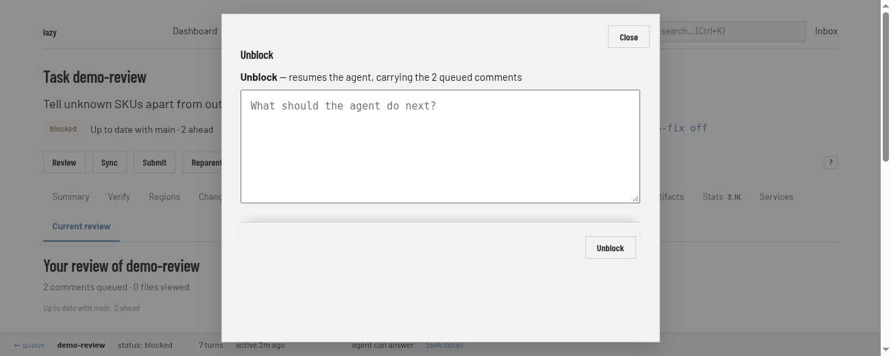
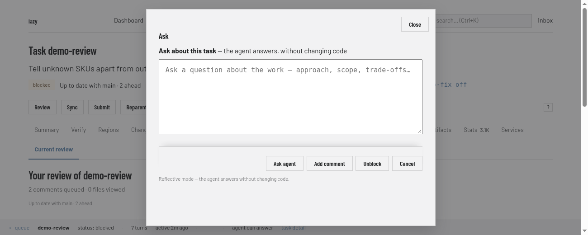
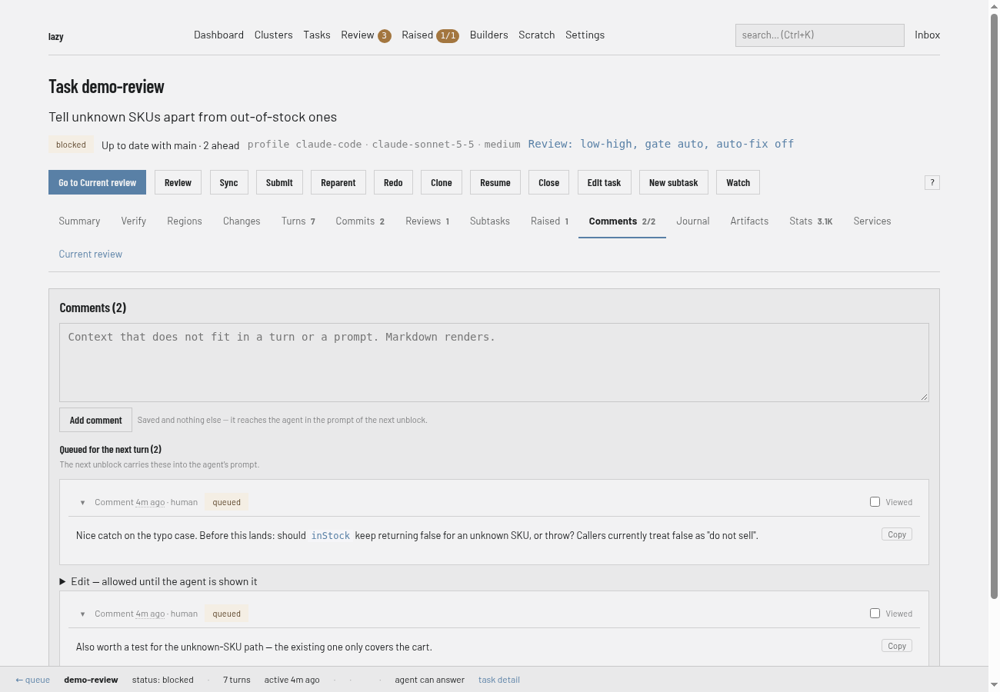

# How to give feedback to a task

You need this when an agent has stopped and is waiting for you, and you want it to carry on with different instructions. Feedback has two parts: an **unblock**, which sends a message and starts the next turn, and **comments**, which are notes that wait for that unblock.

How the agent sees both is explained in [Tasks and turns](../explanation/tasks-and-turns.md).

## How notes reach the agent

A comment is saved and nothing else: it never starts a turn. It reaches the agent in the prompt of the next unblock, together with your feedback. Asking the agent a question (`lazy ask`) and syncing do not carry comments and do not use them up. Comments you write while a turn is running are handed to that same turn before it ends.

### Dashboard

1. Open the task and go to its **Current review** tab. It lists the comments queued for the agent and the buttons that act on them: **Unblock**, **Ask**, **Accept**, **Submit**, **Reject** and **Sync**.

   

2. Choose **Unblock**. It opens a box headed "Unblock — resumes the agent, carrying the 2 queued comments" (the count is however many are queued), with a message field ("What should the agent do next?"); sending it starts the next turn. This is how you send the work back to the agent.

   

3. To ask a question without changing code, choose **Ask**. Its box says the agent answers without changing code, and has **Ask agent**, **Add comment** (saves a note instead), **Unblock** and **Cancel**.

   

4. The **Comments** tab has an **Add comment** form too. It shows each comment as **queued** until the agent has been shown it.

   

### CLI

Send feedback and resume the agent:

```bash
lazy unblock add-auth --message "Add error handling for expired tokens"
```

The feedback comes from `-f <file>`, then `--message`/`-m`, then piped stdin, then `$EDITOR`. With no flags at all and a terminal, `lazy unblock` is interactive: it shows the task and lets you give feedback, accept or reject. Useful options:

- `--follow` waits for the agent and streams its output.
- `--model`, `--effort` and `--agent` change those for this turn and later ones: each persists on the task until you change it again. Switching the agent re-picks model and effort for the new agent unless you pass them too, and starts a fresh agent conversation only if the new agent runs a different harness.
- `--yes` skips interactive prompts.

Leave a note without starting anything:

```bash
lazy comment add-auth --message "Prefer the existing session helper"
```

`lazy comment --edit <comment_id>` replaces a comment the agent has not seen yet.

To bring the parent branch's new work into the task before you give feedback, run `lazy sync <task>`; unblock never merges upstream by itself.

If the agent raised questions, answer them with the same unblock: `--respond-raised <id>=<text>`, `--dismiss-raised <id>=<reason>`, `--acknowledge-raised <id>`, `--promote-raised-subtask <id>` or `--promote-raised-peer <id>`. They are optional on unblock; items you do not name stay open. See [Raised items](../raised-items.md).

### Lazy Teams

Open the task. When it is waiting for you, **Give feedback** has an **Unblock** form (**Send feedback and resume**) and an **Ask** panel. The **Comments** tab has **Add a note** (**Save note**) and lists comments as seen by the agent or queued for the next turn.


## Related

- [Review and accept a task](review-and-accept.md)
- [Raised items](../raised-items.md)
- [Tasks and turns](../explanation/tasks-and-turns.md) and the [task state machine](../state-machine.md)
