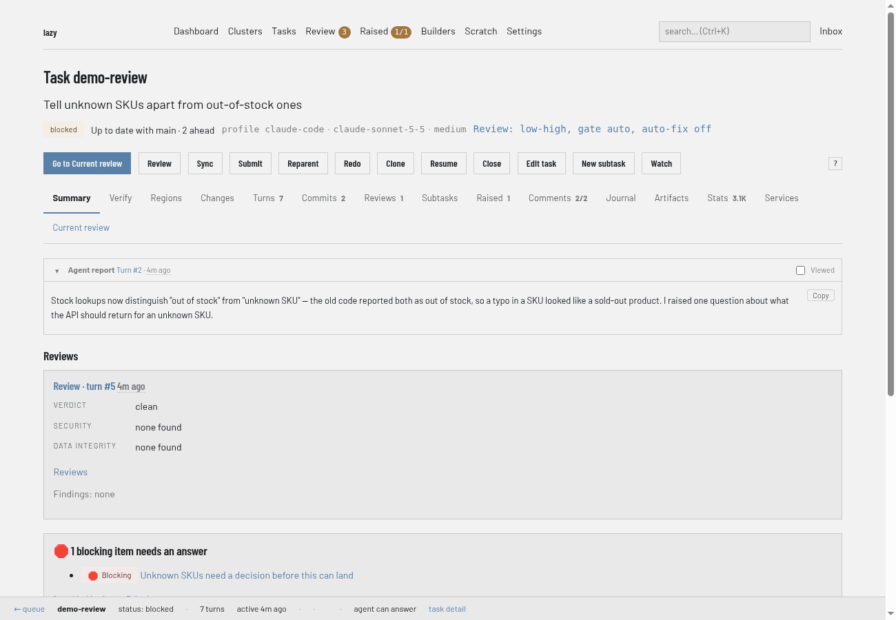
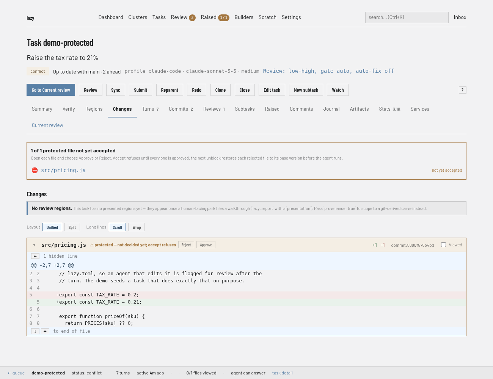
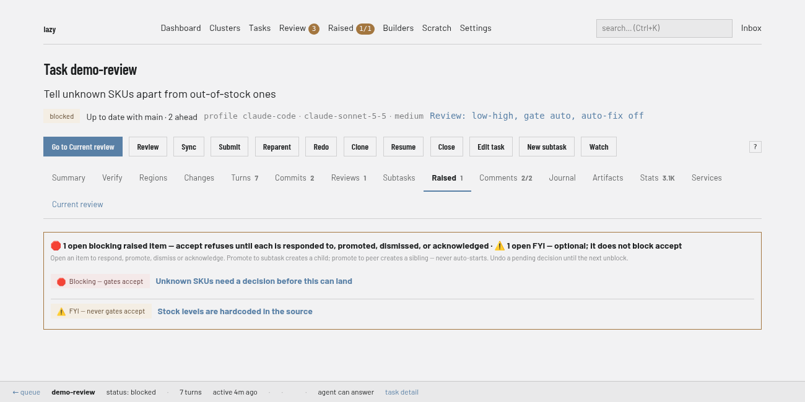
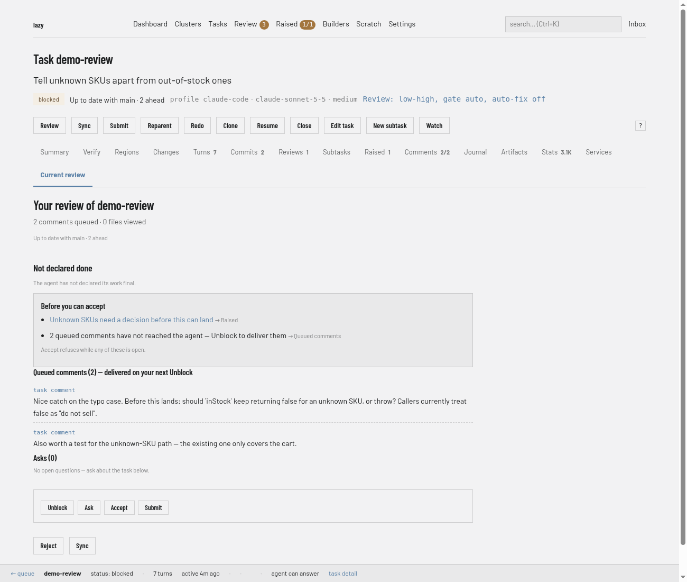
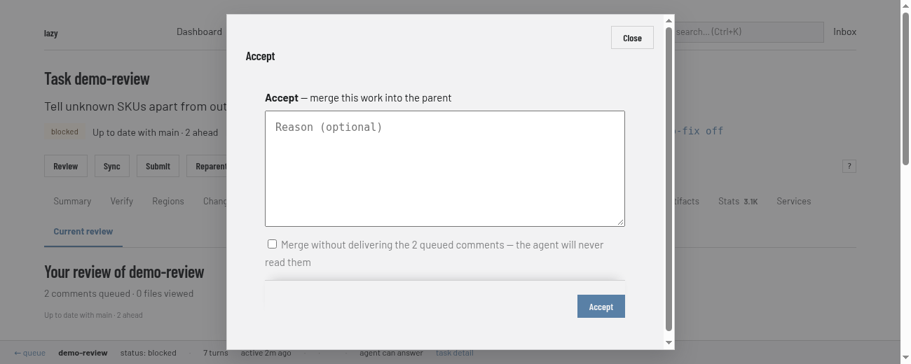
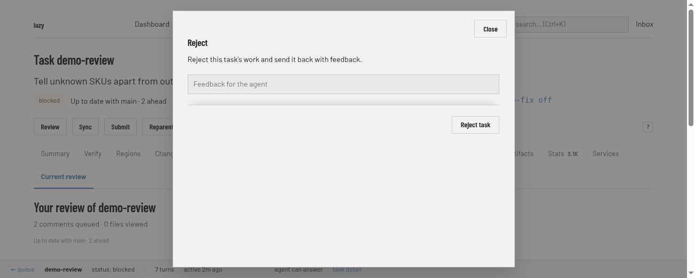
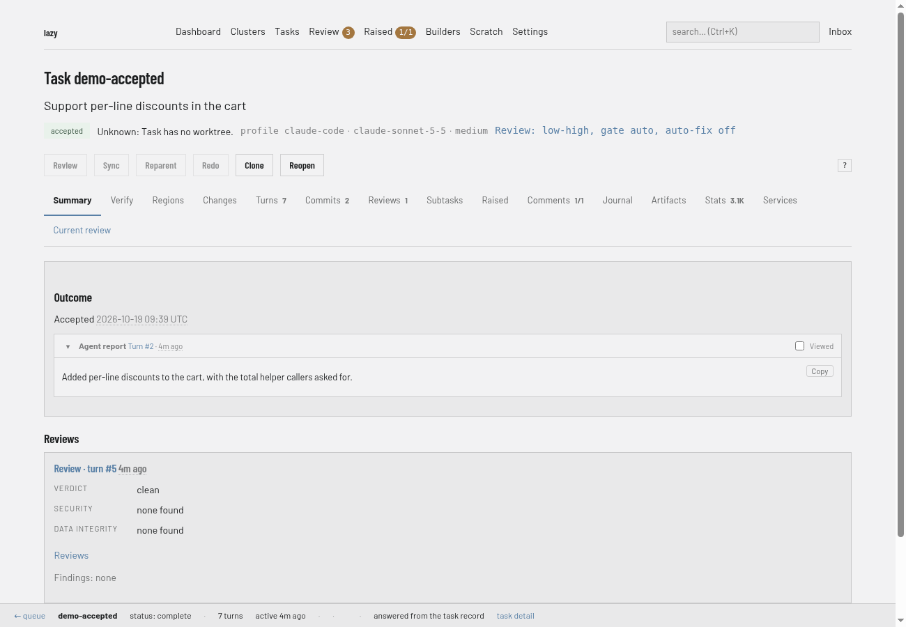

# How to review and accept a task

You need this when an agent has finished a turn and you have to decide what happens to its work: merge it, send it back, or discard it.

Why accept works the way it does is explained in [Review and accept](../explanation/review-and-accept.md).

### Dashboard

1. Open the task. A task waiting for you is **blocked**; choose **Go to Current review**.

   

2. Read the work. The **Changes** tab shows the diff and **Regions** splits it. A protected file shows **Approve** and **Reject** buttons beside it in the diff; Accept refuses until every one is approved, and a file you reject is restored to its base version at the next unblock.

   

3. Optionally choose **Review** on the task page to run a read-only agent review. You land on the **Reviews** tab, where its verdict is recorded.
4. Raised items are on the task's **Raised** tab; Accept refuses while blocking ones are open.

   

5. On **Current review**, decide. The box lists what stands between you and Accept ("Before you can accept"), then offers **Unblock**, **Ask**, **Accept** and, below, **Reject**. **Unblock** sends the work back to the agent with your feedback; see [Give feedback](give-feedback.md). If a protected merge needs the approval passphrase, Accept shows a box for it.

   

   **Accept** opens a box ("merge this work into the parent"; for a top-level task that means its target branch, which the box does not name, so check it first) with an optional reason and a tick box to merge without delivering the queued comments:

   

   **Reject** abandons the task and keeps its branch and history, the same as `lazy reject`. The box has a text field, and what you enter is recorded as the reason. To send the work back to the agent instead, use **Unblock** (see [Give feedback](give-feedback.md)).

   

6. Once accepted, the task's page shows its outcome and the badge changes. **Close** (with a reason) is on the task page for tasks you do not want to merge.

   

### CLI

1. See what changed. The diff is always the task's whole branch:

   ```bash
   lazy diff add-auth                 # summary
   lazy diff add-auth --full          # full diff
   lazy regions add-auth              # the change split into regions
   lazy diff add-auth --region <id> --full
   lazy diff add-auth --turn latest   # only the latest turn
   ```

2. Optionally ask a separate agent to review the work. The report lands on the task, and you read it with `lazy show`:

   ```bash
   lazy review add-auth
   ```

   `--no-wait` starts the review and returns; `--model` and `--effort` apply to that review only.

3. Decide.

   - **Accept** merges the work into the task's parent branch (for a top-level task, the repository's default integration branch, `origin/HEAD` then `main`, or the branch named with `lazy create --parent <branch>`; your current checkout is never adopted silently). Check that this is where you expect the work to land before you accept:

     ```bash
     lazy accept add-auth --reason "LGTM"
     ```

     The reason is also stored as a comment on the task. `--wait` waits for pending CI checks before merging.

   - **Send it back** with feedback: see [Give feedback](give-feedback.md).
   - **Reject** discards the work of a task that has run. The branch and history are kept, and the task is marked abandoned:

     ```bash
     lazy reject add-auth --reason "Wrong approach" --yes
     ```

   - **Close** abandons a task that never ran, or one you no longer want. `--reason` is required:

     ```bash
     lazy close add-auth --reason "Superseded" --yes
     ```

   `lazy reopen <task>` brings a rejected, closed or accepted task back.

#### Protected files and raised items at accept

Accept refuses until you have dealt with two things.

- **Protected files.** If the agent changed a file your project protects, the task shows as `conflict`. Name every such file when you accept; any file left out makes accept refuse, and nothing is reverted for you:

  ```bash
  lazy accept add-auth --approve-file src/auth.ts --approve-file src/session.ts
  ```

  The same flag is needed when the merge would re-add a file the target branch deleted. If the merge itself is into a protected branch, accept asks for your approval passphrase on a terminal; see [Protected branches](../protected-branches.md).

- **Raised items.** Every open blocking item the agent raised must be responded to, promoted or dismissed. On a terminal with no flags, `lazy accept` walks you through each one. Without a terminal, name them:

  ```bash
  lazy accept add-auth --respond-raised a1b2c3d4="use option 2" --dismiss-raised e5f6a7b8="not in scope"
  ```

  `--promote-raised-subtask`, `--promote-raised-peer` and `--acknowledge-raised` work the same way. See [Raised items](../raised-items.md).

Two more flags override a refusal on purpose: `--allow-review-issues` (a review left issues) and `--allow-queued-comments` (comments you queued were never delivered). `--yes` skips prompts, but never the raised-item walk or the protection passphrase.

### Lazy Teams

Open the task. **Changes** and **Regions** show the diff. Under **More**, **Ask the agent to review its work** runs a read-only review. Accept, Reject and Close are in the actions area on **Overview** and **Current review**:

- **Accept** opens an "Accept this task?" page showing where it merges (**Merges into**); check it before you confirm. Choose **Accept and merge**, with an optional reason.
  - Blocking raised items appear under "Decide these before accepting"; pick a decision (respond, promote, acknowledge or dismiss) for each. Open non-blocking notes can be decided there too.
  - Protected files are listed there; approve or reject each one on **Current review**. Pressing Accept on a protected merge counts as your approval and is recorded under your name; no passphrase is asked. See [Protected branches](../protected-branches.md).
- **Reject the work** and **Close the task** are folded sections that need a reason and ask again before acting. Both keep the branch.
- A finished task has **Reopen the task**.

The **Give feedback** panel on the task page has an **Accept** tab beside **Unblock** and **Ask**:


## Related

- [Review and accept](../explanation/review-and-accept.md)
- [Raised items](../raised-items.md), [protected branches](../protected-branches.md) and the [task state machine](../state-machine.md)
- [Give feedback to a task](give-feedback.md)
