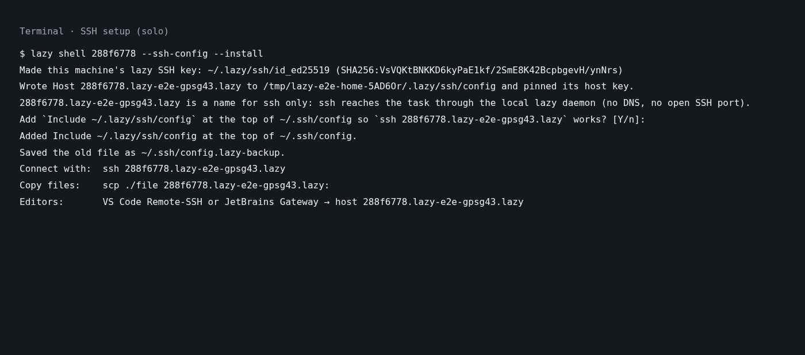
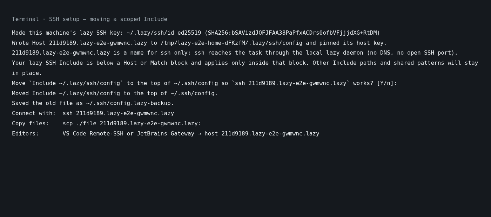
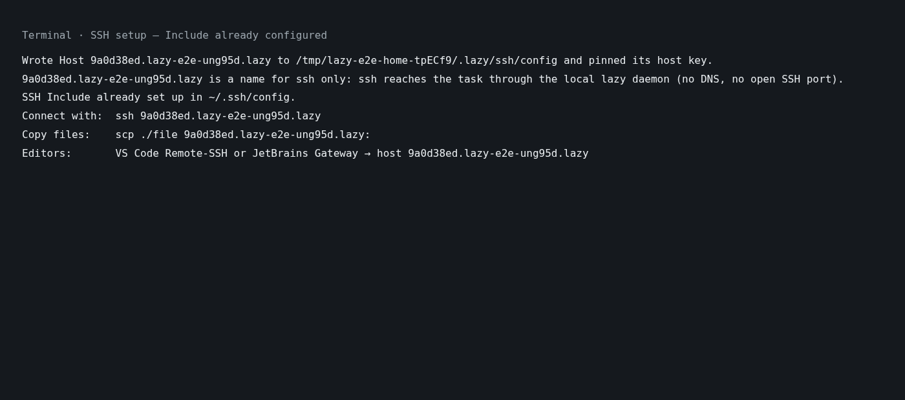
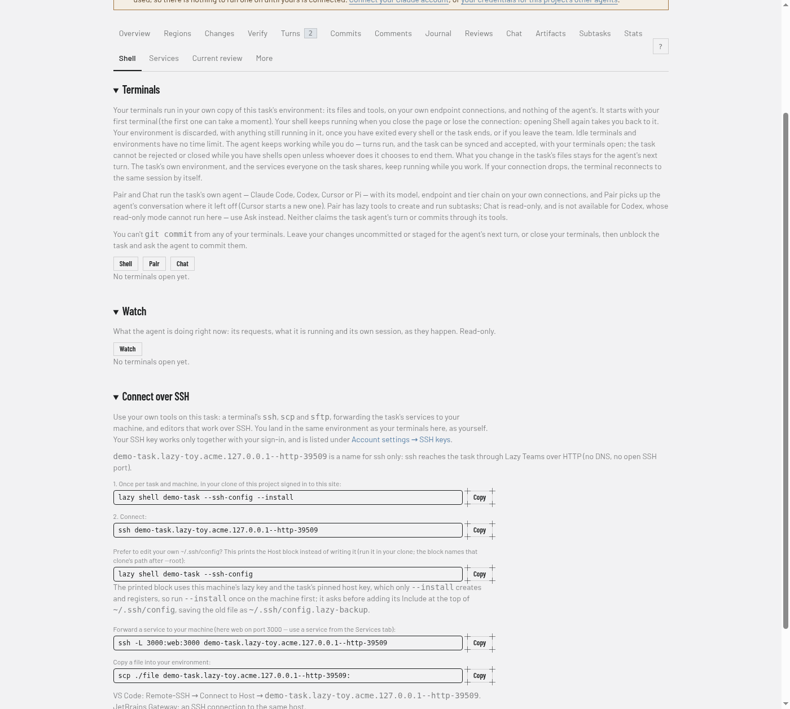
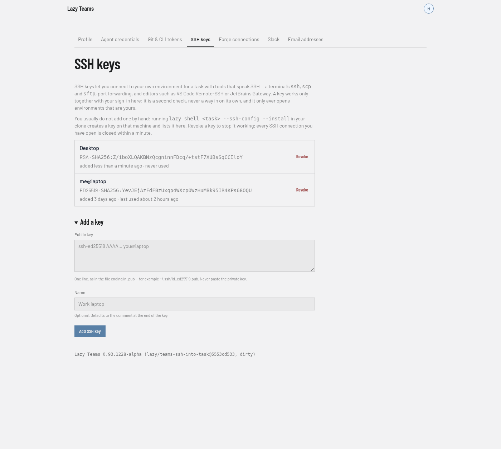

# How to SSH into a task

You need this when a tool that speaks SSH should work inside a task's environment: VS Code Remote-SSH or JetBrains Gateway, `scp` and `sftp`, or `ssh -L` to preview one of the task's services on your own machine. For a plain terminal, `lazy shell <task>` is all you need; SSH is the same environment, reached the way those tools expect.

There is no separate command. `lazy shell <task> --ssh-config` writes the SSH settings for a task, and from then on `ssh` reaches the task through lazy itself. No SSH port is opened anywhere: in Lazy Teams the connection rides the same HTTP or HTTPS address as the web pages, behind the same sign-in.

Where an SSH session lands:

- **Lazy Teams:** your own environment for the task, exactly where the task page's **Shell** lands: your own container, on the task's files, with your own credentials. Several members can be connected to the same task at once, each in their own environment. A running turn never refuses a connection, and a connection never holds a turn back.
- **On your own machine:** the task's container, as `lazy shell <task>` does.

An interactive `ssh` login joins your `shell` terminal session (the same one the Shell tab and `lazy shell` use, when the image has `tmux`), so a dropped connection loses nothing. Once you are in, and when the task's image has tmux 3.2 or later, the bottom line of the terminal says for a few seconds who else is in the task: other people's sessions, the task's services and whether the agent is running a turn. Commands, file copies and remote editors run directly, with no such line. Everything starts in the task's working copy.

## Set it up once per task

Run this in your clone of the project (in Lazy Teams, the clone you bound with `lazy clone` or `lazy login`):

```bash
lazy shell my-task --ssh-config --install
```

It sets up your key and SSH settings:

1. Makes an SSH key for this machine, `~/.lazy/ssh/id_ed25519`, the first time.
2. In Lazy Teams, registers that key under your account. You can see and revoke it under **Account settings → SSH keys**, and add keys of your own there.
3. Fetches the task's host key over your signed-in lazy connection and pins it in `~/.lazy/ssh/known_hosts`, so the very first connection is already verified.
4. Writes a `Host <task>.<project>.<team>.<teams-host>` block into `~/.lazy/ssh/config`.
5. Asks to add `Include ~/.lazy/ssh/config` as the first line of `~/.ssh/config`, saving the old file as `~/.ssh/config.lazy-backup` before changing it.

Answer yes to finish setup. Use `--yes` to consent without a prompt. If you decline or run without a terminal, lazy prints the manual step instead: add this line at the **top** of `~/.ssh/config`. An Include after a Host block applies only to that block.

If your config already includes lazy's file globally, setup says **already set up** and leaves it unchanged. It recognizes `~`, `${HOME}`, absolute paths, and glob patterns covering the file. Your other Include lines, including Colima or OrbStack settings, stay in place: SSH allows any number of Includes. Bare `$HOME` is not expanded by OpenSSH; setup explains this and offers to replace it with the working Include, with your consent and a backup.

If lazy's Include is below a `Host` or `Match` block, setup explains the restriction and offers to move it to the top, with the same consent and backup. Shared glob patterns stay where they are; lazy adds its own global line instead. If `~/.ssh/config` does not exist, accepting creates it with mode 600 and just the Include line.

```
Include ~/.lazy/ssh/config
```

`my-task.myproject.myteam.teams.example.com` is a name for ssh only: ssh reaches the task through Lazy Teams over its web connection (HTTPS, or HTTP if that is how your install is configured). No DNS lookup or open SSH port is involved. The name includes the task, project, team and Teams hostname; solo names use `<task>.<project>.lazy`. Each name has its own pinned host key.

For installs using HTTP or a non-default HTTPS port, the SSH name appends the scheme and effective port: for example, `http://localhost:3000` uses `<task>.<project>.<team>.localhost--http-3000`. This keeps installs on different ports separate.

Then connect:

```bash
ssh my-task.myproject.myteam.teams.example.com
```

`lazy shell my-task --ssh-config` without `--install` only prints the block, if you prefer to paste it yourself. The block runs lazy by its absolute path and names your clone, so it works from any directory and from editors that start `ssh` themselves.







In Lazy Teams the task page's Shell tab has a **Connect over SSH** panel with these commands for that task, ready to copy.



Your keys are listed under **Account settings → SSH keys**, where you can add one by pasting its public half, or revoke one:



## Preview a service with `ssh -L`

Forward a port on your machine to one of the task's services, by the name it has in the project's `[serve]` settings:

```bash
ssh -N -L 3000:web:3000 my-task.myproject.myteam.teams.example.com
```

Then open `http://localhost:3000`. The forward reaches the task's own service, the same one the Services tab shows, and carries any TCP traffic: a web app, a database or a debugger. A port declared without a name is reached as `services`, for example `ssh -N -L 5432:services:5432 …`. The service must be running; start it from the task's Services tab or with Start services.

If lazy cannot complete a forward, a web client gets a `502` response saying why, for example that the service is not published (restart the task's environment after adding it to `[serve]`). Use the service's name, such as `web`, rather than `127.0.0.1`: in Lazy Teams the SSH connection lands next to the task, not inside it, so `127.0.0.1:3000` reaches nothing.

On your own machine the services run in the task's container itself, so use `localhost`: `ssh -N -L 3000:localhost:3000 my-task.myproject.myteam.teams.example.com`.

## Copy files with `scp` and `sftp`

Paths are relative to the task's working copy:

```bash
scp ./fixtures.sql my-task.myproject.myteam.teams.example.com:        # into the task's working copy
scp my-task.myproject.myteam.teams.example.com:log/test.log .          # and back
sftp my-task.myproject.myteam.teams.example.com
```

## Work in VS Code or a JetBrains IDE

- **VS Code:** install the Remote - SSH extension, run **Remote-SSH: Connect to Host…**, and choose `my-task.myproject.myteam.teams.example.com`. Open the folder the connection starts in; that is the task's working copy.
- **JetBrains Gateway:** create an SSH connection to the host `my-task.myproject.myteam.teams.example.com`. Gateway reads `~/.ssh/config`, so the lazy block applies.

## Limits

- Key authentication only; there are no passwords.
- Local forwards (`-L`) only. Remote forwards (`-R`), agent forwarding and X11 forwarding are refused.
- Connections have no idle or lifetime limit. They end when you disconnect, the network drops, your key is revoked, you leave the team, or the task ends. Your `shell` session survives a dropped connection.
- In Lazy Teams every connection is recorded for the project's admins under the project's **Settings → SSH connections**: who connected to which task, from where, when and for how long, and how it ended, with the key and forwarded ports as reported from inside the member's environment.
- Leaving a team ends access to its projects; connections that are open close within a minute. Revoking any of your keys under **Account settings → SSH keys** closes all of your open connections the same way.
- The task's image needs an OpenSSH server. Lazy's own runner image has one; a project that brings its own image needs the `openssh-server` package in it.

## Related

- [Web shell](../web-shell.md)
- [Serve ports](../serve-ports.md)
- [Reference: lazy shell](../reference/cli/shell.md)
