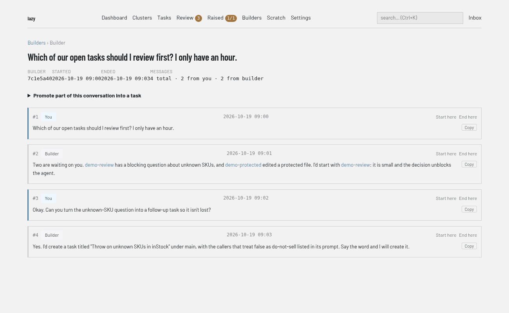

# How to use a builder

You need this when you want to talk to an agent about your project as a whole, rather than about one task: plan work, create tasks, review what is in flight. A builder is a conversation with an agent that has lazy's orchestration tools.

What a builder is, and how it differs from a task agent, is explained in [The builder](../explanation/the-builder.md).

### CLI

Start a builder session in your project:

```bash
lazy builder
```

It starts autonomously (no permission prompts) and, in an interactive terminal, asks you to type `yes` after showing the posture it runs under. Pass `--yes` to skip that, which is required without a terminal, or `--no-autonomous` to keep Claude Code's normal permission prompts. `--model <id>` and `--effort <level>` set the builder's own model and effort.

When a session exits, its ID is printed. Resume a session, and list the captured ones:

```bash
lazy builder --resume <id>
lazy builder list
```

If `lazy upgrade` stops your builder to rebuild the image, it is relaunched in place afterwards with its conversation intact.

In a clone logged in to Lazy Teams, `lazy builder` attaches your terminal to your builder running on the server, starting it if needed. Press ctrl-] to detach and leave it running. `lazy builder stop [<id>]` stops it and keeps the conversation; `lazy builder end [<id>]` ends it for good.

### Dashboard

The dashboard's **Builders** pages list and search past builder conversations and show their transcripts. You cannot start a builder from the dashboard; use `lazy builder`.

Open a conversation to read its messages (#1, #2, … with who said each and when). **Promote part of this conversation into a task** turns an exchange into a backlog task (**Create backlog task**); **Start here** and **End here** on a message mark where that exchange begins and ends.



### Lazy Teams

Open **Builders** in your project.


1. Choose **Start your builder**. If you already have one, the button reads **Open your builder** (running) or **Resume your builder** (stopped).
2. Work in the terminal on the page. A builder runs on the account of the person using it, so you can only open your own.
3. **Stop** keeps the transcript and **Resume** starts it again; **End** is final and the builder cannot be resumed.

Below, each past builder has a transcript. Tick **Select message** beside messages and choose **Create task** to start a new task from them. See [Builders in Lazy Teams](../lazy-teams-builders.md).

## Related

- [The builder](../explanation/the-builder.md)
- [Builders in Lazy Teams](../lazy-teams-builders.md)
- [The builder scratch directory](../builder-scratch-dir.md)
