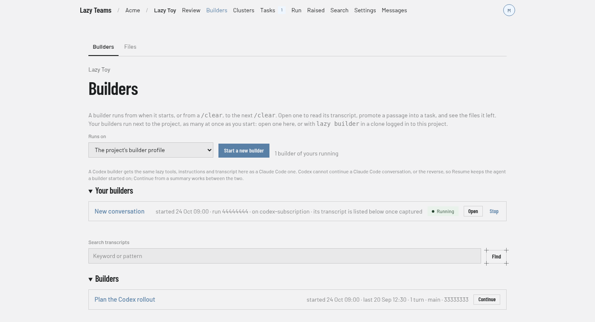

# How to use a builder

You need this when you want to talk to an agent about your project as a whole, rather than about one task: plan work, create tasks, review what is in flight. A builder is a conversation with an agent that has lazy's orchestration tools.

What a builder is, and how it differs from a task agent, is explained in [The builder](../explanation/the-builder.md).

### CLI

Start a builder session in your project:

```bash
lazy builder
```

It starts autonomously (no permission prompts) and, in an interactive terminal, asks you to type `yes` after showing the posture it runs under. Pass `--yes` to skip that, which is required without a terminal, or `--no-autonomous` to keep Claude Code's normal permission prompts. `--model <id>` and `--effort <level>` set the builder's own model and effort.

When a session exits, its ID is printed. Resume a session, and list the captured ones:

```bash
lazy builder --resume <id>
lazy builder list
```

If `lazy upgrade` stops your builder to rebuild the image, it is relaunched in place afterwards with its conversation intact.

To run a builder on Codex, name a Codex profile:

```bash
lazy builder --agent codex-subscription
```

`codex-api` (an OpenAI API key) and your own `harness = "codex"` profiles work the same way, and `[models.roles.builder] agent = "codex-subscription"` makes it the default. See [Codex builders](#codex-builders).

In a clone logged in to Lazy Teams, `lazy builder` starts another builder on the server and attaches your terminal to it, as it starts another one on your own machine. Press ctrl-] to detach and leave it running; `lazy builder attach [<id>]` reattaches (relaunching a stopped one). `lazy builder stop [<id>]` stops one and keeps the conversation; `lazy builder end [<id>]` ends the run, and its conversation stays listed and can be resumed. With more than one builder, name the session id; lazy lists them when you leave it out.

### Dashboard

The dashboard's **Builders** pages list and search past builder conversations and show their transcripts. You cannot start a builder from the dashboard; use `lazy builder`.

Open a conversation to read its messages (#1, #2, … with who said each and when). **Promote part of this conversation into a task** turns an exchange into a backlog task (**Create backlog task**); **Start here** and **End here** on a message mark where that exchange begins and ends.


### Lazy Teams

Open **Builders** in your project.


1. Pick what it **Runs on** — the project's builder profile, or any Claude Code or Codex profile the project has — and choose **Start a new builder**. Each press starts another one, so you can run several at once; every builder of yours is listed under **Your builders** with **Open** and **Stop**.
2. Work in the terminal on the page. A builder runs on the account of the person using it, so you can only open your own.
3. **Stop** keeps the transcript and **Resume** starts that builder again; your other builders keep running. **End** finishes the run; the transcript is kept, and the builder can still be resumed from the list.
4. Each of your own builders in the list, stopped or ended, has a **Resume** button that continues it in an additional builder of yours. See [Resuming a builder](../reference/teams/builders.md#resuming-a-builder).
5. Every builder in the list, a teammate's included, has **Continue**, which starts an additional builder of yours from a summary of it. See [Continuing from a summary](../reference/teams/builders.md#continuing-from-a-summary).

Below, each past builder has a transcript. Tick **Select message** beside messages and choose **Create task** to start a new task from them. See [Builders in Lazy Teams](../lazy-teams-builders.md).

### Codex builders



[Builders at phone width](../images/teams/teams-builders-list-phone.png).

A Codex builder gets the same lazy tools, the same instructions (including the description of where it runs) and the same captured transcript, with per-message token usage, as a Claude Code builder. It is paid with the Codex profile's credential: on your machine, the one stored for that profile (`lazy auth import codex-subscription` for a ChatGPT subscription, `lazy auth set openai` for an API key); in Lazy Teams, your own connection for that profile, never a teammate's or the project's. Usage limits and the usage pause apply to it as to any other builder.

What differs:

- **A conversation stays on its agent.** Codex cannot continue a Claude Code conversation, or the reverse. On the CLI, resume a Codex session with its profile again — `lazy builder --resume <id> --agent codex-subscription` (lazy refuses, and says so, if you leave it out). In Lazy Teams, **Resume** brings a builder back on the profile it started on. **Continue** (a summary) works between the two.
- **Container runners only.** A Codex builder runs under the `docker` or `podman` runner; the host-process runner refuses it.
- **Review conversations.** Builder replies in a review conversation run on the builder role's profile and need Claude Code; with a Codex profile there, lazy refuses the reply and says so.
- **Permission prompts.** `--no-autonomous` makes Codex ask before every lazy tool call; Claude Code asks only before the ones that change something.

## Related

- [The builder](../explanation/the-builder.md)
- [Builders in Lazy Teams](../lazy-teams-builders.md)
- [The builder scratch directory](../builder-scratch-dir.md)
