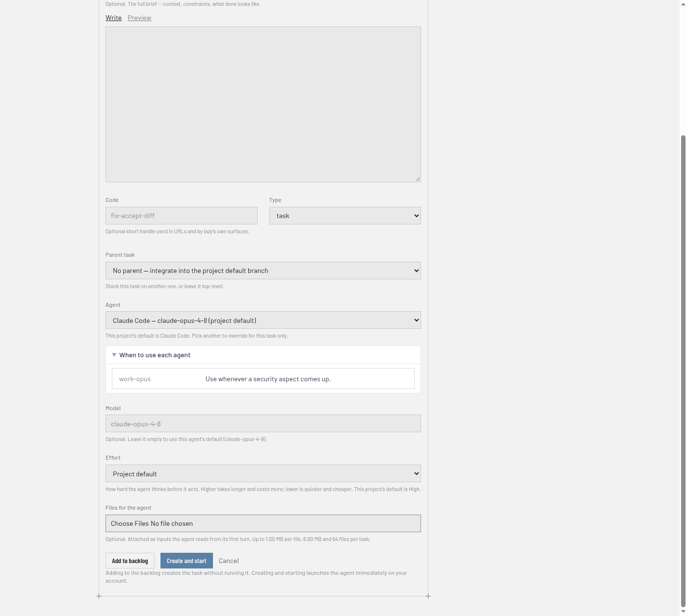
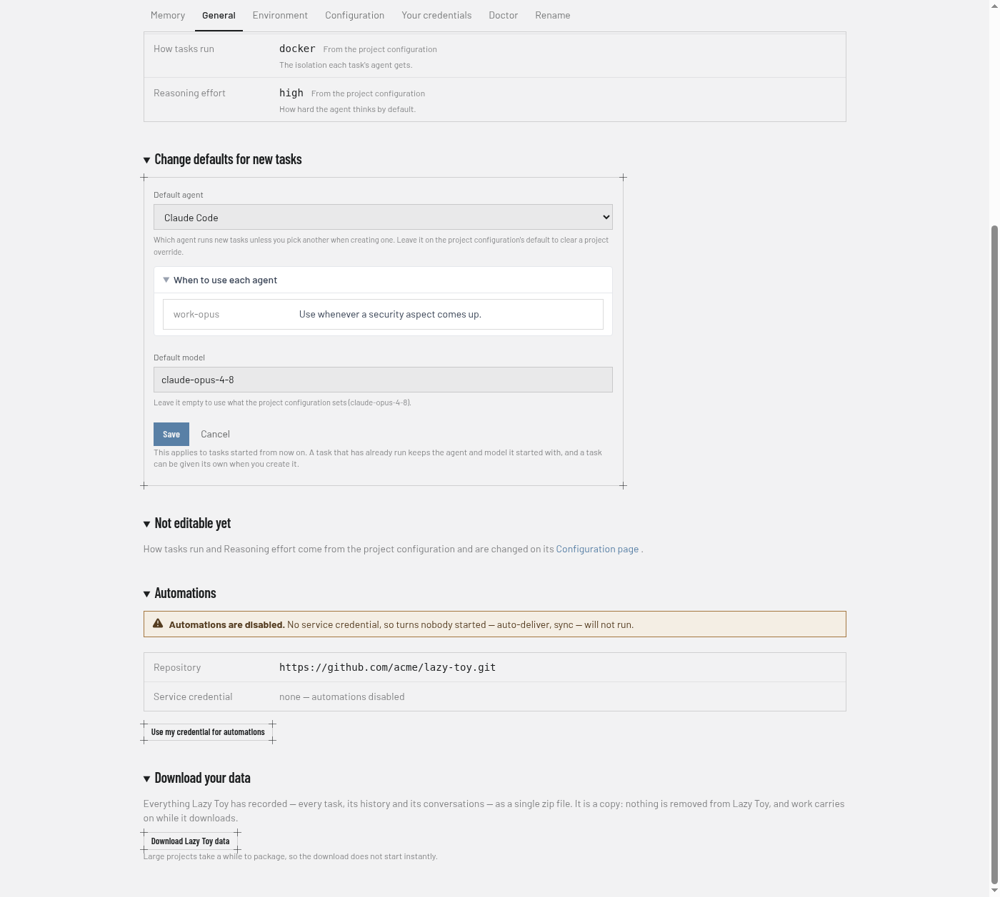

# Agents in Lazy Teams

This page is for Lazy Teams members and admins choosing which coding agent runs
a task and connecting the credentials those agents use. Lazy ships **Claude
Code**, **Codex**, **Cursor** and **Pi**, and a project can define more of its
own. Each agent bills turns to a different account, so the product keeps agent
choice and credentials explicit.

## Choosing an agent for a task

When you create a task, the **Agent** field lets you pick which agent runs it.
The form preselects your project's default (see below). Pick another agent to
override for that task only.



When an agent's configuration says when to use it (its `description`), a
**When to use each agent** list opens beneath the field — for example "use this
one whenever a security aspect comes up". It is guidance for your choice; the
form never switches agent on its own. Project settings show the same list
beside **Default agent**.

### The agents your project offers

The list is your project's own. A project can name its own agents in its
lazy.toml — a named combination of which agent software drives the work and
which model it asks for — and those are offered first, above the ones lazy
ships with. Each one says what it runs beside its name, so two agents built on
the same software but pointed at different models are told apart without
opening a config file.

You choose an agent by name and nothing else: where its traffic goes and which
key pays for it are set where the project is configured, and are never part of
filling in a task form.

If a project's agents cannot be read just now, the form falls back to the ones
lazy ships with rather than guessing.

You can change a task's agent with **Edit** after work has started, as long as
the task is not finished or closed and no turn is running (wait for it to stop
or block, or stop it first). The change applies to later turns and persists on
the task. If the new agent runs a different harness, the next turn starts a
fresh agent conversation, because one harness's conversation cannot be resumed
by another; between two agents on the same harness the conversation continues.
Unless you set a model and effort in the same edit, they are re-picked for the
new agent.

### Long prompts

Every agent receives a turn's instructions on standard input, not as a
command-line argument, so a task with a long history, many comments or long
feedback is delivered whole — nothing is shortened or replaced with a pointer.
You do not have to shorten feedback because a task has a long history.

## Project default agent

Team **admins** set the default under **Settings → General** on a project page. The control
shows what the repository's lazy.toml specifies and what this Lazy Teams install
overrides, so you always see both values and which one wins.



Clearing the override returns new tasks to the repository default. Changing the
default affects tasks that have not started yet; a task already running keeps the
agent it began with.

## Model and reasoning effort

Beside the agent, the new-task form takes a **Model** and an **Effort** — how
hard the agent thinks before it acts. Leave either blank and the project's own
default decides.

What you pick is kept on the task, not just on the run you are about to start.
A task added to the backlog with **Very high** effort still runs at very high
effort when somebody starts it days later from its own page.

## Agent credentials

Every turn runs on the account of the person who starts it — never a teammate's,
and never one key the project shares. Connect your credential **once per
endpoint**; every agent profile using that endpoint uses the same connection.
Separate named endpoints can use different accounts, even on the same provider.

### Where endpoints and profiles come from

A project's owner defines its endpoints and agent profiles — under **Settings →
Configuration → Endpoints and agent profiles**, a page every member can open
that also lists what is waiting for a project admin to confirm, with a form for each endpoint (name,
URL, credential name) and each profile (harness, model, description, an endpoint
or a list of tiers). The form writes the project's `lazy.toml`; the same checks
as the raw editor apply, and nothing is saved while lazy rejects it. Members
then connect their own key for each endpoint on **Your credentials**.

### Your Claude credential

Open **Agent credentials** from your account menu (top right) and connect your
own Anthropic account — subscription token or API key. Lazy Teams stores it
encrypted and never shows it again. This connects the built-in Anthropic endpoint
(`builtin:anthropic`). An agent using a separately named Anthropic endpoint needs
its own connection; it does not borrow the built-in account. Use **Test credential**
for the built-in Anthropic connection to check each ready project's saved copy
before running work. Results appear per project; an unreachable project means
the test could not run, not that your credential is invalid. Named endpoints and
other providers do not use this test. Projects still waiting for their normal
upgrade cannot run credential tests; the page explains that no test was sent.
If a project has not received your saved connection yet, the test sends it again
and re-checks, and says why when it still cannot be delivered. Saved connections
a project is missing are also re-sent automatically every few minutes, and the
page tells you when a connection you saved for another team or project does not
reach the one you are looking at.

### Account, team and project credentials

Each endpoint credential can be set at three levels, and
the most specific one you set wins:

1. **Account** (**Agent credentials** in your account menu) — used on every
   project of yours.
2. **Team** (the team page → **Your credentials**) — overrides your account
   credential on that team's projects.
3. **Project** (the project's **Settings → Your credentials**) — overrides both
   on that one project. You never need one; it is there if a project really
   needs a different key.

Each page says which level currently applies ("Using your team credential").
**Copy to team** on a project credential and **Copy to account** on a team
credential copy it up a level on the server — the value is never shown, and you
are asked before an existing credential at that level is replaced. Only your
own credentials are ever read or copied.

A connection carries the origin shown when you set it: the URL's scheme, host
and port. A project using the same endpoint name at a different origin cannot
use it. A stale project or team override refuses work rather than silently
spending a broader account; reconnect it or remove the override to inherit.

### Endpoints a project uses

On the project's **Settings → Your credentials** tab: Pi, Codex (on an OpenAI API key, or on a ChatGPT subscription), Cursor, and
any agent the project defines with an endpoint of its own — for example a
second Claude agent pointed at a gateway. The tab lists each endpoint once,
shows the agent profiles and tiers using it, and explains:

- what it needs — an API key, or for a ChatGPT subscription the contents of
  `~/.codex/auth.json` after `codex login` (use a login made for this: lazy
  keeps it renewed, which signs out any other copy);
- **where your credential is sent** — the endpoint's origin;
- whether your connection is available, needs reconnecting, or no credential is
  needed (a model server that takes none).

A credential is sent only to the origin you connected it for. Changing a base
path on that origin does not require reconnecting; changing the scheme, host or
port does. Anthropic credentials are never sent to a non-Anthropic destination.

Profiles that name an endpoint share its connection. A profile with its own inline
endpoint has the identity `profile:<name>`; renaming that profile creates a new
identity and does not move the old connection. Use a named endpoint when sharing
one connection across profiles is intentional. Built-in endpoints use
`builtin:<provider>` identities.

Starting a task or builder without a required connection is refused before
anything runs, naming the missing endpoint. Leaving a team
removes the credentials you set for that team and its projects; your account
credentials stay yours.

### Tiered agents and builders

A tiered profile can switch endpoints during a turn as its usage thresholds are
reached. Connect **every paid endpoint in the chain** before starting it, including
tiers you do not expect to use. Each request spends your connection for the tier
actually selected; credential-free tiers send no authentication.

For example, put this in the project's **Settings → Configuration** (the
project's `lazy.toml`):

```toml
[agents.claude-normal]
harness = "claude-code"
tiers = [
  { endpoint = "anthropic-subscription", model = "claude-sonnet-5-5", threshold_percent = 80 },
  { endpoint = "lunaroute", model = "glm-5.3-flash" },
]

[endpoints.anthropic-subscription]
url = "https://api.anthropic.com"
credential = "anthropic"

[endpoints.lunaroute]
url = "https://gw.lunaroute.com/"
credential = "lunaroute-api-key"
```

Requests go to the subscription tier until it reaches 80% of its usage window,
or until the provider refuses a request (HTTP 429); then they go to the next
tier, even in the middle of a turn. `threshold_percent` applies only to a
Claude or ChatGPT subscription tier. Each tier's `credential` names a stored
credential, not the endpoint itself, and every member connects both endpoints
in Teams before starting a task or builder on this agent.

Usage readings belong to your endpoint connection, so profiles sharing it see
the same readings. Replacing a credential clears those readings; renewing the
same session preserves them. Endpoints using the same upstream account still
share the provider's real quota. Providers without usage readings cannot supply
a measured percentage.


### Agents the project adds

The team owner adds and changes a project's agents on its **Settings → Configuration**
page (`[agents.<name>]` blocks in the project's lazy.toml). An agent added
there appears on every member's Your credentials tab and in the task form's **Agent**
list once the project has picked it up.

### Automations

Each project can designate one member's credentials for **automations** (turns
nobody started). Only an admin can set that, and only from their own connected
account; automations run on that member's endpoint connections, including every
paid tier. A missing connection disables the affected automation rather than
spending another member's account. Any connected agent account will do: an admin who has
connected only Codex can pay for a Codex-only project's automations.

## CLI vs Teams

The lazy CLI chooses agents with `agent_id` in lazy.toml and `--agent` on
`lazy create` / `lazy start`. A **project default agent** set in Lazy Teams
(or via the daemon's project settings) applies when you omit `--agent` on
`lazy create` and on MCP task creation too — the same overlay, not a separate
Teams-only default.
