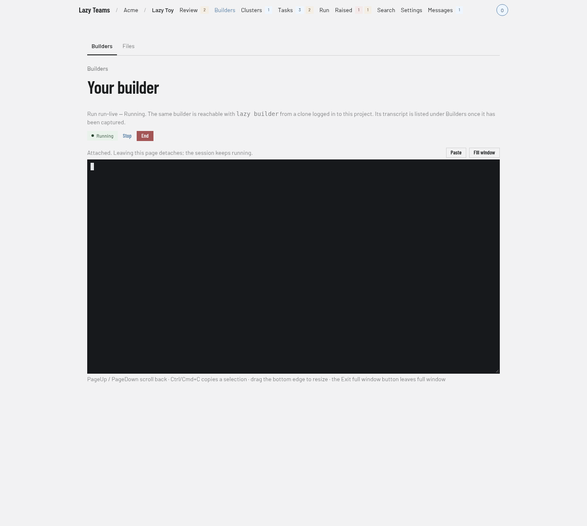

# Builders in Lazy Teams

Open **Builders** in your project to start a builder — as many at once as you
like — return to one of yours, read previous conversations, and find the files
builders have left for you.

## The terminal

Choose **Fill window** above the terminal to make it cover the whole window, and
**Exit full window** (or **Esc**, when the terminal itself is not focused — inside it Esc goes to your program) to return to the page. You can also drag the terminal's bottom-right resize handle to
change its height. **Page Up** and **Page Down** scroll the terminal's captured
output (on Claude Code's fullscreen view they go to Claude Code, which scrolls itself), **Ctrl/Cmd+C** copies a selection, a copy Claude Code makes lands on your clipboard, and **Ctrl/Cmd+V** or **Paste** pastes;
other key combinations keep their existing terminal behavior. Every terminal in
Teams — builders, a task's Shell, Watch and Verify's Run in shell, and the
admin machine shell — has the same controls.

Teams builders run in isolated containers with permission bypass enabled.
This does not change permission settings or warnings for builders you launch
on your own machine.

## Create a task from messages

In a previous builder's transcript, check **Select message** beside each
message you want to use. Messages need not be consecutive. Selections remain
as you move between transcript pages in the same browser tab.

Choose **Create task** to open the normal new-task screen. Its prompt contains
only the selected messages, in conversation order. Set the goal and edit the
prompt before choosing **Add to backlog** or **Create and start**. Selecting
messages alone never creates a task.

Edits to this prompt are saved as a separate local draft. Returning to the same
selection restores your edits without replacing an unrelated new-task draft.

Messages render as markdown, with subtly different backgrounds for the human
and builder.

## Files

Open **Files** to read captured scratch files. **Rendered** displays markdown,
**Source** displays its text within Teams, and **Raw** opens the plain text
without the Teams interface. **Download** saves the stored file content.

Files recorded by name only have no stored content to download. Their page
shows why capture skipped them, rather than offering an empty file.

## Running environment

Every builder receives a generated description of where it runs, alongside its system instructions. It identifies Teams or solo lazy, the runner and deployment backend, the daemon platform, access to files and scratch, and the available browser address. Facts that lazy cannot verify are marked unknown. Custom system instructions do not replace this context. Task agents receive the same deployment context.

The generated context also explains how to inspect another task's committed code
without copying its tree: read files at the recorded commit with git, or request a
file-specific task diff. To run checks that write files, use a disposable export
with the project's required dependencies and setup. Keep other tasks' worktrees
unchanged, even when they are visible from the builder.
