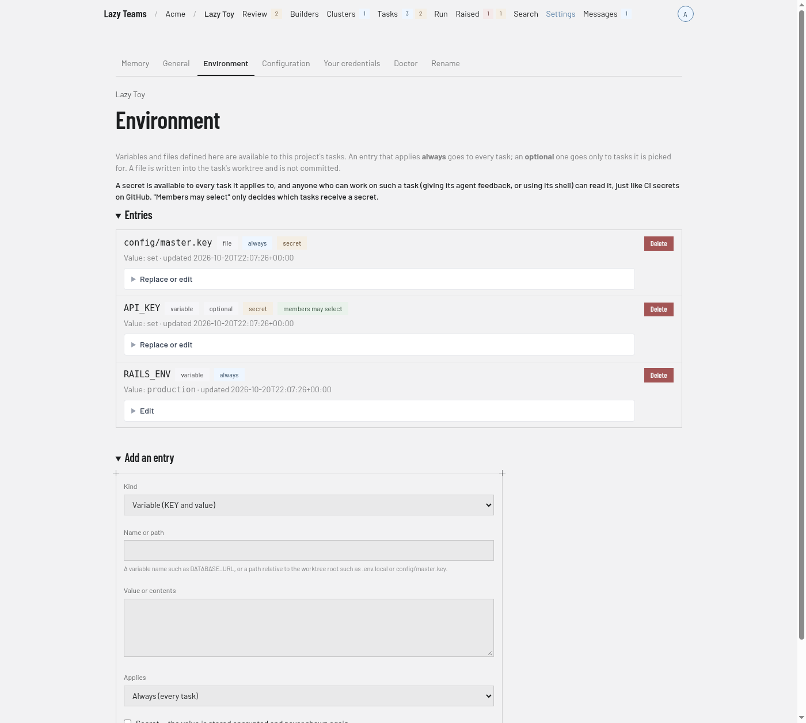
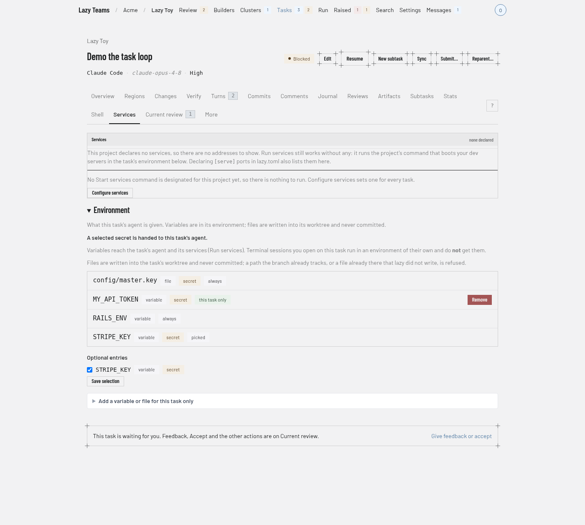

# Environment variables, secrets and files

Project admins define the environment a project's tasks can use under **Settings → Environment**.

Each entry is either:

- a **variable** — a name such as `DATABASE_URL` and a value; or
- a **file** — a path relative to the task's worktree root (for example `.env.local` or `config/master.key`) and its contents.

For each entry you choose:

- **Applies** — *Always* (every task in the project) or *Optional* (only tasks it is picked for).
- **Secret** — the value is write-only. After saving, the page shows only that it is set and when it last changed. To change it, enter a new value (leaving the field empty keeps the current one); to remove it, delete the entry. A secret cannot be turned into a plain entry or back: delete it and add a new one.
- **Members may select** — for optional entries, whether any member may pick it for a task. Otherwise only admins can.

Every value, secret or not, is stored encrypted. On this page a plain variable shows its value and a plain file shows only its size. An entry's kind (variable or file) is fixed once saved; its name or path, value, **Applies** and **Members may select** can be edited. Only project admins can add, change or delete entries; site operators in god mode can view the page but not change it.

A secret is available to every task it applies to, and anyone who can work on such a task (giving its agent feedback, or using its shell) can read it — just like CI secrets on GitHub. **Members may select** only decides which tasks receive the secret, not who can read it there, so only define a secret that everyone who works on those tasks may see.

Teams checks that a variable name uses only letters, digits and underscores and does not start with a digit, that a file path is relative, does not end in `/` and has no control characters, and that no two entries of the same kind share a name. Everything else is checked when the entry is delivered to a task, and a refusal is shown in full:

- **Reserved variable names:** `PATH`, `HOME`, `USER`, `SHELL`, `PWD`, `TMPDIR`, `GIT_SSH_COMMAND`, `CLAUDECODE`, and any name starting with `LAZY_`, `ANTHROPIC_`, `CLAUDE_`, `CURSOR_` or `PI_`.
- **Variables:** at most 64 per task and 128 KiB in total.
- **Files:** at most 32 per task, 256 KiB each and 1 MiB in total. A path is at most 1024 bytes, uses `/` separators, has no `..`, `.` or empty segments, is not inside `.lazy`, `.lazy-task-sandbox` or `.lazy-lock` at the worktree root (nor one of those itself), and has no `.git` segment anywhere. A task can be given at most 256 different file paths over its lifetime.

## What a task gets

A task's page shows an **Environment** section on its Services tab, where you go to troubleshoot its app: every always-applied entry, the optional entries picked for it, and any entries added for that task alone. Secrets, variables and files are listed by name or path only — values are never shown.

- **Pick optional entries.** Tick an optional entry to give it to this task. Members can tick entries marked *members may select*; an admin can tick any.
- **Add something for one task.** Any member who can edit the task can add a variable or file just for it, optionally as a secret (stored encrypted, never shown again). It overrides a project entry with the same name.
- **A secret can be read by anyone who can work on the task** (feedback to its agent, or its shell), like CI secrets on GitHub. Pick secrets accordingly.

Variables are delivered to the task's agent and to its services (Run services) before every launch the page starts, and again whenever the entries or the selection change; a task that is already running picks the change up at its next turn. Every task is given the project's always-applied entries from the moment it is created, however it was started — by a cluster task, a builder or the CLI as well as from the page. A task page says "Not delivered by Teams yet" while Teams has not delivered that task's environment itself. A refusal (for example a reserved variable name) is shown in full where you made the change, and the change stays saved. If an always-applied entry is refused, the Environment page says so in full. Until you fix or remove it, new tasks start without the always-applied entries and each task's delivery is refused too, while entries you removed are still taken off every task — so an entry you deleted never keeps reaching them. Terminal sessions you open on a task run in an environment of their own and do not get these variables. Files are written into the task's worktree and never committed or pushed: a commit that carries one is refused. A file that already holds exactly its contents is left untouched, so a dev server watching it is not restarted when a turn starts. A path the branch already tracks, or a file already in the worktree that was not written there for this task, is refused rather than overwritten, and the reason is shown.

When a file stops applying to a task (you untick or delete its entry), it is no longer written, but it is not deleted: it stays in the task's worktree, still kept out of every commit. The task's Environment section lists such files so you can remove them yourself if you no longer want them there.

A variable that stops applying is unset at the next delivery; variables set with `lazy env set` are left alone. A change made to a task that has already ended is saved but not delivered. An entry added for one task alone can be removed but not edited: remove it and add it again.

## Data directory

A task's Services tab also shows its **data directory**: the path services
should keep their data in (`$LAZY_TASK_DATA`, `/lazy/data`) and how much it
holds. It survives the task's environment being recreated and is removed when
the task is finished. See [the agent container](agent-container.md#keep-your-services-data-across-restarts-put-it-in-lazy_task_data).
