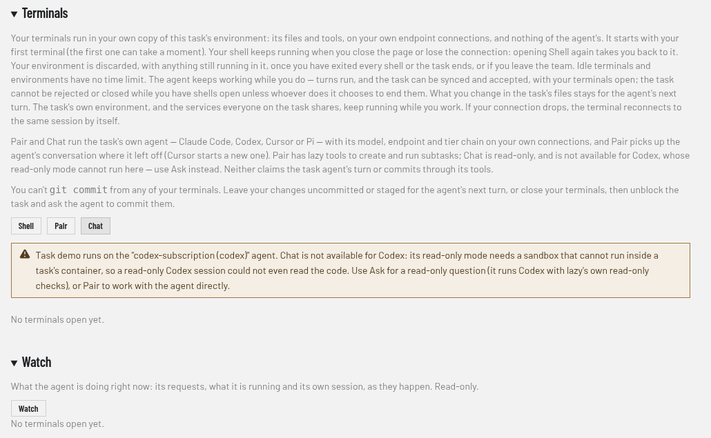

# Pairing

`lazy pair <task>` drops you into an interactive agent session on a task — the
same session its supervised turns run, with the same history, on the same
branch. You talk to the agent directly, it edits the worktree, and when you exit
lazy records a summary turn and puts the task back to `blocked`.

## Where the session runs

**In the task's container**, alongside the task's own turns. Pairing joins the
existing container with `docker exec` rather than starting a new one, so
whatever else is running in it — dev servers, watchers, published ports — keeps
running. A daemon restart keeps the container and its services. If the container
is gone, pairing starts one, the same way
a supervised turn would.

The container keeps the paired session beside the task’s supervised work:

- **Session state.** The agent's home directory is now the sandbox mount the
  task's own turns already write (`<worktree>/.lazy-task-sandbox/`), so resuming
  a container-written session Just Works: it is the same directory, not a copy.
  Nothing is imported across the container boundary, which closes the
  escalation channel described in [Cursor pairing](#cursor-and-codex-pairing) below.
- **Blast radius.** `--autonomous` (permission prompts off) is now the same
  trust decision as any supervised turn, not "an agent with your privileges on
  your machine".
- **Honesty.** Host pairing was the escape hatch for everything that did not
  work in a container. Anything that does not work in a paired session is now a
  container bug to fix.

## Pairing in Lazy Teams

Open **Pair** on a task to continue its conversation in your own terminal
container. Your paired agent gets the task's `lazy_*` tools, including creating
and running subtasks. Its writes name you, and any turn it launches spends your
own credential. Other members can pair on the same task at the same time.

Pair and Chat run the task's own agent — Claude Code, Codex, Cursor or Pi — on
any of their profiles, including named endpoints and tiered profiles. They use
the task's model, endpoint and tier chain, with your connections resolved at
account, team or project level just like a turn you launch. Tiers switch per
request. If a required connection is missing, click Pair or Chat to see which
endpoint to connect under **Connections**.

Pair picks up the agent's conversation where its last turn left it on Claude
Code, Codex and Pi. A Cursor session starts a new conversation, because
Cursor's conversation store is not a format lazy can carry into your
environment. When your session ends, the conversation goes back to the task so
the agent's next turn sees it.

Subtasks you create from Pair notify a cluster's waiting agent and restart a
parked cluster, unless someone explicitly stopped it. Questions about saved
builder conversations also check and use your own account.

Pair and Chat cannot declare the task agent finished, replace its report or
progress, file its raises or replies, justify its protected or maintained files,
or commit through `lazy_commit`. Those tools belong to the task agent's turn.

Waiting from Pair or Chat leaves comments queued for the task agent. Usage
limits show your own account. You can accept a subtask once its parent stops
working.

Each connection has its own tool credential. Closing Pair revokes it immediately;
open Pair again to reconnect. Leaving the team revokes access to your environments
and their tools. The task agent's credential is never shared with your session.

**Chat** has read-only tools. Both modes ignore agent-written hooks and MCP
configuration in the checkout: Claude Code loads only your own settings, Codex
treats the checkout as untrusted, Cursor asks you whether to trust it, and Pi
ignores the checkout's own Pi files.

Chat is read-only on Claude Code, Cursor and Pi. It is not offered on Codex
tasks, because Codex's read-only mode needs a sandbox that cannot run inside a
container — a read-only Codex session there could not even read the code. Use
**Ask** (or `lazy ask`) for a read-only question to a Codex task, or Pair.

The task’s **Chat tab** and **Ask** work on all four harnesses. They run read-only
questions through lazy, including on Codex; the Codex exception above applies
to the interactive terminal Chat. Finished-task interactive chat uses an archived
Claude Code session.



[The same Shell controls at phone width](images/teams/teams-task-shell-codex-phone.png).

## The `--host` escape hatch

**Branchless mode** — `lazy pair` with no task, on a non-task branch — has no
container to join. It requires an explicit `--host`, and prints what that means
before launching.

On a normal task, `--host` is an optional claude-code-only opt-in to run the
agent on your machine instead of in the task's container. There is deliberately
**no automatic fallback**: if the container path fails, pairing fails loudly
rather than quietly running an agent on your machine instead.

```
lazy pair <task>          # in the task's container (the normal case)
lazy pair <task> --host   # claude-code only: on your machine instead of the container
lazy pair --host          # branchless: no task, no worktree, no container
lazy pair --host --no-task  # same, on ANY branch — even a lazy/* branch with no task in this store
```

If you are on a `lazy/*` branch whose task this store does not know (a branch
from another machine, or a task since closed), `lazy pair` refuses. Add
`--no-task` (with `--host`) to skip task detection and pair in the current
directory on your machine. It cannot be combined with a task argument,
`--unlock` or `--no-summary`; `--resume <session>` works as in branchless mode.

## Tools the paired session gets

A CLI paired session is wired with **this task's** `lazy_*` MCP tools — the same
scoped toolset the task's own agent gets, not the broader builder toolset. That
is deliberate: the session is operating on one task, in that task's worktree, so
it gets that task's tool channel or none. Tool registration fails loudly; a
paired session with no lazy tools is broken, not degraded.

While you pair, those tools can do what the task's own agent does during a
turn — including creating, starting, waiting on and accepting the task's
subtasks, which merges their work into the task you are pairing on.

`lazy pair <task> --host` gets the same tools. lazy writes a private MCP config
for the session (readable only by you, outside your home directory, removed
when the session ends) and starts Claude Code with `--strict-mcp-config`, so the
session has lazy's server and no other: MCP servers from your own
`~/.claude.json`, or from a `.mcp.json` in the worktree, are not loaded. Nothing
is written to your `~/.claude` settings; the lazy tools are approved on the
command line instead. Branchless `--host` sessions have no task, and so no lazy
tools.

## Cursor and Codex pairing

Cursor and Codex tasks pair the same in-container way: the interactive CLI runs
inside the task's container on the same mounted home (`~/.cursor` / `~/.codex`)
the supervised turns used, resuming the task's own session. Because the
session runs on the same side of the boundary as the agent that wrote the
history, nothing is copied into your host home. The session uses the
credential the task's own turns use, and follows the daemon to its current
proxy address after a restart.

Codex keeps asking before it runs commands unless you pass `--autonomous`, but
its own command sandbox is off: that sandbox cannot run inside a container, and
with it on, every command the session ran would fail. The container is the
boundary, as it is for the task's turns.

`lazy chat` on a paused Cursor or Pi task runs that agent read-only in the
task's container the same way. On a Codex task it refuses and points at
`lazy ask`.

**Honest gap:** conversation capture and the AI end-of-session summary need
session files lazy can read back, and Cursor's and Codex's are not that — so
pairing on a Cursor or Codex task records the commits you made and skips the
transcript and summary. Pairing says so rather than silently omitting them.

## Pi pairing

Pi tasks pair the same in-container way: `lazy pair` launches `pi`
interactively in the task container. When the task already has a session, the
paired one resumes it with its history and continues the supervised work;
otherwise a fresh session starts, and pairing says which it did.

Pi's session files are in Pi's own documented format, which lazy reads back:
when the session ends, every session file the pairing wrote is captured into
lazy's conversation store (searchable with `lazy search`), and the
end-of-session summary is synthesized from that transcript — the same as for
Claude Code. If saving a conversation fails, pairing says so and still writes
the summary; the session file is untouched on disk either way.

## Ending a session

Exit the agent. Lazy releases the pairing lock, restores the task's status, and
(for Claude Code and Pi) captures the conversation and synthesizes a summary
turn from it.

If the host side is killed — a daemon restart, `lazy upgrade` — the in-container
process is signalled through a pidfile in the shared sandbox directory rather
than left holding the session, because `docker exec` does not forward signals to
the process it started.

```
lazy pair <task> --unlock
```

recovers a session that outlived its host command. It signals the in-container
agent through that same pidfile, removes the pairing lock, and restores the task
to `blocked`. If no pidfile is present there is nothing running to signal, and
`--unlock` just clears the lock and status — it will not start a stopped
container to go looking.

`--host` sessions have no pidfile: they are ordinary child processes of your
shell, so exiting or killing the terminal is what ends them.
