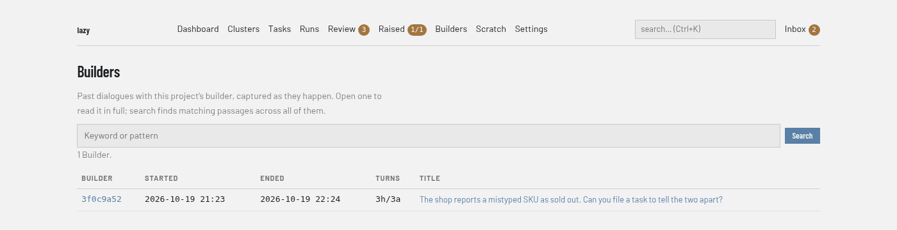

# Builders screen

Captured dialogues with the project's builder (**Builders** in the navigation bar, address `/builders`). The page is read-only: conversations are recorded as they happen and listed here. The badge on the navigation entry counts conversations captured or extended since you last opened this page in this browser. To bring in older conversations, see [Importing conversations](../../conversation-import.md).

## Regions

- **Search box.** Searches the text of every captured conversation by keyword or pattern. Results list up to 10 builders with up to 5 matching passages each, with a **Clear** button to return to the full list.
- **List.** One row per builder conversation: **Builder** (a short id that opens it), **Started**, **Ended**, **Turns** and **Title**. With none captured, the page says "No Builders yet."

## A conversation

Opening a row shows the conversation's messages, paged with **Earlier** and **Later** links. On a conversation you can pick an exchange with **Start here** and **End here** on its messages and create a backlog task from it, with an optional code and parent; the page also lists tasks already promoted from the conversation.
