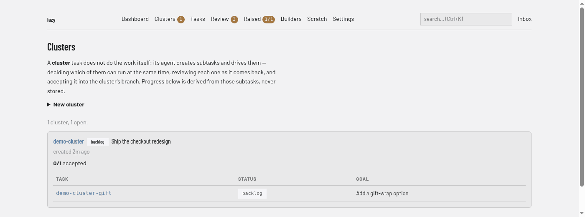

# Clusters screen

The tasks of type `cluster` (**Clusters** in the navigation bar, address `/clusters`). A cluster's own agent creates subtasks, runs them, reviews each result and accepts it into the cluster's branch. See [Cluster tasks](../../cluster-tasks.md). The badge on the navigation entry counts clusters that are not finished.

## Regions

- **Explainer.** A short description of what a cluster is.
- **New cluster.** A collapsed form that creates a cluster. It is the [New task form](tasks.md#new-task) with the type fixed to `cluster`; give it the goal of the whole cluster and its agent creates the subtasks.
- **Summary line.** How many clusters there are and how many are open.
- **Cluster cards.** One per cluster. The heading has the cluster's code (a link to its [task page](task.md)), its status and its goal, followed by when it was created and a progress line (for example `0/1 accepted`) worked out from its subtasks. A table lists each subtask with its status, a **deferred** marker if the cluster set it aside, and its goal.

A cluster with no subtasks yet says so. With no clusters, the page says "No cluster tasks yet."
