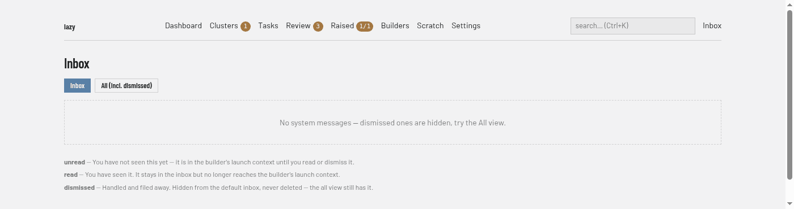

# Inbox screen

System messages: reports and notices lazy files for you (**Inbox** at the right of the navigation bar, address `/messages`). The badge counts unread messages. For what a message is and who posts one, see [System messages](../../system-messages.md).

## Regions

- **Filter buttons.** **Inbox** (the default) hides dismissed messages; **All (incl. dismissed)** shows everything. In the inbox view, **Dismiss all** dismisses every open message after a confirmation.
- **Summary line.** How many messages are unread. Unread messages are part of the builder's launch context until you read or dismiss them.
- **Table.** One row per message, newest first, with **ID**, **Kind** (hover for its meaning), **State**, **Created**, **Source**, **Title** and **Actions**. A message that repeated shows "happened N times" beside its title.
- **Actions.** **Mark read** (unread messages only), **Dismiss**, and **Dismiss all like this**, which dismisses every open message with the same source and title after a confirmation. A dismissed message shows when it was dismissed and by whom; dismissed messages are kept, never deleted.
- **Legend.** Under the table, the meaning of the three states: unread, read and dismissed.

A title opens the message, with its metadata, the same actions, and its full text.

The dashboard home also lists unread messages; see [Dashboard screen](overview.md).
