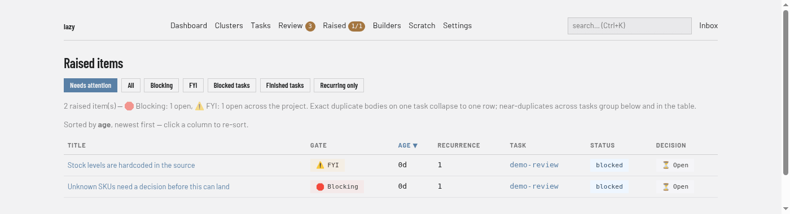

# Raised items screen

Every question, decision and proposal that agents have raised, across all tasks (**Raised** in the navigation bar, address `/raised`). The badge on the navigation entry shows open blocking items first, then non-blocking ones (for example `1/1`). For what raised items are and how they gate a merge, see [Raised items](../../raised-items.md).

## Regions

- **Filter buttons.** **Needs attention** (the default) lists open items on blocked tasks. **All** lists every item, decided ones included. **Blocking** and **FYI** list only items of that gate. **Blocked tasks** and **Finished tasks** restrict the list by the status of the task the item sits on. **Recurring only** lists items that near-duplicate others, most recurrent first.
- **Summary lines.** The count of items, with how many are open per gate, and the current sort order. Exact duplicates on one task collapse into one row; near-duplicates across tasks are grouped.
- **Table.** One row per item with **Title** (opens the item), **Gate** (Blocking or FYI), **Age**, **Recurrence**, **Task** (a link to the [task page](task.md)), **Status** (of that task) and **Decision** (open, or how it was decided). Click a heading to sort.
- **Recurring items.** When near-duplicates exist, a section below the table groups them with their count, a sample and the tasks involved.

## An item

A title in the table opens the item, which shows:

- its gate, decision, task, date and recurrence size, then the item's text;
- **Options the agent offered** and **Agent comments**, when there are any;
- **Decide**, for an open item: choose *Respond to agent*, *Acknowledge*, *Promote to subtask*, *Promote to peer task* or *Dismiss*, add a response, and apply. Promoting creates a backlog task that is never started automatically, with a goal and code you can edit, records the item as promoted, and opens the new task;
- **Gate**, which lets you flip the item between blocking and FYI. The agent chose the flag, and you have the last word;
- **Provenance**, and **Similar raised items**.

Items for a single task are also listed on that task's **Raised** tab.
