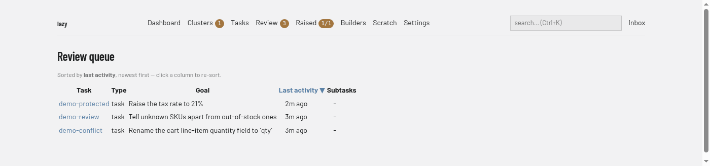

# Review queue

The list of tasks waiting for a human (**Review** in the navigation bar, address `/review`). The badge on the navigation entry is the number of tasks in it.

## Regions

- **Sort note.** States the current order, for example "Sorted by last activity, newest first". Click a column heading to sort by it; click the active heading to reverse.
- **Table.** One row per waiting task, with the columns **Task** (a link to the [task page](task.md)), **Type**, **Goal**, **Last activity** and **Subtasks** (how many tasks sit anywhere beneath it, or `-`).
- **Badges** after the Subtasks column, shown when they apply: the number of comments on the task, comments queued for the agent's next turn, review questions still awaiting the agent, and `no session` for a task whose agent never ran.

The queue holds tasks in a blocked or conflict state, and tasks that are submitted. When nothing is waiting it says "Nothing awaiting review." Reviewing a task is covered in [Reviewing in the browser](../../web-review.md).
