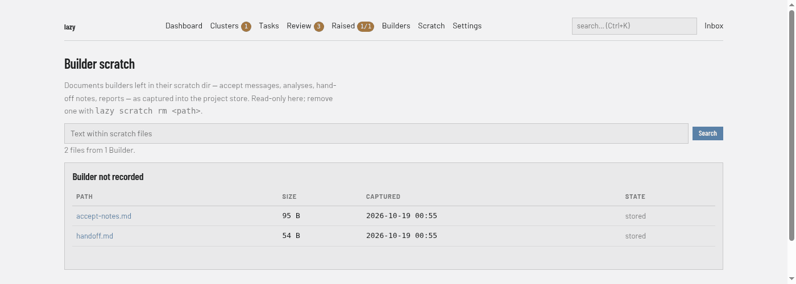

# Scratch screen

Files that builders left in their scratch directory, captured into the project's store (**Scratch** in the navigation bar, address `/scratch`). The page is read-only; remove a file with `lazy scratch rm <path>`. For what the scratch directory is and how capture works, see [The builder scratch directory](../../builder-scratch-dir.md).

## Regions

- **Search box.** Searches the text of captured files. Results list each matching file with the text around the match; **Clear** returns to the list.
- **Summary line.** How many files from how many builders.
- **File groups.** One block per builder, headed by the builder (a link to its [conversation](builders.md) when it is recorded, otherwise "Builder not recorded"). Its table has **Path** (opens the file), **Size**, **Captured** and **State**: `stored`, or `name only` with the reason when a file's content was not kept.

With nothing captured, the page says so and points at `lazy scratch sync`, which captures the live scratch directory immediately.

## A file

Shows the file's size, when it was captured and by whom, and its content. A Markdown file is rendered, with a **Raw** button to see the source (and **Rendered** to return); other files are shown raw. A file recorded by name only says so and points at the live scratch directory (`lazy scratch path`).
