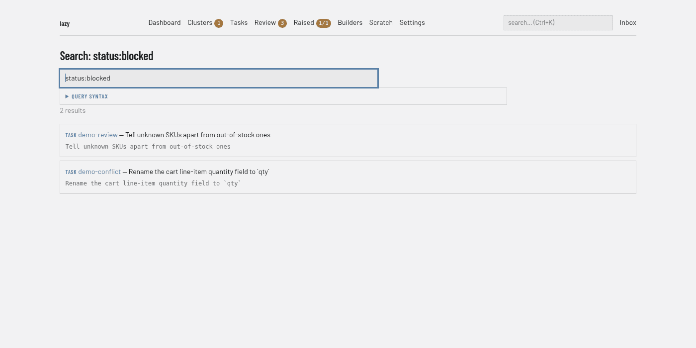

# Search screen

Search across the project's tasks and their contents (the box at the top of every page, address `/search`). The page runs the same search as `lazy search`; the query language, modes and examples are in [Searching tasks](../../search.md).

## Regions

- **Search box.** Pre-filled with the current query. Press Enter to search. The placeholder shows example queries.
- **Query syntax.** A collapsible panel listing the query language: its fields and operators, notes, and examples that run when clicked. It is collapsed when there are results, and open when the page has no query, no results or an error.
- **Result count.** For example "2 results".
- **Results.** One card per hit, starting with the kind of thing that matched (task, prompt, turn and others), then a link to its task, the task's goal, and the text around the match. Turn hits name the turn and link to it. An id-shaped query also shows the matching id.

An empty search, or one with no hits, shows the same box and syntax panel, with a hint where lazy has one.

## Command palette

On any page, `Ctrl+K` (`Cmd+K` on macOS) opens a palette over the page. Typing searches the project. Starting with `>` switches to commands, such as creating a new task or navigating to the dashboard, clusters or full search. `Ctrl+Shift+K` (`Cmd+Shift+K`) opens it directly in command mode. Arrow keys move through the list, Enter opens the selection and Escape closes the palette.
