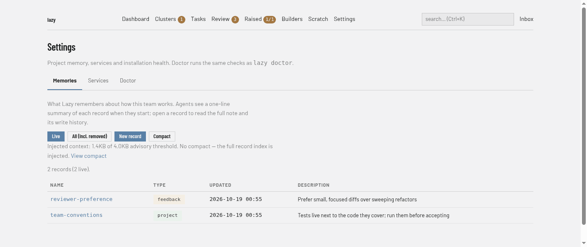

# Settings screen

Project memory, services and installation health (**Settings** in the navigation bar, address `/settings`). Three tabs sit under the heading: **Memories**, **Services** and **Doctor**. The page opens on **Memories**.



## Memories

`/settings/memory`. The shared memory records Lazy injects into builder and agent launches. For what a record is, how compaction works and who may write, see [Shared memory](../../memory.md).

- **Live** and **All (incl. removed)** switch between current records and every record including removed ones (their history is kept).
- **New record** opens a form with Name, Type, Description and Body. **Compact** opens the compact page, where you can run or clear compaction.
- A line reports how much context the index injects against the advisory threshold.
- The table lists each record's **Name** (opens it), **Type**, **Updated** and **Description**. A record's page shows its body, its write history, an edit form, and a link to remove it.

## Services

`/settings/services`. The project-wide **Start services** command: the one command a task's **Start services** runs inside that task's environment, with the ports declared under `[serve]` published. It is the same for every task. The tab shows the current command, a box to change it and a **Clear command** button; with none set, no task offers Start services. The command is saved to the project's store, not to `lazy.toml`. See [Reaching a task's dev server](../../serve-ports.md).

For example, declare a web service in the project root's `lazy.toml`:

```toml
[serve.services]
web = 3000
```

Then set the Start services command on this tab to launch the app on port 3000.
In Lazy Teams, a project admin edits the same port under **Settings →
Configuration**.

## Doctor

`/settings/doctor`. The same checks as `lazy doctor`.

- **Run doctor** runs the checks and shows the result; until you run it, the tab shows the last report, or says doctor has not run yet.
- **Report.** The time of the last run and a count of errors and warnings, then one card per check with its status, detail and, where there is one, a documentation link and a button to run its remedy. A **Missing runs** list, when there is one, names tasks with an explanation for each.
- **Remedies.** A list of the cleanup actions `lazy doctor` offers as flags, each with its command. Actions that remove disk, containers or stored content open as a **Preview** that lists what would go and asks again before running; the others have a **Run** button.
