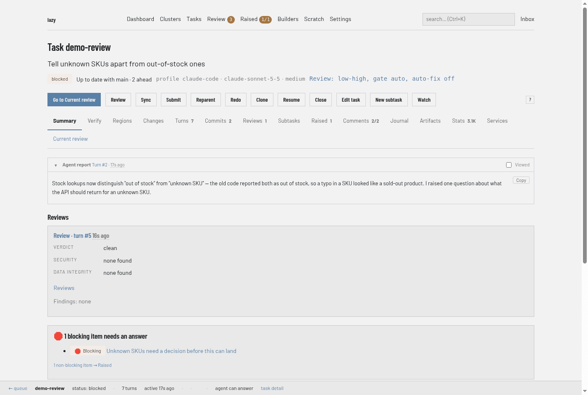

# Task page

The page for one task, at `/tasks/<code>` (the task's code, or its id when the code is shared with another task). Open it from any task link: the [task list](tasks.md), the [review queue](review-queue.md), search results.

## Header

- **Title and goal.** `Task <code>` and the task's goal.
- **Status line.** The status badge, then, when they apply: a link to the parent task, a marker for a linked branch, a link to the pull or merge request, how the task stands against its parent branch (for example `Up to date with main · 2 ahead`, as of the last fetch), the agent profile, model and effort the next turn will use, and the task's review setting (for example `Review: low-high, gate auto, auto-fix off`). Hover an item for where its value came from. Tags appear on their own line.
- **Action buttons.** Which buttons appear depends on the task's status. A button that does not apply right now is shown greyed out, and its tooltip says why.

| Button | When | What it does |
|---|---|---|
| **Go to Current review** | Blocked or conflict tasks | Opens the [Current review](../../web-review.md) tab, where you accept, unblock or ask. |
| **Start** | Backlog tasks | Starts the agent's first turn. |
| **Resume** | Interrupted or blocked tasks with a session | Resumes the agent with no new feedback. |
| **Stop** | While a turn is running | Halts the agent; asks for a reason. The task does not resume by itself. |
| **Review** | Blocked, conflict, submitted or interrupted tasks | Runs a read-only agent review of the task's work and records it on the task as a review, with a verdict and security and data-integrity results. You land on the **Reviews** tab. The task keeps its status. Tick **Automatically fix** to have lazy start a work turn that hands the review's findings to the agent as fix feedback when the review finds issues. Lazy posts nothing to a pull or merge request. |
| **Sync** | Blocked, conflict or interrupted tasks | Merges the parent branch into the task; the agent resolves conflicts. |
| **Submit** | Blocked or conflict tasks that have commits | Pushes the task branch, creates or updates the pull or merge request and marks the task submitted. Needs a remote driver in `lazy.toml`. |
| **Reparent** | Tasks that are not finished or running | Points the task at another parent (a task or a branch) and merges that parent into the task's branch, with the agent resolving conflicts. |
| **Redo** | Tasks that are not running, complete or closed | Asks for a reason, closes the task and creates a replacement under the same parent, then opens the replacement. |
| **Clone** | Tasks that are not running | Creates a new task from this one without starting it, then opens it; you can change its goal, prompt, code, model and agent first, or base it on the exact commit this task started from. |
| **Close** | Tasks that are not finished | Closes without merging; asks for a reason. |
| **Reopen** | Completed or closed tasks | Brings the task back: to blocked if it had a session, otherwise to the backlog. A completed task needs a reason. |
| **Edit task** | Tasks that are not finished | Edits the goal and prompt. |
| **New subtask** | Tasks that are not finished | Opens the New task form with this task as parent. |
| **Watch** | Tasks that are not finished | Opens a live, read-only view of the agent's output. |
| **?** | Always (with scripting on) | Lists the keyboard shortcuts. |

Reject and Accept are on the Current review tab, not in this row.

## Tabs

The tab strip is the same on every task; each tab is its own address (`/tasks/<code>/<tab>`). Some tabs carry a badge with a count. With scripting on, switching tabs swaps the body in place; with it off, each tab is an ordinary page. Keys `1`–`9` jump between the first tabs, and `[` and `]` step through them.

| Tab | Shows |
|---|---|
| **Summary** | Depends on status. A running task shows the agent's latest progress line and its latest turn. A blocked or conflict task shows the agent's report, review findings, blocking raised items awaiting an answer, and what changed since you last looked. A finished task shows its outcome. A backlog task shows its prompt. A collapsed **Metadata** section holds the id, timestamps and session details. |
| **Verify** | Steps for checking the work, from the agent's latest turn. |
| **Regions** | The units the change is split into for review. See [Review regions](../../review-regions.md). |
| **Changes** | The diff. |
| **Turns** | The record of turns, newest first. |
| **Commits** | Every commit on the task. |
| **Reviews** | Agent reviews that produced a usable result. |
| **Subtasks** | The task's child tasks. |
| **Raised** | Raised items on this task. See [Raised items](raised.md). |
| **Comments** | Comments on the task, including those not yet delivered to the agent. |
| **Journal** | The task's out-of-prompt notes. |
| **Artifacts** | Files attached to the task. See [Artifacts](../../artifacts.md). |
| **Stats** | Where the task's time and tokens went. |
| **Shell** | Terminals in the task's container. Hidden when the runner has no container. See [Web shell](../../web-shell.md). |
| **Services** | Declared ports and whether they are live. See [Reaching a task's dev server](../../serve-ports.md). |
| **Current review** | Your in-progress review: queued comments and the buttons that end it. |

The full behaviour of each tab is described in [Reviewing in the browser](../../web-review.md).

## Status bar

A bar pinned to the bottom of the window shows a link back to the review queue, the task code, its status, the number of turns and how long ago the agent was last active, and a link to the task page. Counters for comments queued for the agent and review questions awaiting it appear once you have queued or asked something.
