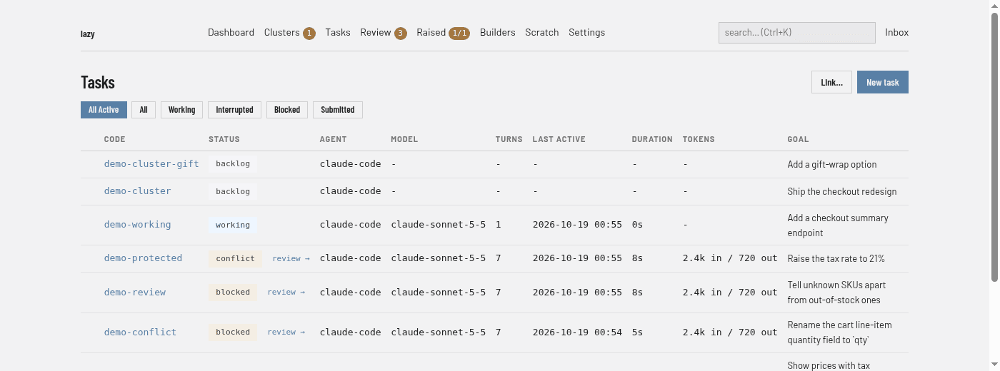

# Tasks screen

The list of the project's tasks (**Tasks** in the navigation bar, address `/tasks`), with the forms that create a task or link an existing branch.

## Regions

- **Filter buttons.** **All Active** (the default) lists every task that is not finished. **All** lists every task. **Working**, **Interrupted**, **Blocked** and **Submitted** list tasks in that status; **Submitted** also includes tasks that have a pull or merge request recorded.
- **Link…** and **New task** (top right). Open the two forms described below.
- **Task table.** One row per task. The unlabelled first column shows a link to the task's pull or merge request when it has one. The other columns are **Code**, **Status**, **Agent**, **Model**, **Turns**, **Last Active**, **Duration**, **Tokens** (in and out) and **Goal**. Click a column heading to sort by it; click again to reverse.
- **review →.** Beside the status of a blocked, conflict or submitted task. Opens the [task page](task.md).
- **Markers in the Goal column.** Protected tasks and linked tasks carry a marker before the goal; when any protected task is listed, a legend under the table explains the markers.

A search from the box in the navigation bar is covered on the [Search](search.md) page.

## New task

**New task** opens a form with the same fields as `lazy create`:

| Field | What it is |
|---|---|
| **Goal** | Required. A one-line statement of what the task is for. |
| **Prompt** | The instructions for the agent, written in Markdown, with a rendered preview above the box. |
| **Code** | The task's short name: lowercase letters, digits and hyphens, 2–63 characters. Left blank, one is derived from the goal. |
| **Parent** | A task code or id, which makes this a subtask, or a branch name, which makes a top-level task that targets that branch. Blank means the repository's default branch. |
| **Type** | The task type. |
| **Agent profile**, **Model**, **Effort** | Which agent runs the task. Leave them on the project default unless you want something different. |
| **Review**, **Review gate**, **Review auto-fix** | How the task is reviewed once the agent declares its work finished. Each can inherit from the parent. |
| **Start now** | Starts the first agent turn after creating the task. A prompt is required for this; unchecked, the task waits in the backlog. |

## Link a branch or PR

**Link…** adopts work that already exists. Enter a pull or merge request URL, a branch page, `origin/<branch>` or a plain branch name; optionally a **Parent** and a **Code**. The new task is created on that branch as a blocked, linked task. See [Linking a task](../../link.md).
