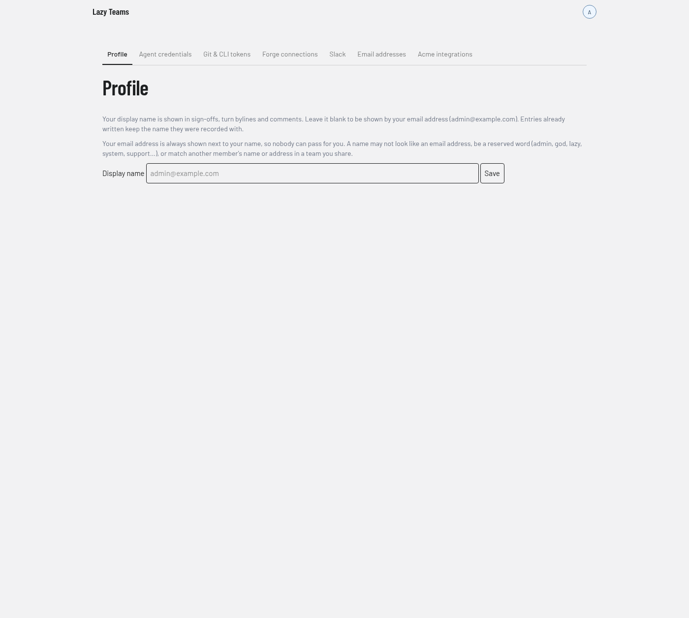

# Account settings

Account settings holds everything scoped to you rather than to a project. You reach it from **Account settings** in the avatar menu. It opens on the Agent credentials tab; the screenshot below shows the Profile tab.

## Tabs

A tab strip runs across the top of every Account settings page.

| Tab | What it is |
| --- | --- |
| **Profile** | Your display name. |
| **Agent credentials** | Your model accounts. |
| **Git & CLI tokens** | Tokens for using `git` and the `lazy` command line against this installation. |
| **Forge connections** | Your GitHub or GitLab connections. |
| **Slack** | Linking your Slack user to your account. |
| **Email addresses** | The email addresses on your account. |
| *Team* **integrations** | One tab per team you administer, for that team's own integrations. The screenshot shows "Acme integrations". |

See [Agents in Lazy Teams](../../lazy-teams-agents.md) for the credentials, and [Slack rooms](../../slack-rooms.md) for Slack.

## Profile

The Profile tab has one field, **Display name**, and a **Save** button.

- Your display name appears in sign-offs, turn bylines and comments. Leave it blank to be shown by your email address.
- Entries already written keep the name they were recorded with.
- Your email address always appears next to your name.
- A name may not look like an email address, may not be a reserved word (such as admin, god, lazy, system or support), and may not match another member's name or address in a team you share.

If your current name breaks one of those rules, a warning appears and new sign-offs, comments and turns show your email address only until you change it.
