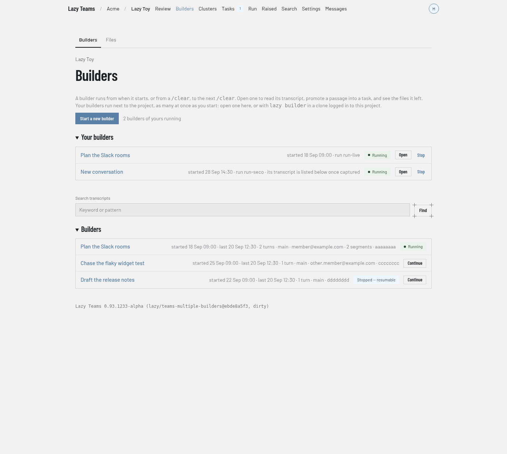

# Builders

The Builders screen lists the builder conversations for a project; you reach it from **Builders** in the top navigation.

For what a builder is and how to use one, see [Builders in Lazy Teams](../../lazy-teams-builders.md).

## Section tabs

Two tabs sit above the title: **Builders** (this screen) and **Files**, which lists the files builders left in scratch for the whole project.

## Header and introduction

The title is **Builders**, with the project name above it as a link back to the project overview. A short paragraph explains that a builder runs from when it starts, or from a `/clear`, to the next `/clear`, and that you can open one to read its transcript, promote a passage into a task and see the files it left. It also says your builders run next to the project, as many at once as you start: you can open one here, or with `lazy builder` in a clone logged in to the project.

## Starting a builder

**Start a new builder** is always there. Each press starts another builder of yours with a fresh conversation; builders you already have keep running. The project can run a limited number of builders at once across all its members; a start beyond that is refused with a message saying so. Beside the button, a count says how many of yours are running and how many are stopped.

If you are not allowed to open a builder, the button is replaced by a notice that a builder runs on the account of the person using it, so it can only be opened in your own name.

## Your builders

Every builder of yours that has not ended is listed in **Your builders**, above the list of all builders. Each row shows:

- what it is working on: the title of the conversation it carries, or **New conversation** for a builder whose transcript has not been captured yet;
- when it started, and how it last ended if it stopped unexpectedly;
- a state badge (**Running**, **Starting** or **Stopped — resumable**);
- **Open** and **Stop** while it runs, or **Resume** while it is stopped.

**Open** goes to the builder's terminal. **Stop** stops that builder only and keeps its conversation; **Resume** starts that same builder again. Your other builders are never touched.

## Search transcripts

The **Search transcripts** box takes a keyword or pattern and has a **Find** button. With a query, the page lists **Matches**: each row gives the builder's title, its start time, the number of matches and an excerpt. If nothing matches you see **No matching builders**; clear the search to see every builder again.

## Builders list

Each row is one builder. The row shows the title and a line of details, and links to the builder's page. A badge on the right shows the state of its run, for example **Running** or **Stopped — resumable**. A builder with no badge has no run attached. Your own builders that are not running also carry a **Resume** button (see [Resuming a builder](#resuming-a-builder)). An empty project shows **No builders yet**, and a builder is listed once its transcript has been captured.

## A builder's page

Opening a builder shows:

- **Details**: Id, Run, Started, Last activity, Branch, Messages, and Segments when the transcript was stitched from more than one.
- **Your builder** (only for your own run of this builder): the run's state, **Stop** while it runs, **Resume** while it is stopped, and **End**, which asks for confirmation. Ending finishes the run; the transcript is kept, and you can still resume the builder later from the list. While it runs, a terminal is shown here.
- **Resume** (your own builder, when it has no run of yours attached): resumes it, as described below.
- **Create a task from messages**: select the messages you want in the transcript, then choose **Create task**. You can set **Goal**, **Code**, **Parent task** and **Prompt**, and **Create backlog task** makes a task in the backlog without starting it. Empty fields use defaults, as the hints on the page describe.
- **Transcript**: the messages, paged with **Earlier** and **Later**.
- **Files this builder left**: the scratch files attributed to this builder.

## Resuming a builder

**Resume** continues one of your own builders, stopped or ended, in a builder run of yours, like `lazy builder --resume <id>` does on the command line. It runs on your account and spends your credential. The page goes to the start page and then to the running builder.

- **Resume opens an additional builder.** Builders of yours that are already running keep running. If the builder you picked is already running in one of yours, Resume opens that one instead of starting it twice.
- **If the builder's session file is no longer on the server**, Resume says so and starts nothing. The transcript can still be read on its page.
- **A teammate's builder** has no Resume button: Resume carries over the whole session, including the commands it ran and their output, so it is only for the person who had the conversation. Use **Continue from a summary** instead.

## Continuing from a summary

**Continue from a summary** (**Continue** in the list) is on every builder, yours and your teammates'. It starts a **new** builder of yours, on your account and your credential, seeded with a summary of the builder's transcript and a line naming that builder and who had it.

- The summary is made from the transcript shown on the builder's page — what each person and the builder wrote — and never from the commands the builder ran or their output.
- The new builder starts a fresh conversation. It is told the summary is background, and can read the original transcript if it needs more.
- In offline mode no model runs, so the new builder gets the last messages of the conversation instead, labelled as an excerpt.
- **Continue opens an additional builder.** Builders of yours that are already running keep running.
- A continued builder's page shows **Continued from**, linking to the original; the original's page shows **Continued as**, linking back. The link appears once the new builder's conversation has been captured, within about half a minute of it starting.
