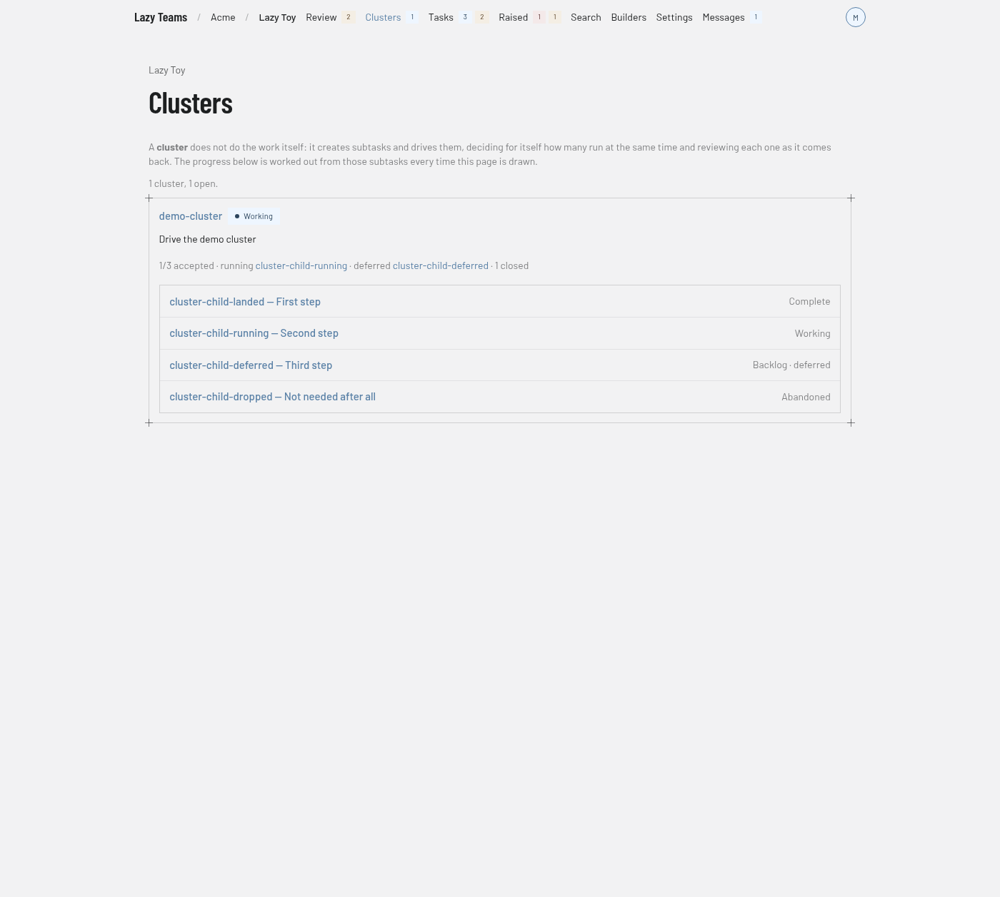

# Clusters

The Clusters page shows each cluster task in a project and how far its subtasks have got. You reach it with **Clusters** in the project's top navigation.

## Header and explainer

The project name above the title links back to the project overview. Under the title, a short paragraph explains that a cluster does not do the work itself: it creates subtasks and drives them, decides how many run at the same time, and reviews each one as it comes back. The progress shown is worked out from those subtasks every time the page is drawn. See [cluster tasks](../../cluster-tasks.md).

A summary line gives the count, for example "1 cluster, 1 open."

## Cluster cards

Each cluster has a card with:

- the cluster's code, linked to its [task page](task.md), and its status badge;
- the cluster's goal;
- a progress line, for example "1/3 accepted", followed by the running subtasks, the deferred subtasks and the number closed. Subtask names in that line are links;
- a list of the cluster's subtasks. Each row shows the code and goal, linked to the subtask, with its status on the right. A deferred subtask also says "deferred".

A cluster that has not created a subtask yet says "No subtasks yet — this cluster has not created its first one."

The page updates on its own as tasks change. If the project cannot be reached, a warning says clusters could not be loaded and gives the reason.

## When there are no clusters

The page shows **No clusters yet** and explains that a cluster is a task that drives other tasks. Its **New task** button opens the new task form, where you set the type to `cluster`.
