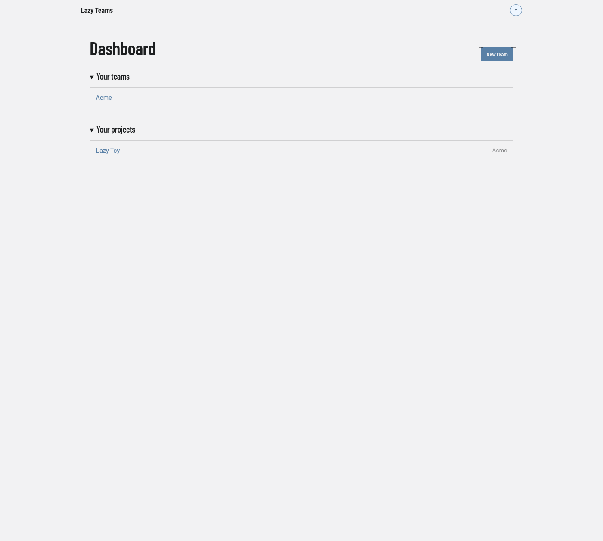

# Dashboard

The dashboard is the page you land on after signing in; it lists your teams and your projects.

## Top bar

Outside a project the top bar carries only the **Lazy Teams** brand, which returns you here, and the avatar menu on the right. The avatar menu has these entries: **Teams** (the list of every team you belong to) and **Account settings** (see [Account settings](account-settings.md)), then **Sign out**, or a note that you signed in through your sign-in provider and sign out there. Inside a project the bar also names the project and lists its pages; see [Project overview](project-overview.md).

## Header

| Control | What it does |
| --- | --- |
| **New team** | Opens the form for creating a team. |

## Your teams

One row per team you belong to. Selecting a row opens that [team](team.md). With no teams, the section reads "No teams yet" and offers a **New team** link.

## Your projects

One row per project in your teams, with the owning team's name on the right. Selecting a row opens the [project overview](project-overview.md). With no projects, the section reads "No projects yet".

If you have not yet connected a model credential, a notice above these sections tells you so. See [Agents in Lazy Teams](../../lazy-teams-agents.md).
