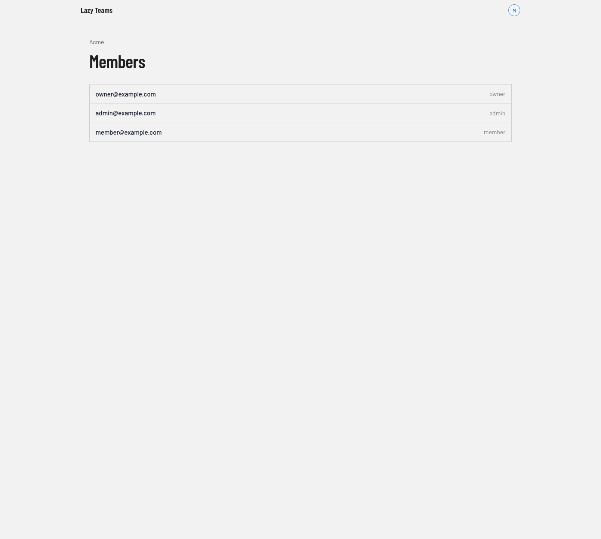

# Members

The members page lists who is in a team, and lets team owners and admins invite people, change roles and remove members. You reach it with the **Members** button on the [team](team.md) page.

## Header

The team name above the title links back to the [team](team.md) page.

## Invite someone

Team owners and admins see an **Invite someone** card above the list. Enter an **Email address**, choose a **Role**, and select **Invite**. The invited person joins when they accept. You get a link to hand them, and if the installation sends email, the link is emailed to them too. Someone without an account creates one through the link. Members who are not admins do not see this card.

## Member list

One row per member, showing their email address.

- For team owners and admins, each row has a role selector; changing it saves at once. Rows may also show a **Remove** button, which asks you to confirm before removing the person from the team.
- Without those permissions, the role appears as plain text on the right (`owner`, `admin` or `member`, as in the screenshot) and there is no **Remove** button.

Which roles you may assign, and whom you may change or remove, depends on your own role.

## Pending invitations

When invitations are outstanding, a **Pending invitations** list appears below the members. Each row shows the address, the role, who invited them and when the invitation expires. Two buttons may appear on a row:

| Button | What it does |
| --- | --- |
| **New link** | Makes a new invitation link; the old one stops working. You confirm first. |
| **Withdraw** | Cancels the invitation. You confirm first. |
