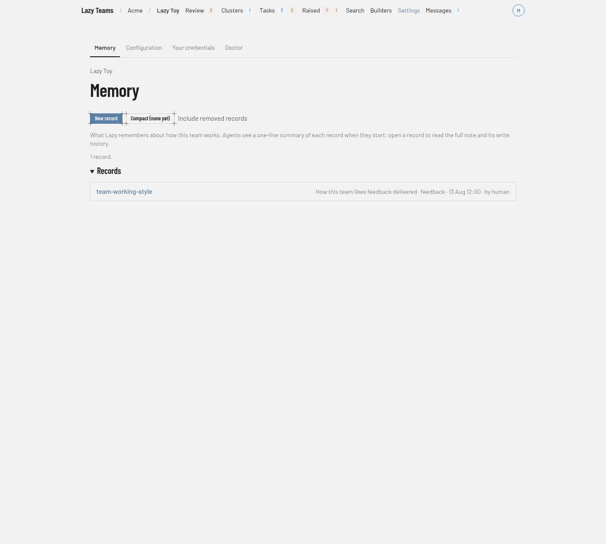

# Memory

The Memory screen lists the project's shared memory records; you reach it from **Settings** in the top navigation, where Memory is the first tab.

For what memory is and how agents use it, see [Memory](../../memory.md).

## Section tabs

Memory sits in the Settings section beside tabs such as **Configuration**, **Your credentials** and **Doctor**. Which of those tabs you see depends on your role; Memory is shown to every member.

## Actions

| Control | What it does |
| --- | --- |
| **New record** | Opens the new-record form. Shown only to members who may write and act in their own name. |
| **Compact** | Opens the compact page. It reads **Compact (none yet)** until a compact exists. |
| **Include removed records** | Adds removed records to the list. It becomes **Hide removed records** while they are shown. |

## Introduction and summary

A paragraph says Memory is what Lazy remembers about how this team works, that agents see a one-line summary of each record when they start, and that you can open a record to read the full note and its write history. Below it, a count gives the number of records. When the project has live records, a sentence about the compacted context appears with a **View compact** link, and an **over threshold** badge when it applies.

## Records

Each row shows the record's name, linked to its page, then its one-line description and details such as its type. A removed record is marked **(removed)** and is not linked. With no records you see **No memory records yet**.

## A record's page

A record shows a type badge, the fields **Summary**, **Type**, **Revision**, **Last updated** and **Created**, and the **Body** with a copy button. **Write history** lists each write in order. Members who may write also get an **Edit** section with **Save changes** and a **Remove this record** link; removing keeps the write history.

## New record

The **New memory record** page explains that people write records and task agents can only read them. Its fields are:

- **Name**, normalised to a kebab-case slug. Saving under an existing name overwrites that record.
- **Type**: one of user, feedback, project or reference.
- **Description**: one line, at most 200 characters, shown to every agent when it starts.
- **Body**: the knowledge itself, in markdown.

**Create record** saves it.
