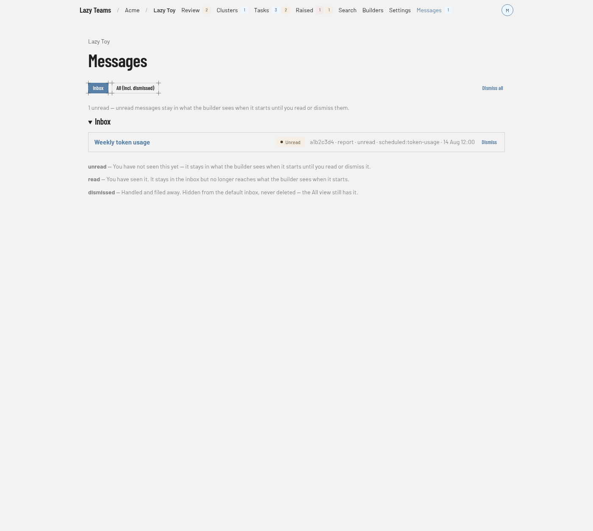

# Messages

Messages is the project's inbox for reports, notices and alerts; you reach it from **Messages** in the top navigation, the last link on the right.

For what messages are, see [System messages](../../system-messages.md).

## Filters and bulk action

| Control | What it does |
| --- | --- |
| **Inbox** | Shows messages you have not dismissed. This is the default view. |
| **All (incl. dismissed)** | Also shows dismissed messages. |
| **Dismiss all** | Dismisses every open message after you confirm. They stay on record in the All view. |

**Dismiss all** appears only when there are open messages and you are a team member who may write and act in your own name.

## Summary

A line above the list says how many messages are unread, and that unread messages stay in what the builder sees when it starts until you read or dismiss them. With none unread it says **Nothing unread.** An empty inbox says **Nothing in the inbox**.

## Inbox

Each row shows the message's title, linked to its page. On the right you see an **Unread** badge when it is unread, then its id, kind, state, source, when it was created and, if it repeated, a repeat summary. Open messages also have a **Dismiss** button, and **Dismiss all like this** when other open messages share the same source and title or the message has repeated. Both need the same permission as **Dismiss all**.

## State legend

Under the list, a legend explains the three states:

- **unread**: you have not seen it yet.
- **read**: you have seen it. It stays in the inbox but no longer reaches what the builder sees when it starts.
- **dismissed**: handled and filed away. Hidden from the default inbox, never deleted.

## A message's page

Opening an unread message marks it read if you are a team member who may write and act in your own name. The page shows kind and state badges, then Id, Source, Created, and Repeats or Dismissed when they apply. Until it is dismissed you can use **Mark read** (while it is unread), **Dismiss** and **Dismiss all like this**. The **Message** section shows the body. If it mentions scratch files, **Scratch files mentioned** links to them.
