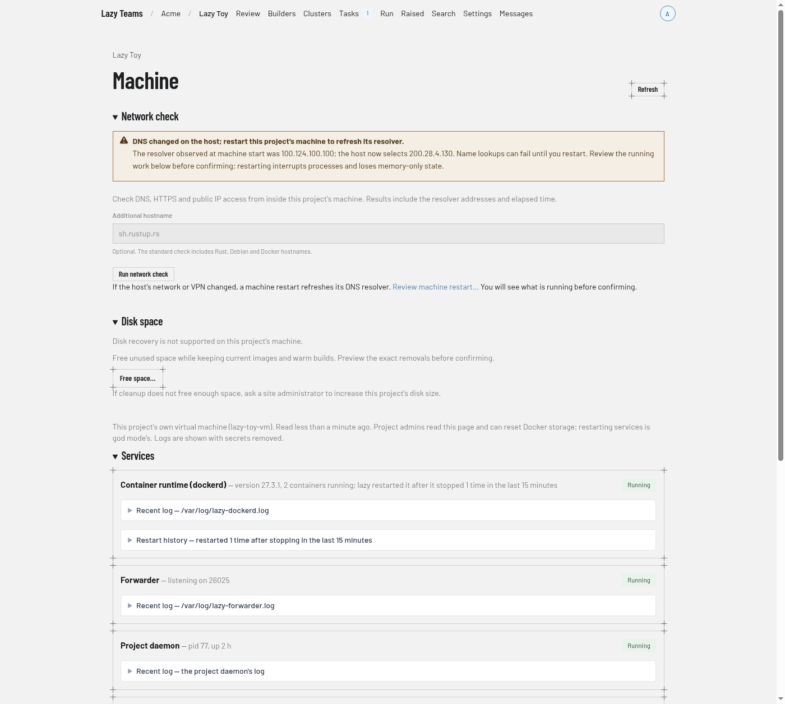
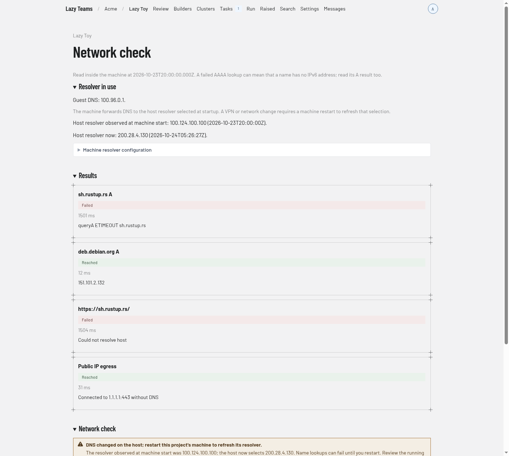
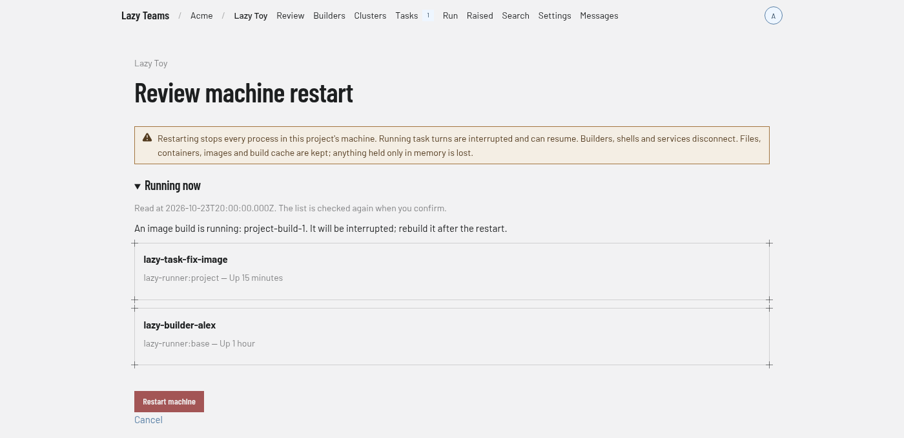
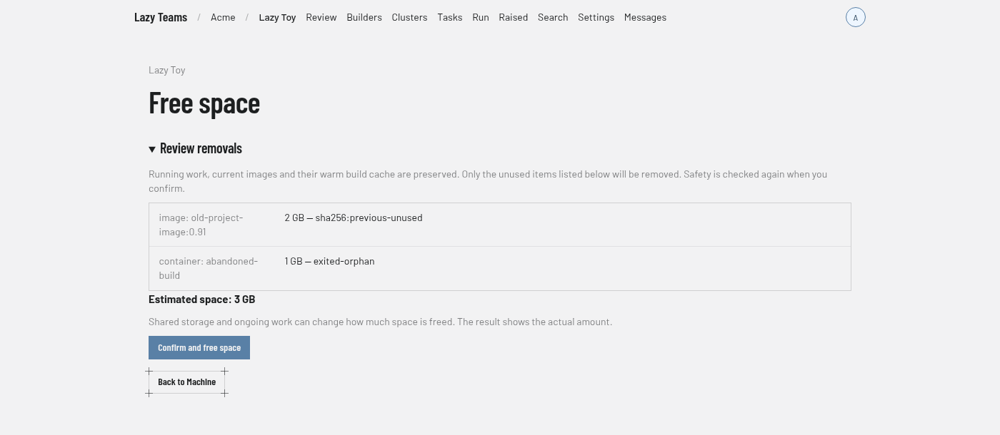

# Project machine

The Machine page shows the health of the virtual machine a project runs on. You reach it with the **Machine** button on the [project overview](project-overview.md), which project admins see.

## Header

The project name above the title links back to the overview. **Refresh** reloads the page. Below the title, a line names the kind of machine and when it was last read, and notes that project admins can read the page and reset Docker storage. Logs are shown with secrets removed.

If the machine does not answer, a warning says so and explains that the installation restarts a project daemon that should be running.

## Network check

On a project's microVM, **Run network check** checks DNS for the Rust, Debian and Docker hostnames, HTTPS access and a public IP connection without DNS. Enter an additional hostname to check it too. The results show the guest's resolver addresses, each answer or error, elapsed time and an ISO 8601 timestamp. IPv4 and IPv6 results are separate: a name can work over IPv4 without having an IPv6 address.

The Machine page and network results show a warning when the host’s selected DNS resolver differs from the one observed at machine start. The warning names both addresses and offers a restart; it never interrupts work automatically. Older machines without a recorded startup resolver cannot show this comparison. Refresh the page after a VPN or network change to check it.

If name resolution stopped working after a host VPN or network change, **Review machine restart…** shows the containers and image build running on the machine before you confirm. Restarting refreshes its upstream DNS selection. The list is checked again on confirmation; if it changed, review it again. Each confirmation can be used only once, and opening a new preview replaces the previous confirmation. A restart interrupts tasks, builders, shells and services and loses anything held only in memory. Files, containers, images and build cache are kept.

## Services

One card per service. The screenshot shows **Container runtime (dockerd)**, **Forwarder**, **Project daemon** and **Task proxy**. Each card has a state badge (such as "Running") and a short detail line. Each can expand:

- **Recent log**, naming where the log comes from. It opens by itself when the service is not healthy.
- **Restart history**, for services that record restarts.

A **Restart** button appears on some services only for site administrators. Restart a project's daemon from here rather than with `lazy daemon restart` on the machine itself: started from a shell without the environment Lazy Teams starts it with, the daemon would lose its credentials, so lazy refuses that and points back here. A shell that loads that environment (the machine shell Lazy Teams opens) can restart it, and the daemon keeps the forge token Lazy Teams last sent.

## Docker storage

Appears on machines of the virtual-machine kind. It explains that resetting Docker storage starts it clean when Docker keeps running out of memory or its disk is full, and warns that it deletes every image, container, volume and build cache on the machine and stops anything running in Docker. **Reset Docker storage…** starts the reset for project admins, after a confirmation. While a reset runs, the page refreshes itself and lists each step.

## Resources

Tiles showing CPU (cores and load), Memory (percent used, and used of total), and one tile per disk, such as **Container images and data** and **Project checkout**, with the percent used and the space free. A warning appears under the tiles when a resource is running short.

## Free space

Project admins can open **Free space…** to preview unused containers, superseded images and old build cache, with an estimate of what can be reclaimed. **Confirm and free space** checks safety again before removing them and reports the actual space freed. Current task and member environments, running work, volumes, current images and their warm cache are kept. An empty preview explains why nothing can be removed.

[Free space at phone width](../../images/teams/teams-machine-admin-free-space-phone.png).

If a build says the disk is too small even after cleanup, ask the site admin to raise its size. On microVM projects, disk growth happens live without removing running containers. If Docker must restart to apply a larger cache limit, the page says so; automatic recovery does not restart it and interrupt running work.

## Memory

Shows memory over time once the machine has been sampled a couple of times. The machine's size is changed by the installation's site admin.
