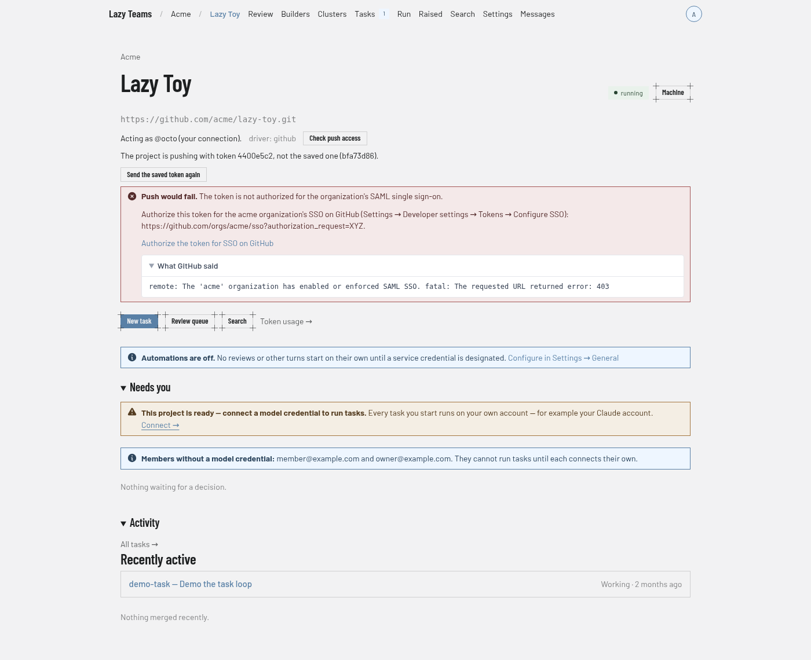

# Project overview

The project overview is a project's landing page: what needs you, what has been happening, and the state of the project itself. You reach it by selecting a project on the [dashboard](dashboard.md) or a [team](team.md) page, or the project name in the top bar.

## Top bar

Inside a project the bar reads team name, then project name, then the project's pages: **Review**, **Builders**, **Clusters**, **Tasks**, **Raised**, **Search**, **Settings** and **Messages**. Small counters sit beside some of them: waiting for review, running, and unread messages, and the blocking and other open raised items. **Settings** opens [project settings](project-settings.md). Pressing Cmd/Ctrl+K opens a command palette.

## Header

The team name above the title links back to the team. A status badge on the right shows what the project is doing (the screenshot shows "running"). Next to it you may see:

| Button | Shown to |
| --- | --- |
| **Machine** | Project admins. Opens [Machine](project-machine.md). |

Below the header is the project's repository address. A project hosted by Lazy Teams shows it with the commands to clone it.

## Forge identity

For a GitHub or GitLab repository, a line under the address says whose identity the project pushes and opens pull requests with:

- "Acting as @handle (your connection)", or "(a teammate's connection)", when it uses the forge connection of the member who started the project, while they are still on the team;
- "Using the team's shared GitHub integration", when that member has no connection of their own;
- "No GitHub credential" when there is nothing to push with. The member whose connection the project uses gets a link to connect their account; anyone else is told who can fix it.
- "This project never pushes" when the project is set up not to push anywhere: its work stays on the project's machine. A project whose repository is not on GitHub or GitLab still pushes task branches and accepted work to its repository, with the same identity.

The line also names the repository driver, and says whether the project is using the token your connection was saved with. The member whose connection it is, and admins, see a short fingerprint of each token (never the token itself), so a project still holding an old token is visible at a glance, with a **Send the saved token again** button that fixes it.

Connecting, replacing or removing a forge connection in [Account settings](account-settings.md), or changing the team's GitHub integration, takes effect on a running project straight away, and on every restart after it; no restart is needed.

**Check push access** asks the forge, as that identity, whether the repository can be pushed to. Nothing is pushed. The answer is either "Push access OK" or "Push would fail", with what went wrong (the credential was refused, the token cannot write to the repository, the token is not authorized for the organization's single sign-on, the repository was not found, or the remote is an SSH address) and what to do about it, such as reconnecting your account or giving the token write access to the repository's contents. Admins can also open the forge's own message. The same check runs as part of the project's health checks.

If a task's work could not be pushed — after a turn, or after it was accepted — the task page says so with the forge's own error and, when lazy recognises it, the fix: for example that a token needs the `workflow` scope (or "Workflows: Read and write") to push a change to `.github/workflows/`, needs authorizing for an organization's SSO, or cannot push to a protected branch. A push the forge refused is reported at once rather than retried on the spot, and is not described as a network problem. lazy tries again on its own later, so once the token or permission is fixed the work goes through without anyone re-running anything. Repeated failures also appear in the project's Messages.

[Push-access results at phone width](../../images/teams/teams-project-push-access-phone.png).

## Quick actions

| Control | What it does |
| --- | --- |
| **New task** | Starts a new task. Shown only when the project is answering and you may create tasks. |
| **Review queue** | Opens the review queue. |
| **Search** | Opens project search. |
| **Slack room** | Opens the project's Slack channel, when one is set up. |
| *N* unread messages | Opens the project's messages, when there are unread ones. |
| **Token usage →** | Opens the project's token usage page. |

## Notices

Depending on the project's state, notices appear above the sections: for example "Automations are off" when no service credential has been designated, a setup-in-progress or reconnecting message, a usage pause, or a request to re-authorize your Claude token. Admins may see extra detail and a link to the cause.

## Needs you

Task cards for work waiting on a decision, each with its status, type, agent, turn count and last update. **Open review queue (N)** opens the full queue. When nothing is waiting, the section reads "Nothing waiting for a decision."

## Activity

**All tasks →** opens the task list. **Recently active** lists the latest tasks with their status and age. **Recently merged** lists tasks that were accepted. See [the task state machine](../../state-machine.md) for what the statuses mean.
