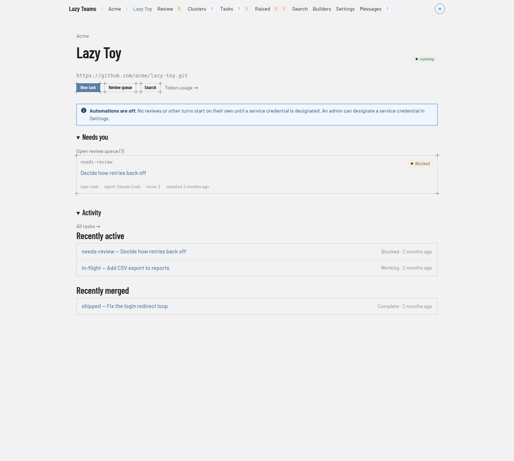

# Project overview

The project overview is a project's landing page: what needs you, what has been happening, and the state of the project itself. You reach it by selecting a project on the [dashboard](dashboard.md) or a [team](team.md) page, or the project name in the top bar.

## Top bar

Inside a project the bar reads team name, then project name, then the project's pages: **Review**, **Clusters**, **Tasks**, **Raised**, **Search**, **Builders**, **Settings** and **Messages**. Small counters sit beside some of them: waiting for review, running, and unread messages, and the blocking and other open raised items. **Settings** opens [project settings](project-settings.md). Pressing Cmd/Ctrl+K opens a command palette.

## Header

The team name above the title links back to the team. A status badge on the right shows what the project is doing (the screenshot shows "running"). Next to it you may see:

| Button | Shown to |
| --- | --- |
| **Machine** | Project admins. Opens [Machine](project-machine.md). |

Below the header is the project's repository address. A project hosted by Lazy Teams shows it with the commands to clone it.

## Quick actions

| Control | What it does |
| --- | --- |
| **New task** | Starts a new task. Shown only when the project is answering and you may create tasks. |
| **Review queue** | Opens the review queue. |
| **Search** | Opens project search. |
| **Slack room** | Opens the project's Slack channel, when one is set up. |
| *N* unread messages | Opens the project's messages, when there are unread ones. |
| **Token usage →** | Opens the project's token usage page. |

## Notices

Depending on the project's state, notices appear above the sections: for example "Automations are off" when no service credential has been designated, a setup-in-progress or reconnecting message, a usage pause, or a request to re-authorize your Claude token. Admins may see extra detail and a link to the cause.

## Needs you

Task cards for work waiting on a decision, each with its status, type, agent, turn count and last update. **Open review queue (N)** opens the full queue. When nothing is waiting, the section reads "Nothing waiting for a decision."

## Activity

**All tasks →** opens the task list. **Recently active** lists the latest tasks with their status and age. **Recently merged** lists tasks that were accepted. See [the task state machine](../../state-machine.md) for what the statuses mean.
