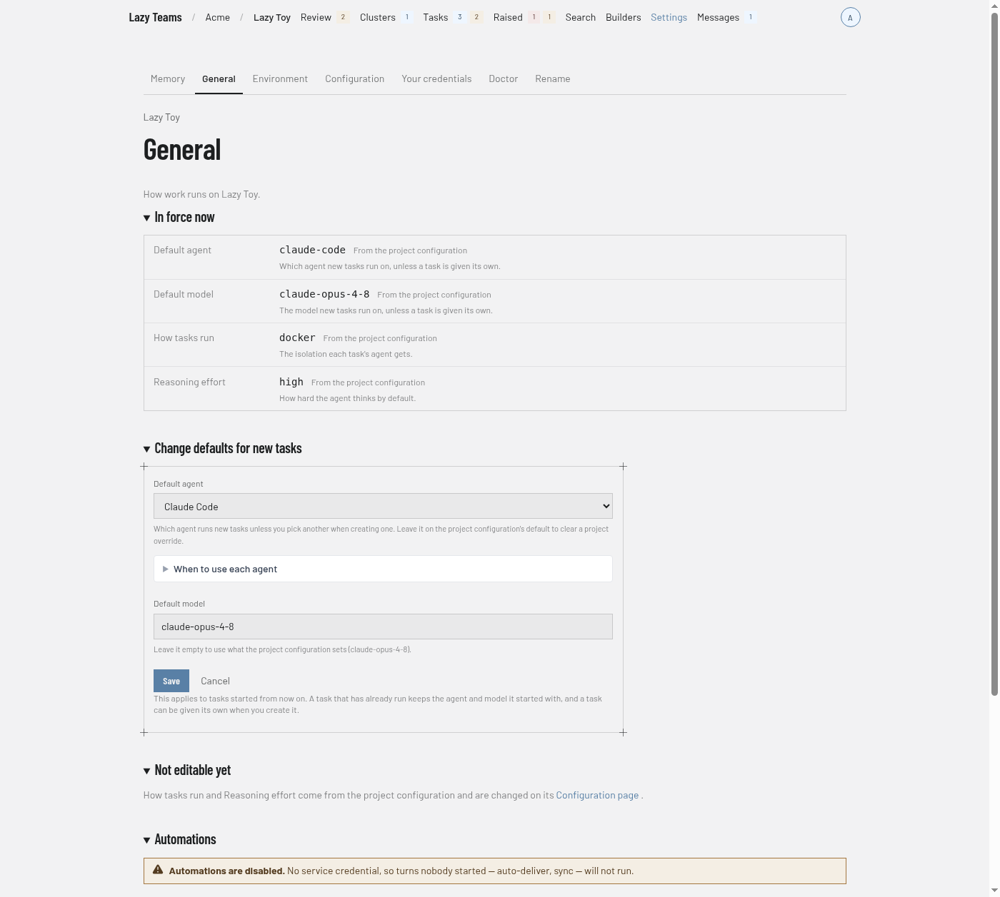

# Project settings

Project settings gather how a project runs and what it knows. You reach them with **Settings** in the project's top bar. This page describes the General tab and the tab strip around it.

## Tabs

Each tab appears only for people who may open it.

| Tab | What it is | Shown to |
| --- | --- | --- |
| **Memory** | The project's shared memory. See [Memory](../../memory.md). | Every member |
| **General** | This page. | Project admins |
| **Environment** | Variables and files for tasks. See [Environment](project-environment.md). | Project admins |
| **Configuration** | The project's configuration. | Every member |
| **Your credentials** | Your own credentials for this project. | Every member |
| **Doctor** | The project's health check. | Every member |
| **Rename** | Renames the project. | Project admins |

## In force now

A table of the settings currently in effect, each with its value, where it comes from (the screenshot shows "From the project configuration"), and a one-line description: **Default agent**, **Default model**, **How tasks run** and **Reasoning effort**. If a setting here overrides the project configuration, the row also shows what the configuration sets. "Last changed" shows when settings were last edited.

## Change defaults for new tasks

A form with **Default agent**, **Default model**, **Save** and **Cancel**. **When to use each agent** expands a description of each agent. The new defaults apply to tasks started from now on; a task that has already run keeps the agent and model it started with. Project admins see this form when the default model is editable.

## Not editable yet

Names the settings that are not edited here, and links to the **Configuration page**, where they are changed.

## Automations

Says whether turns nobody started, such as auto-deliver and sync, can run, and shows the **Repository** and the service credential that pays for them. Admins who may manage it also get **Use my credential for automations** and, once one is set, **Clear service credential**.

## Default branch

For a project hosted by Lazy Teams, shows whether members may push the default branch directly. Admins get **Protect the default branch** or **Let members push the default branch**.

## Download your data

Admins who may export get a **Download <project name> data** button that saves everything the project has recorded as a single zip file. Nothing is removed from the project.
