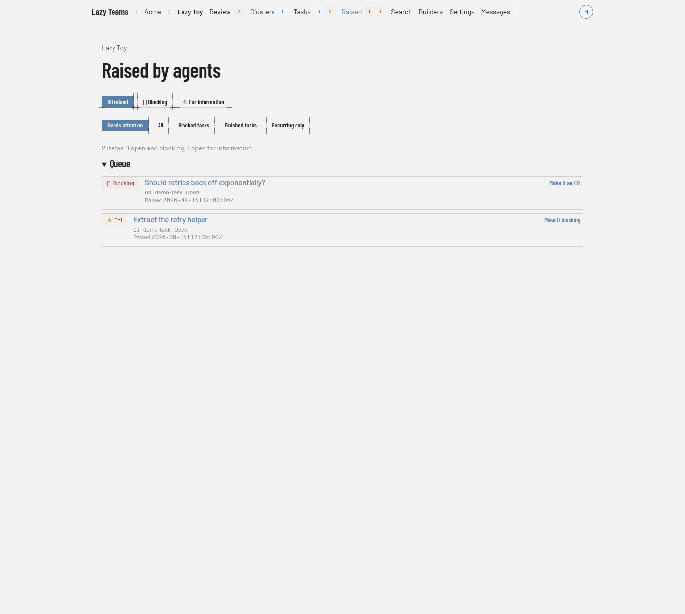

# Raised by agents

This screen lists the questions and notes agents have raised across a project; you reach it from **Raised** in the top navigation.

For what raised items are and how they gate an accept, see [Raised items](../../raised-items.md).

## Navigation badges

The **Raised** link carries two counts: open items that block an accept, and open items that are for information only. They cover the whole project whatever filter the page is on.

## Gate filters

The first row of buttons chooses which items to show: **All raised**, **Blocking** and **For information**. The selected button is highlighted.

## State filters

The second row narrows by state: **Needs attention** (the default), **All**, **Blocked tasks**, **Finished tasks** and **Recurring only**. The two rows combine, so you can look at blocking items on finished tasks, for example.

## Summary

A line above the queue gives the total and how many items are open and blocking and open for information. When similar items are grouped into one row, it also says how many grouped rows there are. When nothing matches, the page says **Nothing raised matches this filter**.

## Recurring items

When near-duplicates exist across tasks, a **Recurring items** section lists each group with its size and a sample of the wording.

## Queue

Each row shows:

- a **Blocking** or **FYI** badge, which says whether the item holds up an accept;
- the item's headline, linked to its page;
- a line with its age in days, the task it came from, and its state, plus **recurring ×N** for a grouped row;
- a button on the right that flips the gate: **Make it an FYI** on a blocking item, **Make it blocking** on one that is for information. On a grouped row it reads **Make this one an FYI** or **Make this one blocking** and changes that item only.

The gate button appears only if you are a team member who may write and act in your own name.

## An item's page

Opening an item shows its blocking and decision badges, the task it belongs to with a link to open it, a description of the gate, and **What the agent raised**. Below that, depending on your permissions and the item's state:

- **Does this hold up accept?** has the same gate button.
- **Decide** has a **Decision** menu, a **Note** field and **Apply**. The page explains that responding quotes your answer back to the agent, acknowledging means you saw it, dismissing means you will not pursue it, and promoting creates a task without starting it. For a promotion you can set **Goal** and **Code (optional)**.
- **Undo this decision** appears while the agent has not yet been given the decision.
- **Ask, comment or unblock** lets you act on the task without leaving the item.
- **Similar items** lists other items that share its recurrence.

A decided item shows **Decision** instead of **Decide**.
