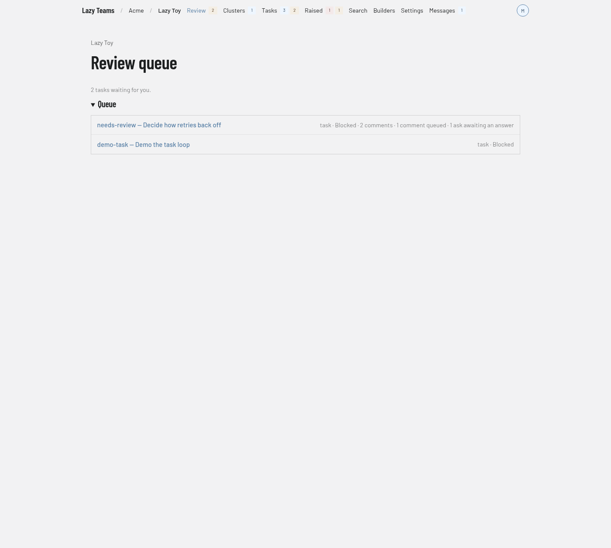

# Review queue

The review queue lists the tasks in a project that are waiting for a decision from you. You reach it with **Review** in the project's top navigation.

## Header

The project name above the title links back to the project overview.

## The queue

The screenshot shows two tasks waiting. When no task needs a decision, the page shows **Nothing awaiting review** and the note "When a task blocks and needs a decision, it appears here."

When tasks are waiting, a line above the list says how many, for example "2 tasks waiting for you." Under the **Queue** heading, each task is one row:

- the title is the task's code and its goal;
- the line beneath it lists, separated by dots, the task type, its status, and, when they apply, the number of comments, comments queued, asks awaiting an answer, or "no session";
- clicking the row opens the [task page](task.md), where you give feedback or accept.

The page updates on its own as tasks change. If the project cannot be reached, a warning says the review queue could not be loaded and gives the reason.

The same set of tasks is counted in the badge beside **Review** in the top navigation. A task enters the queue when it is blocked, in conflict or submitted. See [the state machine](../../state-machine.md) and [reviewing a task](../../lazy-teams-task-review.md).
