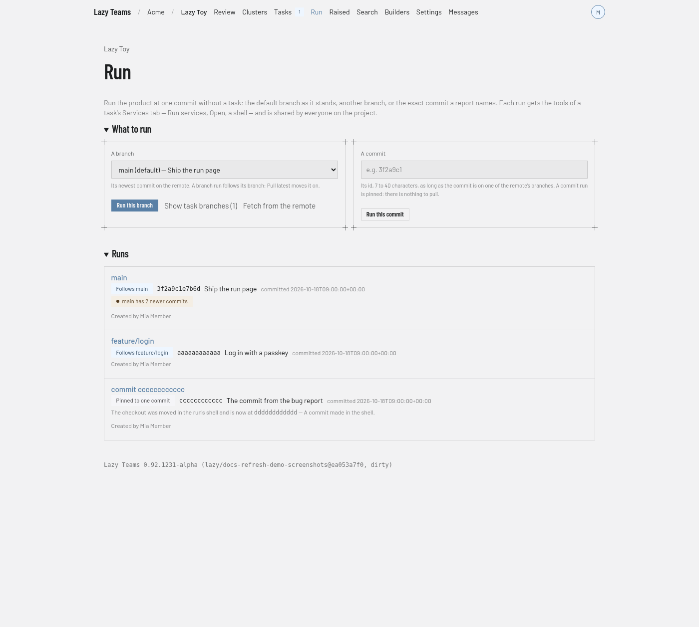
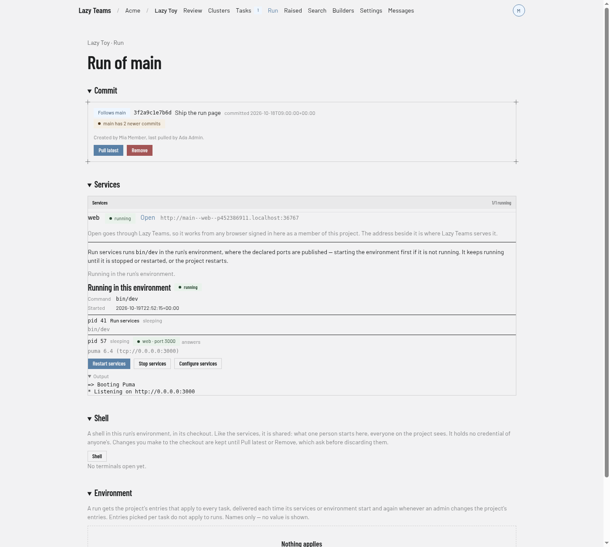
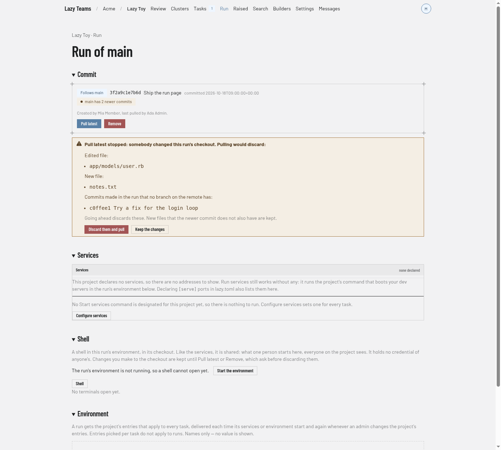

# Run

The Run screen starts the project's product at one commit, with no task, and lists the runs that exist (**Run** in the project's menu, next to **Tasks**). A run is not a task: it has no agent, turns, review or pull request, and it never appears in task lists or counts. Everyone on the project shares the same runs. For what a run checks out and holds, see [Running the product at any commit](../../running-a-commit.md).

## What to run

- **A branch.** A drop-down of the remote's branches with the default branch selected, so **Run this branch** runs the default branch unless you pick another. Branches lazy made for tasks (`lazy/…`) are hidden until you choose **Show task branches**; **Fetch from the remote** refreshes the list. A branch run follows its branch.
- **A commit.** Type a commit id and press **Run this commit**. The commit must be on one of the remote's branches; an id the remote does not have is refused under the field and what you typed is kept. A commit run is pinned to that commit.

Choosing something that already has a run takes you to that run. While a run is being set up, the page shows each step as it happens. Members of the project can start runs; anyone else sees "Viewing only" in place of the buttons.

## Runs

One row per run, its name, whether it **Follows** a branch or is **Pinned to one commit**, the commit it serves with its subject and date, a note when its branch has newer commits, and who created it. A row opens the run's page.

## A run's page

- **Commit.** What the run follows, the commit it serves, how many newer commits its branch has, who created it and who last pulled it, with **Pull latest** (branch runs only) and **Remove**.
- **Services.** The same card as a task's Services tab. **Run services** runs the project's Start services command in the run's environment, starting the environment first if needed, and shows each step; **Stop services** ends it. Each declared service has an **Open** link that goes through Lazy Teams, so it works from any browser signed in as a member; while the app is still starting, Open waits and goes through when it answers. If no Start services command is designated, the card says so and links to **Configure services**. Opening a link never starts anything by itself.
- **Shell.** Opens a terminal in the run's environment, in its checkout. Shells and services are shared by everyone on the project. If the environment is not running, **Start the environment** brings it up.
- **Environment.** The names (never values) of the project's entries that apply to every task, which the run receives.

If the project's image is not ready, the page says so and offers **Use lazy's default image**; once it is ready, **Use the project's image** switches back.

## Pull latest

**Pull latest** moves a branch run to its branch's newest commit on the remote and restarts the services if they were running. If somebody changed files in the run's checkout through the shell, or committed there, it stops and lists them; **Discard them and pull** goes ahead, **Keep the changes** leaves the run where it is.

## Remove

**Remove** asks for confirmation, then deletes the run's environment, its checkout and its record. If the checkout has changes, it lists them and asks again with **Discard them and remove** and **Keep the changes**.
