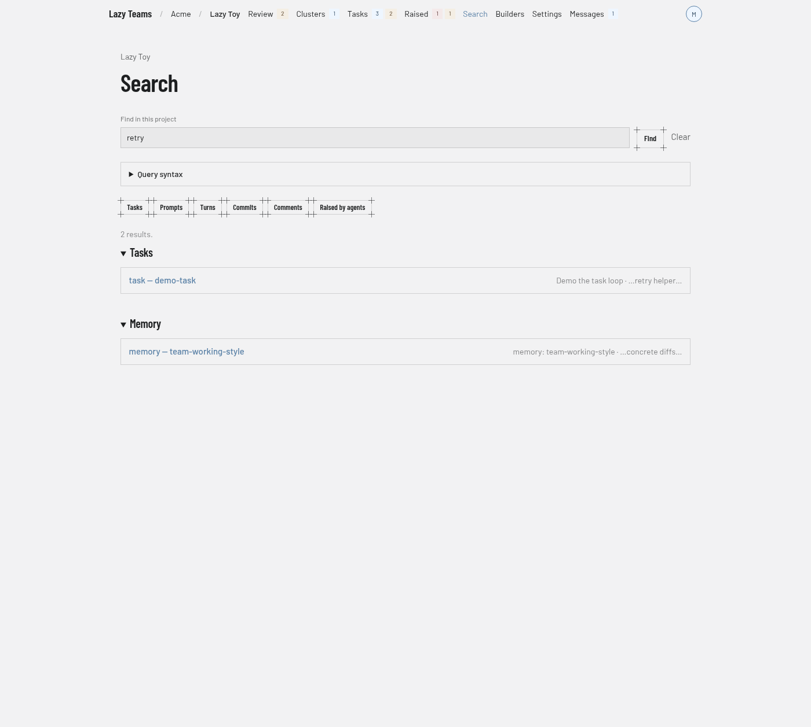

# Search

The Search screen finds tasks, prompts, turns, commits, comments and raised items in one project; you reach it from **Search** in the top navigation.

For the query language, see [Search](../../search.md).

## Search box

The **Find in this project** box takes your query, with the hint "Tasks, turns, commits, notes…" as its placeholder text. **Find** runs it. Once a query is present, a **Clear** link empties it.

## Command palette

On any project page, press Cmd+K or Ctrl+K to open a command palette. Its box reads "Search… or type > for commands": type to search, or start with `>` to list navigation commands. Cmd+Shift+K or Ctrl+Shift+K opens it with `>` already typed.

## Query syntax

A collapsed **Query syntax** panel under the box describes the fields and operators a query can use, with examples. It opens by itself when a query could not be read.

## Type filters

A row of buttons narrows results by type: **Tasks**, **Prompts**, **Turns**, **Commits**, **Comments** and **Raised by agents**. Each button toggles its type and keeps your query; a selected type is highlighted.

## Results

A summary line gives the number of results. Results are grouped under a heading per type, such as **Tasks** or **Memory**; hits from other places, such as memory, appear in their own groups. Each row names the type and the task, links to the hit, and shows the task's goal and the matching text. With an empty query you see **Search this project**, and with no matches **No results**.

## Errors

If the query could not be read, you see **That query could not be read** with the search engine's explanation. If search itself fails, you see **Search is unavailable right now**, which says the problem is not your query.
