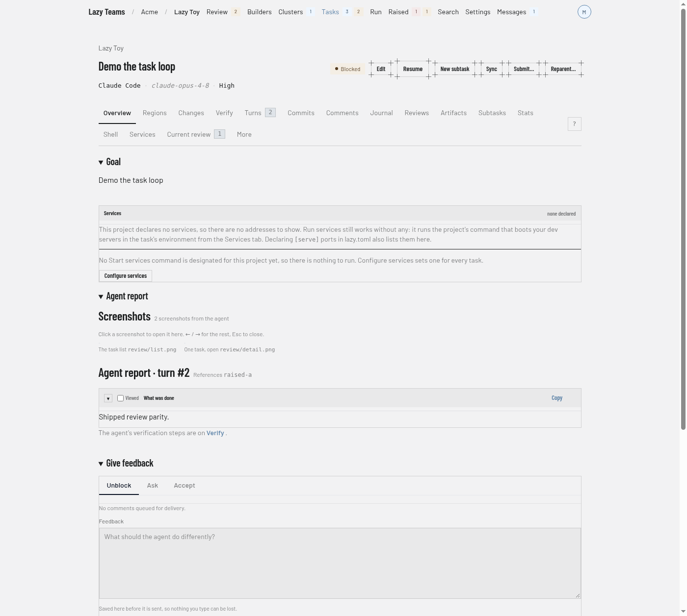
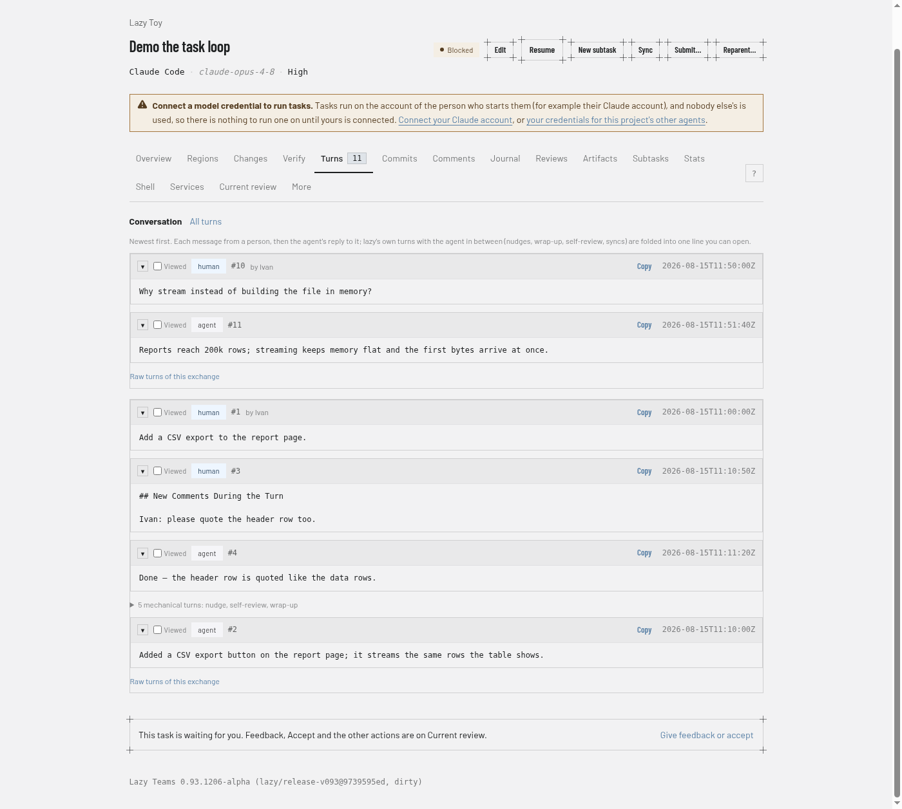
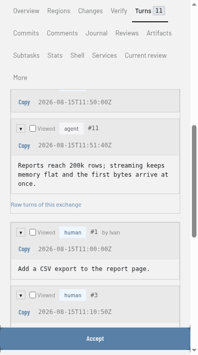

# Task

The task page is where you read one task, give its agent feedback and decide whether to accept it. You open it by clicking a task in [Tasks](tasks.md), the [review queue](review-queue.md) or [clusters](clusters.md).

For how to review a task, see [reviewing a task](../../lazy-teams-task-review.md). For what each status means, see [the state machine](../../state-machine.md).

## Header

The header shows the task's goal as the title, with the project name above it linking back to the project overview. Beside the title are the task's status badge, plus **Stopped** or **Failed** badges when they apply, and a link to the pull or merge request once the task has one. Under the title, a line names the agent, the model and the effort level the task runs with.

For a cluster task, a progress line sits under that.

The header buttons depend on the task's state and on what you may do on the project, so you see only some of them at a time:

| Button | What it does |
| --- | --- |
| **Edit** | Edits the task's fields. |
| **Start** | Gives a backlog task its first turn. |
| **Restart** | Puts an interrupted or stalled task back to work. |
| **Resume** | Asks the agent to carry on with what it already has. |
| **New subtask** | Opens the new task form with this task as the parent. |
| **Sync** | Brings the parent's work into this task. |
| **Submit…** | Opens a confirmation page for opening a pull or merge request. |
| **Reparent…** | Opens a page for moving the task under a different parent. |

Accept, Reject and Close are not in the header; they are in the [action area](#action-area) at the bottom of the page.

## Banners

Above the tabs, banners explain the task's state when something needs saying: the task has not started, was interrupted, failed, is waiting for a person, or could not be started. They are shown only when they apply.

## Tabs

A strip of tabs sits under the header. Counts appear on a tab when there is something to count.

| Tab | What it shows |
| --- | --- |
| **Overview** | The goal, the services the task serves, and what the agent's last turn reported. |
| **Regions** | The change carved into units of work, each with its own files and owner. |
| **Changes** | The diff the task's branch carries, and the conversation about it. |
| **Verify** | The agent's verification steps for its latest turn, each with a Verified tick. |
| **Turns** | The conversation: each message and the agent's reply, with lazy's own turns folded away; **All turns** shows every review chunk. See [the conversation view](#the-conversation-view). |
| **Commits** | What the task's branch recorded, newest first. |
| **Comments** | Notes to the agent, saved now and delivered with the next feedback. |
| **Journal** | The rationale, decisions and deferred items the agent recorded. |
| **Reviews** | Formal reviews an agent ran on the task's own work. |
| **Artifacts** | Files attached for the agent to read, and files it published back. |
| **Subtasks** | Tasks stacked on this one, grouped by where they stand. |
| **Stats** | Where the time and the tokens went, per turn and per tool. |
| **Shell** | Terminals in the task's own environment, and the Watch panel. |
| **Services** | What the task serves, its environment, and the project's Start services command. |
| **Current review** | What stands between the task and accept: the checklist, queued comments and what the agent raised. |
| **More** | The prompt, details, diagnostics and the less common things to do with the task. |

The **?** button at the right end of the strip opens the keyboard shortcut legend.

## The conversation view

**Turns** opens on the conversation, newest exchange first: each message from a person, then the agent's reply to it. The turns lazy adds in between (nudges, self-review, wrap-up, syncs) are folded into one line that you can open, and **Raw turns of this exchange** lists every turn. **All turns** switches to the full list of review chunks. **Current review** shows the agent's reply where you asked.

On a phone the same view stacks in one column.

## Action area

Under **Overview** and **Current review** the page ends with an action area. What it holds depends on the task's state and on what you may do on the project.

- While the task is waiting for a person and you may answer it, the area is headed **Give feedback** and has three tabs: **Unblock**, **Ask** and **Accept**. **Unblock** is a box for feedback to the agent, saved as you type so nothing you write is lost, with a **Send feedback and resume** button. **Ask** is where you ask the agent about the task. **Accept** says "Merge this work into its parent." and has an **Accept…** button that opens a confirmation page. See [reviewing a task](../../lazy-teams-task-review.md).
- Under it, a **Decide** section holds **Accept**. Rejecting and closing are folded away: **Reject the work** and a matching close control each expand with an explanation before you confirm.
- Otherwise the area shows only what applies: **Ask about this task**, **End this task**, **Reopen this task** for a finished task, or **Stop this task** while the agent is working.

On every other tab, a line says the task is waiting and links to **Current review** instead.
