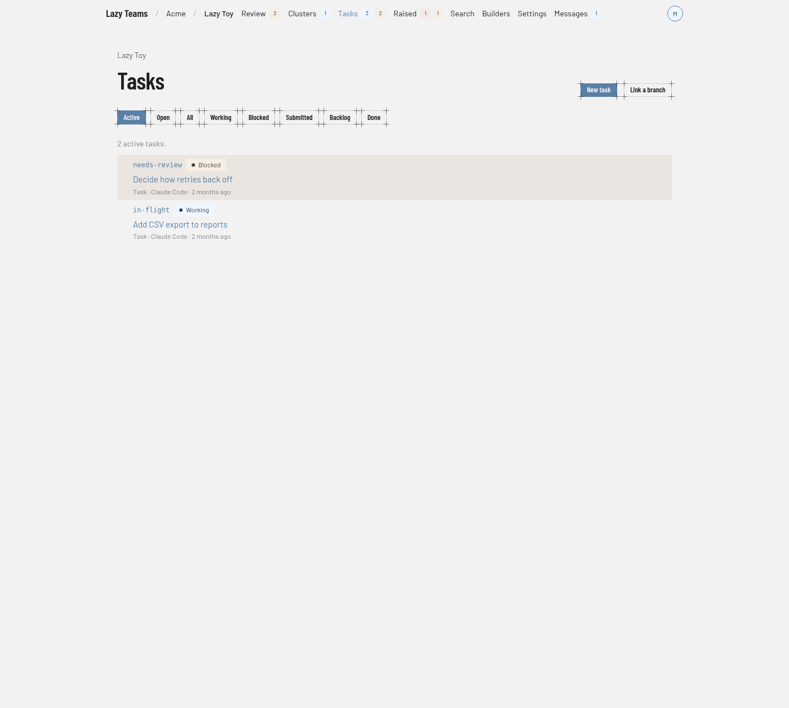

# Tasks

The Tasks page lists a project's tasks as a tree. You reach it with **Tasks** in the project's top navigation.

## Header

The project name above the title links back to the project overview. Two buttons sit on the right of the title:

| Button | What it does |
| --- | --- |
| **New task** | Opens the [new task form](#new-task). |
| **Link a branch** | Opens the [link form](#link-a-branch). |

Both appear only when the project is ready to answer. **New task** also needs permission to create tasks on the project.

If the project is not ready to list tasks yet, the page says so and links to the project overview.

## Status filters

A row of buttons under the title chooses what the list shows:

| Filter | Shows |
| --- | --- |
| **Active** | The default. A tree of tasks that are in flight or waiting on someone. Earlier tasks appear only where they keep a descendant's place in the tree connected. |
| **Open** | A flat list of tasks that have not finished. |
| **All** | Every task, as a flat list. |
| **Working**, **Blocked**, **Submitted**, **Backlog**, **Done** | Tasks in that one status. **Done** covers completed and abandoned tasks. |

Tasks in the `conflict` status are listed under **Blocked**. See [the state machine](../../state-machine.md) for what each status means.

## The list

A line above the list counts what you are looking at, for example "2 active tasks."

Each row shows the task code, a status badge, the goal, and the task type, agent and time since its last activity. Click a row to open the [task page](task.md). In the flat views you can sort by clicking a column header. The page updates on its own as tasks change.

When nothing matches, the page says so. In the **Active** and **Open** views it offers **Create the first task** if you can create tasks.

## New task

**New task** opens a form with these fields:

| Field | Notes |
| --- | --- |
| **Goal** | Required. One line saying what the agent is asked to achieve. |
| Prompt | Optional. The full brief. |
| **Code** | Optional short handle used in URLs. |
| **Type** | The task type: `task`, `fix`, `spike`, `refactor`, `test`, `audit`, `migrate`, `document`, `tidy`, `rework`, `feature`, `release` or `cluster`. See [cluster tasks](../../cluster-tasks.md). |
| **Parent task** | Stack the task on another one, or leave it top-level. |
| **Agent**, **Model**, **Effort** | Which agent runs the task and how. Leave them to use the project's defaults. |
| **Files for the agent** | Optional files attached as inputs the agent reads from its first turn. |

Two buttons submit the form. **Add to backlog** creates the task without running it. **Create and start** launches the agent immediately on your account.

## Link a branch

**Link a branch** adopts an existing branch (or a pull or merge request) as a task. Enter it in the first field, optionally give a **Code** and a **Parent task**, and press **Link**. The task is not started. A short model run on your account reads the branch and writes the task's goal and prompt. Recent links appear below the form with their progress. See [linking a branch](../../link.md).
