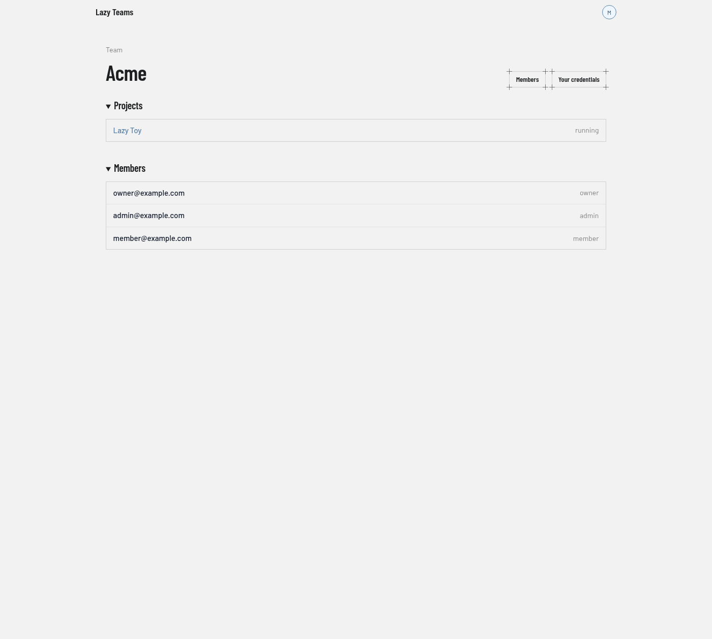

# Team

A team page shows one team's projects and members. You reach it from the [dashboard](dashboard.md) or from the **Teams** entry in the avatar menu.

## Header

The small "Team" label sits above the team name. The buttons on the right are:

| Button | What it does | Shown to |
| --- | --- | --- |
| **Members** | Opens the [members](members.md) page. | Everyone on the team |
| **Your credentials** | Opens your own credentials for this team. | Everyone on the team |
| **Rename** | Opens the form for renaming the team. | Team owners and admins |
| **Integrations** | Opens the team's integrations. | Team owners and admins |

## Projects

One row per project, with its current state on the right (the screenshot shows "running"). Selecting a row opens the [project overview](project-overview.md).

The section's **New project** link, which registers a git repository as a project, appears only for team owners and admins. A team with no projects shows "No projects yet".

## Members

A read-only list of the team's members, each with their role (`owner`, `admin` or `member`) on the right. To invite people or change roles, use the **Members** button.

## Related lists

The **Teams** entry in the avatar menu opens a list of all your teams, each showing its member count, with a **New team** button. A team's own project list is also available as a separate page headed "Projects", which has the same rows and the same admin-only **New project** button.
