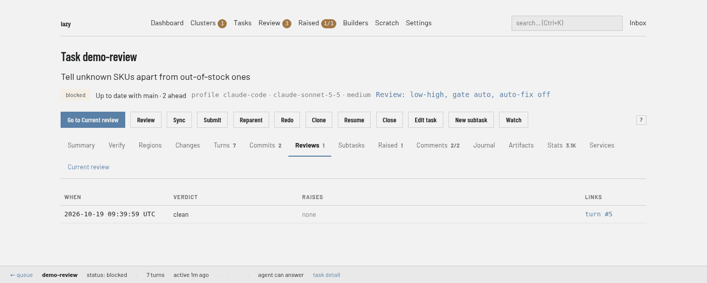

# The review paradigm — what lazy does by default, and why

Lazy reviews every task before you merge it, without being asked. The default
review is **fast** — one session, self-reviewed, with the diff still in
context — and the separate reviewer is the **optimization you opt into** when quality is worth the extra wall-clock and tokens.

This page is the reasoning behind that. For the mechanics of a single review —
the verdicts, what the reviewer may touch, how to stop one — see
[agent reviews](review.md).

## What a review is for

A review does three jobs, and the trade-offs later hang on which one you care
about.

It is a **merge gate**: a second reader who catches what the writer missed. A
writer that has just spent eight turns on a change is the worst possible
auditor of it.

It is a **substitute for your own reading**: the reason you can accept without
opening every file. Someone went through this branch, swept it for security and
data-integrity problems, and said so in writing.

And it is a **feedback loop**: what turns a cheaper writer into acceptable
output over a bounded number of rounds. A model told precisely what it got
wrong can land work it would never have produced in one pass.

## Three modes

`[review] mode` in lazy.toml picks how a task is reviewed, and every task
carries its own. The default is `low_high`.

| mode | who reads the work | gates accept | relative cost |
| --- | --- | --- | --- |
| `low_high` *(default)* | the writer, in its own session | no | 1x |
| `separate` | a reviewer in a new session | yes | 3–4x |
| `off` | nobody | no | 0 |

The "gates accept" column is the DEFAULT answer — what lazy's own automatic
review does in each mode. A review you asked for yourself gates in all three,
and [`[review] gate`](#the-gate-when-a-review-actually-holds-a-merge) overrides
the column either way.

**`low_high` — the writer reviews itself.** The work turn runs at
`draft_effort` (`low`), then the *same session* is resumed for a hostile
read-only self-review at `review_effort` (`xhigh`, raised to match the draft
when a task's own effort puts it higher — a review never runs weaker than the
work it reviews), then one revise pass
applies what that review found. The diff is already in context, so nothing is
re-read, and no second container starts. Its outcome is **recorded as a review**
— the same verdict / sweeps / findings shape every other review has, so you read
it the same way — and under the default gate it does not hold your accept. Set
[`gate = "always"`](#the-gate-when-a-review-actually-holds-a-merge) and it does.
See [the low-high loop](low-high-loop.md) for the phases in detail.

**`separate` — a reviewer in its own session.** After the task declares done, a
new agent in a short-lived container of its own reads the branch cold,
read-only, and files a verdict that **gates your accept**. It is never weaker
than the writer: it runs on the task's own model and effort.

**`off` — nothing.** A final triggers no review, and accept is not gated on
one, because there is none.

Set it per project:

```toml
[review]
mode = "low_high"
```

or per task, which wins and sticks for that task's whole life:

```
lazy create --review separate --goal "Rotate the signing keys"
lazy edit <task> --review low-high
```

## Settings are inherited, not just defaulted

`[review]` is the project's **default**, and a task can say otherwise. There are
three levels, and each setting resolves through them independently:

    project config  →  parent task  →  task

A task that says nothing inherits its **parent task's** value; a top-level task
inherits the project's. That is what makes a [cluster](cluster-tasks.md) cheap
to configure: the driver sets a mode once on itself and every child follows,
unless a child overrides — and a child that overrides only the mode still
inherits its parent's gate.

**Only a choice is inherited.** A task picks up what somebody explicitly *set*
on an ancestor — `--review*` on create, start or edit, the same arguments over
MCP, or the web form. It does not pick up a value that ancestor merely ended up
with, such as the project default its own launch pinned on it. So setting a mode
on a cluster driver still configures every child, while a parent task that was never
configured leaves its children on the project default, which is what you would
expect of a default.

**A choice travels the whole tree**, not one generation: configure a parent task and its
grandchildren follow too, and lazy keeps naming the task where the choice was
actually made rather than whichever task passed it on.

The resolved values are pinned on the task the first time it launches, the way
`--model` and `--effort` are. A project default you change later moves new
tasks and leaves running ones exactly where they were. `lazy show <task>` prints
the effective values, so you never have to reconstruct them.

## Reading the Review line

The task page in the dashboard and `lazy show <task>` both carry one line for this. On the dashboard it sits under the task's title, and the task's **Reviews** tab lists each recorded review with its verdict:



On the command line the same line reads:

```
Review:  low-high, gate auto, auto-fix off
         mode low-high — the writer reviews its own work in its own session, then revises (project default)
         gate auto — the mode decides whether a review holds the merge; a review you asked for always does (project default)
         auto-fix off — a review that finds something parks the task instead of starting a fix round (project default)
```

Three values — the [mode](#three-modes), the [gate](#the-gate-when-a-review-actually-holds-a-merge)
and the [auto-fix switch](#what-still-holds-in-every-mode) — and, for each one,
**where it came from**:

| provenance | what it means |
| --- | --- |
| `project default` | nothing was set for this task or any task above it; `[review]` in lazy.toml decided |
| `inherited from <task>` | somebody set it on that task — a parent or a further ancestor — and nothing below it overrode |
| `set on this task` | somebody set it here, with `--review*`, the MCP tools or the web form |
| `already recorded on this task, with no choice on record` | the task was launched by a version of lazy that pinned the value without recording who decided it |
| `recorded on this task before [review] existed` | the task predates these settings and keeps the arm it was running under (see [migrating](#migrating-from-agent-low_high_loop)) |

On the task page the same clauses are the tooltip on the `Review:` item, and the
item links here. Over MCP, `lazy_show` returns them as `review.explanations`
with the machine-readable `review.sources`.

If a value is not what you expect, the provenance says which level to change:
the project's `[review]` section, the parent task, or this task.

## The gate: when a review actually holds a merge

The mode says who reads the work. `[review] gate` says whether what they found
can refuse a merge, and it is the master switch over the mode rule.

| gate | what holds a merge |
| --- | --- |
| `auto` *(default)* | the mode decides for a review **lazy dispatched** — plus any review **you asked for**, in any mode |
| `always` | every recorded review, the low-high self-review's own outcome included |
| `never` | nothing, in any mode, manual reviews included |

**A review you asked for always counts, under the default.** `lazy review` and
a driver's `lazy_review` are deliberate acts — nobody spends a review turn they
did not want — so ignoring what one found because the task is in the fast mode
would make the command a no-op at exactly the moment you reached for it. Only
lazy's own automatic dispatch follows the mode.

`always` is for the project that wants the fast shape and still wants a bad
self-review to stop a merge: findings above medium, or a sweep that found
something, hold the accept until addressed or overridden. It does **not** hold
on findings the revise pass already applied — a self-review that found
something and fixed it is a self-review that worked, and a setting that stranded
those tasks would be unusable. `never` is the one
setting that also switches off a manual review's gate, because a human who
writes `never` has said exactly that.

**Nothing is disregarded silently.** When your settings let a merge through over
a review that found something, accept says so in one line and points you at the
report. A review that gates refuses instead, which is its own notice.

## Why the default is the fast one

A second agent re-reading a diff that is already warm in the writer's own
context costs wall-clock and tokens, and with many tasks running at once each
can take several review-then-fix rounds. So the default is fast, and the
separate reviewer is a per-task escalation, because that is where you can see
whether the stakes justify it.

## What still holds, in every mode

The declaration is still the trigger. An agent declares its work done with
`lazy_final`, and that is the only thing the declaration does: accept does not
need one, so a task that parked for a decision — or simply stopped — is yours to
merge whenever you have read it.

Whenever a review COUNTS — in `separate` mode, or because you asked for it, or
because the gate is `always` — everything it can conclude still gates your
accept: a verdict that needs work, a blocking decision, a review that could not
be parsed, one that crashed, one that never started. "Nobody knows what it
concluded" may not read as a pass. `lazy accept <task> --allow-review-issues` is
your override, deliberately CLI-only: an agent may not overrule a review on your
behalf.

**A review that inspected nothing is a failed review.** Reviews and asks are
read-only, and lazy checks that itself: it records the task's working tree
before the reviewer starts and compares it afterwards, and any change — an
edited file, a new file, a commit — fails the review, naming the files. Nothing
is reverted; you decide what to keep. A reviewer that reports it could not read
the work (its tools or commands failed) is recorded as a failed review, never as
a pass and never as findings. So is a review that passes the work without
calling a single tool, including the self-review's bare approval in `low_high`
mode.

**Findings at medium or below do not gate.** Critical and high findings hold; so do a failed
review, an outstanding blocking raise, and a report whose own security or
data-integrity sweep names something no finding covers.

**Fixing is its own switch.** `auto_fix` is `false` by default: a
`separate` review that finds something parks the task with the findings
attached instead of spending another round on the daemon's own initiative.
Turn it on to have the daemon start fix rounds itself:

```toml
[review]
mode = "separate"
auto_fix = true
```

The rounds that *are* started stay bounded: at most two review-then-fix rounds
before the task parks with its findings, and `[cluster] max_child_fix_rounds`
(default 3) per child for a cluster.

Automatic reviews still come out of `[daemon] auto_react_daily_budget`, the
shared daily allowance for every turn the daemon starts on its own (default 50,
reset at local midnight). Lower it and reviews arrive late rather than never.
Setting it to `0` is blunter than it looks: it stops every self-started turn,
including the recovery of a crashed one. A `separate` task whose review was
never dispatched does not quietly become acceptable — the skip is recorded, with
the reason, and it holds acceptance exactly as an unclean review does.

## Migrating from `[agent] low_high_loop`

The `[agent] low_high_loop*` keys are the older spelling of the `[review]`
settings. They are still accepted and map as below; `lazy doctor` names the replacement for
each:

| old | new |
| --- | --- |
| `[agent] low_high_loop = true` | `[review] mode = "low_high"` |
| `[agent] low_high_loop = false` | `[review] mode = "separate"` |
| `[agent] low_high_loop_draft_effort` | `[review] draft_effort` |
| `[agent] low_high_loop_review_effort` | `[review] review_effort` |

`false` means `separate`, not "no review". Setting both spellings to things
that disagree is refused at load. `lazy start --low-high-loop on|off` is not accepted:
use `--review low-high` or `--review separate`.

**The effort you chose for a task is not discarded.** An `--effort` on THIS TASK
wins for the draft and the revise pass alike. A project-wide `[agent] effort` is
the fallback the other phases resolve from and does not outrank `draft_effort`
for the draft.

## When tokens are still the constraint

Every lever below is real, and every one trades something away.

**Run a cheaper writer.** `lazy create`/`start`/`edit` take `--model`, and
`--agent <name>` picks an [agent profile](lazy-toml.md#agentsname--named-agent-profiles)
with its own model, harness and credential. *What it trades:* in `separate`
mode the review inherits the **task's own** model and effort, so a cheaper
writer is also a cheaper reviewer. `lazy review <task> --model <strong>
--effort high` buys back a strong reader for one review.

**Use `--review off` for work you are going to read yourself.** A one-line
config change, a doc fix, a revert. *What it trades:* everything — you are the
reviewer, and nothing records that anyone read it.

**Lower `[cluster] max_child_fix_rounds`.** Fewer rounds per child before the
cluster must accept it, close it, or ask you. Lower means a smaller number — `0`
is not a floor, it removes the bound and is the most expensive setting there is.
*What it trades:* the cluster hands you more decisions.

**Keep briefs small.** One coherent goal makes a small diff, and a small diff
is a cheap review — the reviewer walks the change in the
[regions](review-regions.md) the writing agent grouped itself. *What it
trades:* more tasks to create and accept.

**Accept with `--allow-review-issues` when you have read it yourself.**
`lazy accept <task> --allow-review-issues` merges over a review that left
issues outstanding or could not produce a verdict. *What it trades:* everything
above — you are the reviewer now.

## What lazy records, so you can judge the trade

Two surfaces answer this, and they count **different things** — expect two
numbers, and know which one you are reading.

The task page's **Stats** tab is *what the agent reported, per turn*, for the
task or its whole subtree
([what it means](web-review.md#what-the-stats-tab-means)). Its caveat: usage is
recorded only when the harness reports it. Claude Code, Pi, Codex and Cursor
measurements are retained with their turns; a turn that reported none is left
out rather than drawn as a free turn.

`lazy stats tokens` is *what went over the wire*: one record per request the
lazy proxy forwarded, rolled up by role, task and model. Every launch is
proxied, so nothing escapes the trail — but token counts are read off the wire,
and only the Anthropic and OpenAI wires are read. A **Cursor** task is
forwarded opaquely, so its requests appear with no tokens and no model against
them. Its other caveat: the trail is a **bounded rotating window**, so old
traffic ages out. `lazy stats tools <task>` breaks it down by tool.
