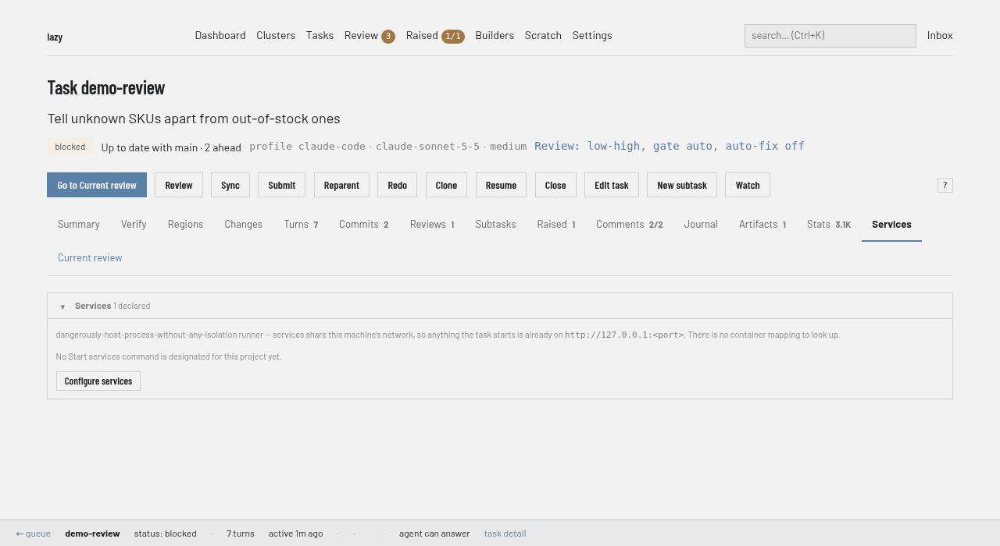

# Reaching a task's dev server

A task runs in its own environment. When the work is a web app, that environment
has a dev server in it — and until you can open it in a browser, the task is only
half usable.

Declare the ports your project serves on, and every task's dev server gets its
own name in the browser. `lazy url` tells you where.



In the web UI, a **Services** card on both the task detail page and the review page shows each service with its URL as a link, a green/grey liveness dot from the same TCP check `lazy url` uses, and the `lazy url <task> <service>` command ready to copy. When no services are configured, the card offers **Configure services**. The task *list* does not show it. The same mapping is printed by `lazy url` and shown in `lazy show`.

```toml
# lazy.toml
[serve]
ports = [3000, 5173]
```

```bash
lazy start my-task
lazy url my-task
# 3000  http://my-task.3000.lazy.localhost:26024  ● listening
# 5173  http://my-task.5173.lazy.localhost:26024  ○ not listening

open "$(lazy url my-task 3000)"
```

The dot is a liveness check: ● means a plain TCP connect to the port the
container publishes succeeds — something is listening behind the URL right now;
○ means the port is published but nothing answers yet (the dev server has not
started, or has stopped). The check connects and immediately closes without
sending a byte, so it never counts as a request to your app. With a service
argument (`lazy url my-task 3000`) the output stays exactly one bare URL, so it
keeps composing in scripts.

## Naming services

With more than a port or two, the number stops being a good name. Give them one:

```toml
[serve.services]
web = 3000
api = 8080
storybook = 6006
```

```bash
lazy url my-task            # web  http://my-task.web.lazy.localhost:26024
                            # api  http://my-task.api.lazy.localhost:26024
                            # ...
lazy url my-task web        # http://my-task.web.lazy.localhost:26024
```

Both spellings can be used together — `ports` for the ones whose number *is* the
name, `[serve.services]` for the ones worth naming. A bare port from `ports` is
addressed by its number (`lazy url my-task 5173`); a named service is addressed
by name or by its container port, case-insensitively. Service names must start
with a letter, so a name is never mistaken for a port.

## The URL is a name: `<task>.<service>.lazy.localhost`

That URL is served by the running lazy daemon, on the same port as the
dashboard. The daemon reads the hostname, finds the task's container and the
port it publishes, and forwards the request there — including WebSockets, so
hot reload and ActionCable work through it.

Two things that gets you, both of which a bare `127.0.0.1:49154` cannot:

- **Each task gets its own cookie jar.** Cookies ignore ports, so every task app
  on `127.0.0.1` shares one — two tasks running the same Rails app would log
  each other out on every page load. `my-task` and `other-task` are different
  hosts, so their sessions no longer collide.
- **The URL stops moving.** The published host port is assigned when the
  container is created, so it changes on every recreate. The name does not: a
  browser tab, a bookmark, or a note in a PR keeps working across restarts.

The task part is the task's **code** when it has one, and its short id
otherwise (`http://a1b2c3d4.web.lazy.localhost:26024`). That is why task codes
are restricted to what a hostname allows — lowercase letters, digits and
hyphens, up to 63 characters. Older tasks whose code does not fit keep it
and keep working everywhere else; in a URL they are addressed by
short id, which is what `lazy url` prints for them. The service part is the
service name, or the container port for a bare `[serve] ports` entry.
The task always comes first, so every service of one task sits together:
`my-task.web` and `my-task.3000` both address `my-task`.

### `--direct` for curl and scripts

Chromium and Firefox resolve `*.localhost` to loopback themselves, so nothing
has to be installed for a browser to reach these names. **The OS resolver
usually does not**, and a wildcard cannot go in `/etc/hosts` — so `curl`, an
HTTP client in a script, and anything else that is not a browser needs the raw
mapping:

```bash
curl "$(lazy url my-task web --direct)"   # http://127.0.0.1:49154
```

`--direct` works in both shapes — with a service argument it prints the one
bare loopback URL, and without one it lists them all.

## Under Lazy Teams

When the project runs under Lazy Teams, each task's Services card has an
**Open** link for every service. Teams proxies the request to the project and on
to the task, so the service opens from any browser signed in to Teams as a
member of the project — not only on the machine running it — with WebSockets
and hot reload passing through. The service gets a host name of its own under
the install's services host (`<task>--<service>--p<project>.<services host>`),
so, as with `lazy url`, every task keeps its own cookie jar. What an install
needs for that name to resolve is in
[Self-hosting Lazy Teams](self-hosting-lazy-teams.md#reaching-a-tasks-running-services).

The address printed beside **Open** is the one Teams serves the service on, and
the `lazy url` command is not shown there: under Teams, `lazy.localhost` names
belong to the project's own machine and answer nowhere else. An install with
no services host shows no address and says what an operator must set up.

Opening a service that nothing is serving — the task's environment is down, or
nothing listens on the port — takes you to the task's **Services** tab, which
says what is running and offers **Run services**, which starts the task's
environment first if it is down and shows each step as it happens.

A server started inside a task's container must listen on all interfaces
(`0.0.0.0`), not only on the container's loopback, to be reachable through the
published port — `BINDING=0.0.0.0 bin/rails server`, `vite --host`, and so on.

### Links in the pull request

When the install has a public address, a submitted task's PR/MR description
opens with one line: a link to the task in Teams and a link to its **main
service**, so a reviewer can switch between the pull request and the running
app. The main service is the port named by `main_service`, or the first
declared port when it is not set:

```toml
[serve]
ports = [3000, 5173]
main_service = 5173     # must be one of the declared ports
```

A `main_service` that is not a declared port is a config error. The task's Services card marks which service that is. The service link appears only where the install can open task services (it has a services host); otherwise the line carries the task link alone. With no ports
declared, the line carries the task link only. The line is kept current as the
host or main service changes, and is never added on a solo install, where a
localhost address would mean nothing to a reviewer. The links are plain; Teams'
own sign-in still guards them.

## When nothing is listening

Opening a task service in a browser when the dev server is not up does not
give you the browser's own "connection refused" page. The daemon knows why it
could not forward, so it sends you to that task's page in the web UI with a
banner saying which service you opened and what is wrong — the container is not
running, or it is running and nothing is listening on that port — followed by
the same **Start container** and **Start services** buttons the page already
has, and a *Try again* link back to the URL you tried.

Only browser *navigations* are redirected. An asset, an XHR or a `fetch` gets a
`502` with a one-line explanation instead, because answering those with an HTML
page produces a confusing failure rather than a clear one.

Nothing on that page starts anything by itself. Pressing a button does; opening
a URL never does, and no page you visit elsewhere can start a container by
embedding a task URL.

## What the host port is, and why it isn't 3000

Every task gets an **OS-assigned** host port (docker's `-p 127.0.0.1:0:3000`),
not a fixed one. That is what makes five tasks that all serve on 3000 able to run
at once — a fixed host port would mean the second task's container fails to
start. The runtime is the source of truth for the mapping; `lazy url` asks it,
so a mapping is never stale.

The binding is **loopback only**. A task's dev server is for the person driving
the task, not for the coffee-shop network the laptop is on.

## Changing `[serve]` takes effect on the next container

Published ports are fixed when a container is **created** — neither docker nor
podman can add a mapping to a running container. So editing `[serve]` does not
change a task that is already up. `lazy show` says so plainly:

```
  Serving:
    web → http://my-task.web.lazy.localhost:26024
    api → (not published — restart to pick up [serve])
```

To pick the change up on a task that is already up:

```bash
lazy shell my-task --restart
```

That recreates the container with the current `[serve]` and drops you into it —
so anything running inside (including a dev server) stops. It is refused while
the agent is mid-turn; `lazy stop <task>` first, or wait for the turn to end.

`[serve]` is read from the **project root's** `lazy.toml`, like every other
setting — a copy inside a task worktree is ignored. A branch that adds a service
gets it once the change is on the root, which is also the config a task's
container is created from. The Services tab on the task page still *shows*
those branch-only ports, each with `lazy forward <task> <port>` so you can
reach them while the container is up, without treating the worktree file as
config.

## One-off ports: `lazy forward`

`[serve]` is for the ports a project *always* serves on. For the ones you want
once — a database you feel like poking at, a debug server, a port you never
declared — there is `lazy forward`:

```bash
lazy forward my-task 5432
# Forwarding 127.0.0.1:49231 -> lazy-my-task:5432
#
# Forwarding while this command runs. Press Ctrl-C to stop.
```

It runs in the foreground and forwards for exactly as long as it runs. Ctrl-C
closes every listener and every connection it was carrying; nothing is left
published, and nothing is registered anywhere to clean up later.

Each argument is a port pair:

```bash
lazy forward my-task 3000                 # container 3000 → an assigned host port
lazy forward my-task 8080:3000            # container 3000 → 127.0.0.1:8080
lazy forward my-task 8080:3000 5433:5432  # as many pairs as you like
```

A bare number means "assign me a free host port", which is the spelling that can
never collide with something already on your machine. Either way the resolved
address is printed as soon as the listener is up, one line per pair.

Like `[serve]`, the listener is **loopback only** — a forwarded port is never
exposed to the network the machine is on.

Two things it deliberately does not do. It never starts a container: a freshly
created one has nothing listening yet, so a forward into it would be dead on
arrival. Bring the task up with `lazy shell my-task` first, start
whatever should be listening, then forward in another terminal. And it does not
show up in `lazy url`, which reports what the *container* publishes — a forward
lives only in the terminal you started it in.

If the task's image is old enough to predate lazy shipping `socat` (which is how
a forwarded connection reaches a port inside the container), the command says so
up front and points at `lazy upgrade --images`.

## Working inside the task's environment

The typical loop: get a shell in the container, set things up, start the server,
open it.

```bash
lazy shell my-task      # a shell inside the task's container
# ... npm install, npm run dev ...

# in another terminal
lazy url my-task web
```

`lazy shell <task>` opens a shell inside the task's container by default: the
same node, the same installed packages, the same network as the agent sees.
`lazy shell <task> --host` gives you a shell in the task's worktree on your own
machine instead, which is the right thing for git and host editors.

If the task's container is not running, `lazy shell` starts it first and says so
— which also means the container is created fresh, picking up the current
`[serve]`.

