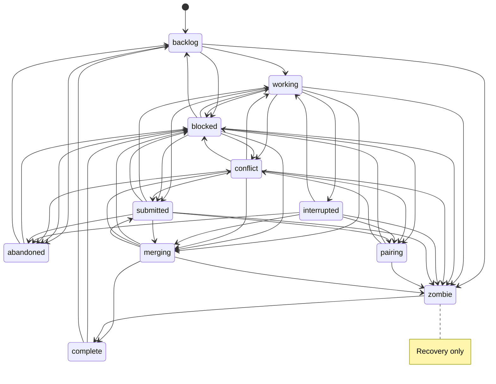

# The task state machine

A task has one status at a time. The arrows below come from the same transition table the daemon uses to allow status changes.

| Status | What it means | How it leaves |
| --- | --- | --- |
| `backlog` | Created, not started. | Start, close, or recover existing work. |
| `working` | A turn or accept check is running. | Turn finishes, crashes, submits, or begins merging. |
| `blocked` | Work is paused for review or feedback. | Unblock, resume, submit, pair, accept, or close. |
| `conflict` | Paused with a protected-file decision due. | Resolve at accept, unblock, resume, pair, submit, or close. |
| `submitted` | A PR or MR is open for review. | Review, unblock, pair, accept, close, or retarget the PR. |
| `interrupted` | A turn stopped before finishing. | Resume, pair, close, or recover a remote merge. |
| `pairing` | A person is working with the agent. | End the pairing session. |
| `merging` | Accept or a forge merge is underway. | Merge completes or the prior paused status is restored. |
| `zombie` | The daemon is recovering work already accepted. | Recovery completes. |
| `complete` | Work was accepted and merged. | Reopen. |
| `abandoned` | Task was closed or rejected. | Reopen. |

## Why some arrows look surprising

A sync on a `submitted` task restores `submitted` when it finishes: syncing changes the branch, not whether its PR is awaiting review. A protected-file decision still due can instead leave it in `conflict`.

A task stopped by a person stays stopped until its next completed turn; the daemon does not automatically restart it. A crashed turn goes to `interrupted` and may be resumed automatically.

An accept that dies during `merging` is resumed. Once the merge lands, the task becomes `complete`; remaining push and cleanup steps can be retried.

For what happens inside a turn, see [Tasks and turns](explanation/tasks-and-turns.md). For accepting and forge reviews, see [Review and accept](explanation/review-and-accept.md). For protected files, see [Resolving a conflict task](lazy-toml.md#resolving-a-conflict-task).
