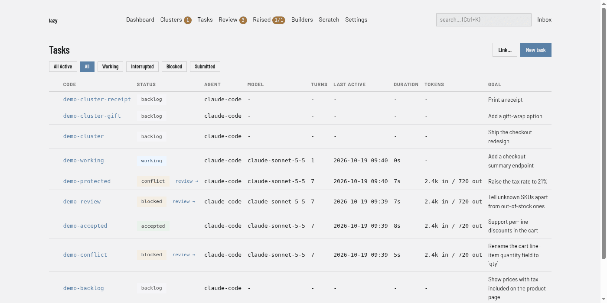

# The task state machine

Every task is in exactly one **status**, and the daemon allows only certain moves between statuses. This page lists the statuses, the moves, who makes each one (an agent, a human, or the daemon on its own), and what lazy does when an agent crashes or the daemon restarts. For the concepts behind it, see [Tasks and turns](explanation/tasks-and-turns.md).

## Statuses

The dashboard's **Tasks** page shows each task's status next to its code. Here the **All** filter lists a `backlog` cluster and its two `backlog` children, a `working` task, a `conflict` task (a protected file is waiting for a decision), `blocked` tasks waiting on a human, and a finished task that the list labels `accepted` (its status is `complete`):



There are eleven statuses:

- **`backlog`**: created but not started. No session exists.
- **`working`**: a turn is running. The part in brackets that some surfaces add, such as `working(agent)`, says what lazy can see running (see [Working, but not alive](#working-but-not-alive)).
- **`blocked`**: a turn ended and the task is waiting for a human.
- **`conflict`**: the same resting place as `blocked`, with a decision owed at accept time. The task is unblocked, resumed and paired exactly like a `blocked` one and nothing reverts the violated files; only `lazy accept` gates on them: every *pending* violated file must be approved there (all-or-nothing) or the accept is refused. See [Resolving a conflict task](lazy-toml.md#resolving-a-conflict-task).

  **`conflict` is derived, never set by hand.** The set of pending violations decides it: a paused task is labelled `conflict` while that set is non-empty and `blocked` once it is empty. Every way a task comes to rest (a turn or sync finishing, a failed turn being parked, crash recovery, a pairing session ending, `lazy stop`, `lazy doctor <task>`) re-checks the set rather than writing `blocked`.
- **`submitted`**: the task's branch has an open pull/merge request waiting for review on the forge (`lazy submit`). It is a paused status like `blocked`: you can unblock it, review it, sync it, pair on it or accept it.

  **A sync or review does not take a `submitted` task away from its reviewer.** Both move the task through `working` for the duration of the turn. A review restores the status it found. A sync restores only `submitted`; from any other status it parks like a finished turn (`blocked`, or `conflict`), and a sync from `interrupted` does not go back to `interrupted`. A sync that fails in a way lazy will not retry (a dead credential, a bad model id) restores `submitted` too; a crash lazy *will* retry goes to `interrupted` instead, because the merge may be half applied. The exception is a protected-file decision still owed: pending violations make the task `conflict` regardless.

  **A task finds its own PR/MR by its branch.** If lazy has no PR/MR on record for a task (it stopped right after the forge created one, or someone opened it by hand), the daemon's background sync looks it up by branch. An open one is recorded on the task. One merged into the task's target completes the task, but only when everything on the task's branch is already in the target; otherwise a comment explains why. One merged into some other branch leaves the task alone and raises an alert. A closed one changes nothing. When lazy opens a PR/MR itself, it first adopts an open one on the branch if there is one.
- **`pairing`**: a human is working interactively with the task's agent, in the task's container (see [Pairing](pairing.md)).
- **`interrupted`**: an agent turn died or was killed (crash, watchdog, daemon restart) without finishing.
- **`merging`**: a merge is in flight: either an accept is merging the branch locally right now, or the task's PR/MR has been handed to the forge and is waiting for CI and merge. If an accept dies partway, the daemon resumes it rather than undoing it.
- **`zombie`**: system-only recovery state for a task whose work was accepted but whose status was never updated. The daemon moves it straight on to `complete`.
- **`complete`**: accepted and merged. When the task had a parent *task*, lazy leaves a `[Subtask accepted]` comment on the parent with the merge commit SHA. The comment does not start a turn or unblock the parent. `lazy wait` reports the same SHA as `head_sha`.
- **`abandoned`**: rejected (`lazy reject`) or closed (`lazy close`). Both resolve to this one status. A parent task gets a `[Subtask removed]` comment naming the reason.

**Terminal statuses** (finished, core fields frozen): `complete`, `abandoned`. **Waiting for a human**: `blocked`, `conflict`, `submitted`. **Has a live worktree that must not be merged into**: `working`, `interrupted`, `pairing`, `merging`.

### A parent task is told when its subtask list changes

A task whose subtasks come and go gets a one-line comment each time, so its agent can see what happened on its next turn:

- `[Subtask added] <child> — "<goal>"` when a subtask is created under it, reparented into it, or reopened after having been closed.
- `[Subtask removed] <child> — "<reason>"` when a subtask is closed, rejected or abandoned, and `[Subtask removed] <child> — reparented to <parent>` when it moves elsewhere.
- `[Subtask accepted] <child> …` when a subtask is accepted and merged. An accepted subtask is only ever reported this way, never also as removed.

Like every lazy comment, these never start a turn and never unblock the parent: they show up in its next notes. Nothing is written to a parent that is already `complete` or `abandoned`.

## Allowed transitions

The daemon refuses any move not in this table ("Invalid status transition"). Staying in the same status is always a no-op.

| From | Can move to |
| --- | --- |
| `backlog` | `working`, `blocked`, `abandoned` |
| `working` | `blocked`, `conflict`, `submitted`, `interrupted`, `merging` |
| `blocked` | `working`, `conflict`, `submitted`, `merging`, `pairing`, `abandoned`, `backlog` (allowed by the table; nothing currently makes this move) |
| `conflict` | `working`, `blocked`, `submitted`, `merging`, `pairing`, `abandoned` |
| `submitted` | `working`, `blocked`, `merging`, `pairing`, `abandoned` |
| `interrupted` | `working`, `merging`, `pairing`, `abandoned` |
| `pairing` | `blocked`, `conflict` |
| `merging` | `complete`, `blocked`, `conflict`, `submitted` |
| `zombie` | `complete` |
| `complete` | `blocked`, `backlog` |
| `abandoned` | `blocked`, `backlog` |

Any non-terminal status can also move to `zombie`, but only the daemon does that.

Some absences are deliberate:

- **`merging` never moves to `abandoned`.** A task mid-merge cannot be closed or rejected, so a half-applied merge is never abandoned. A merge either completes or fails back to the status the task held before the accept.
- **`working` never moves to `pairing` or `abandoned`.** The agent is running. `lazy reject` and `lazy close` on a working task stop the agent first (`working` → `interrupted`), then abandon it.
- **`interrupted` never moves to `complete`**, and `lazy accept` does not take an interrupted task: resume or unblock it first.
- **`blocked` never moves to `complete` directly.** It goes through `merging`.

## Who moves a task

Every status change records an **actor**: `human` (the CLI), `builder` (an AI orchestrator using the MCP tools), `agent` (a task's own agent driving its own subtasks over MCP), `system` (the daemon on its own) or `supervisor` (lazy's per-task supervisor, for its own follow-up prompts). The actor records the channel, not who wrote the words; it never changes what a command does. A command that arrives over MCP makes the same move as its CLI twin but records `builder` or `agent`.

### Humans (and builders and agents, over MCP)

| Command | Move |
| --- | --- |
| `lazy start` | `backlog` → `working` |
| `lazy unblock` | `blocked`, `conflict`, `interrupted` or `submitted` → `working`, with your feedback saved first. It does not merge upstream; run `lazy sync` for that |
| `lazy resume` | `interrupted`, `blocked` or `conflict` → `working`, with no feedback. Pending protected-file violations do not refuse it |
| `lazy pair` | `blocked`, `conflict`, `interrupted` or `submitted` → `pairing`; on exit back to `blocked` (or `conflict` while violations are pending) |
| `lazy submit` | `blocked` or `conflict` → `submitted` |
| `lazy sync` | `blocked`, `conflict`, `interrupted` or `submitted` → `working` → back to `submitted` if that is where it started (see `submitted` above); otherwise it parks like any finished turn: `blocked`, or `conflict` while violations are pending. A sync from `interrupted` does not return to `interrupted` |
| `lazy review` | `blocked`, `conflict`, `interrupted` or `submitted` → `working` → the status it found |
| `lazy ask` | `blocked` or `conflict` → `working` → the same status. An ask never changes task state; the brief `working` marks the task busy. After a timeout the task stays `working` so a late answer can be recorded, then parks as usual |
| `lazy stop` | `working` → `blocked` (or `conflict` while violations are pending), marked as stopped by you: the daemon does not run it again until its next completed turn (see [Crashes, restarts and recovery](#crashes-restarts-and-recovery)) |
| `lazy accept` | `blocked`, `conflict` or `submitted` → `merging` → `complete` (see [Accept](#accept-and-the-merging-status)) |
| `lazy reject`, `lazy close` | `backlog`, `blocked`, `conflict`, `interrupted`, `submitted` → `abandoned` (`reject` does not apply to `backlog`); a `working` task is stopped first |
| `lazy reopen` | `complete` or `abandoned` → `blocked` when the task had a session, otherwise `backlog` |

`lazy chat` changes no status, records no turn and makes no commits; it holds the worktree lock while open, so start, unblock, sync and resume refuse until it closes.

Reopening restores the task on its own branch at its last head. If no head can be found it refuses and changes nothing. Reopening an accepted task supersedes that accept: lazy never treats it as a crashed accept to recover.

### The agent

- **A turn completes**: `working` → `blocked`, or `conflict` when it produced file-permission violations or earlier ones are still unresolved. A turn that runs no permission check (an ask, a sync) never clears pending violations.
- **A turn dies**: `working` → `interrupted` (see [Crashes, restarts and recovery](#crashes-restarts-and-recovery)).

### The daemon, on its own

The daemon keeps checking task state in the background and fixes up anything that has changed underneath it:

- **Working tasks**: a finished turn is recorded and the task parks `blocked` (or `conflict`). A task whose agent died without finishing gets a crash turn recorded and moves to `interrupted`.
- **Late answers**: an answer that arrives after its task was marked `interrupted` is still recorded and the task parks `blocked` (via `working`).
- **Auto-resume**: `interrupted` → `working` (see below).
- **Dead pairing sessions**: a task left in `pairing` after its process ended parks `blocked` (or `conflict`).
- **Backlog tasks whose branch already has commits** (for example work that arrived from another machine) move to `blocked`.
- **Accepted work whose status was never updated** (an accept that died after its merge): the task moves through `zombie` to `complete`.
- **PR/MR merged on the forge**: the task completes through `merging`. A PR/MR closed on the forge sends a `merging` task back to `blocked`, as does a failed pipeline on its PR/MR; on any other task, a PR/MR closed without merging abandons the task and reparents its children.
- **Re-parenting that could not move a PR/MR**: if a task's parent was accepted or closed and the forge refused to retarget its open PR/MR, lazy closes the PR/MR and the task moves `submitted` → `blocked`.
- **Leftover containers** for `complete` or `abandoned` tasks are removed.

## How a turn ends

A task's status says where the task IS. It cannot say whether the agent thought
it was finished: `blocked` reads exactly the same whether the agent delivered
the whole task or simply ran out of budget halfway through. So an agent says
which, and a turn ends in one of three ways.

Nothing asks the agent which of the three it was — lazy reads the ending off
what the turn did.

- **Declared done.** The agent calls `lazy_final` — pencils down. The claim
  names the branch head at the moment it was made and is recorded on that turn,
  along with an optional one-line note. It is not a turn-end signal: the turn
  still ends when the agent stops, and an agent may keep working after declaring.
  Declaring is what starts an automatic review; it does not gate acceptance.
- **Needs input.** The agent raised a blocking item (see
  [Raised items](raised-items.md)). The task parks for a human decision.
- **Neither.** The turn simply stopped — budget, watchdog, crash, or the agent
  said nothing. The task parks `blocked`.

The last two look the same in the status: blocked is blocked whether or not
anything was raised. What differs is the record — a blocking item, or none —
and lazy labels the task from that.

**You can accept from any of the three.** A human-facing task gets its
walkthrough whichever way the turn ended, precisely so the decision you are
being asked to make has something to go on.

The first two are exclusive. `lazy_final` refuses while a blocking item is open
on the task, and names the item, because filing one is the agent having already
chosen the other ending. The task's journal records which items parked it.

### Work left uncommitted when the turn ends

A task is reviewed and merged from its **commits**. Anything an agent edits and
never commits is in no diff, in no walkthrough, and in nothing `lazy accept`
would carry — and it disappears with the worktree.
Four things make that visible rather than silent.

- **The agent is asked, once, before the turn closes.** When a turn is about to
  end with uncommitted paths, whether it declared itself done or parked for
  input, lazy names them and asks the agent once whether it has committed all
  its work — commit what belongs to the task, or say why it should stay
  uncommitted. A turn that declared itself done is additionally asked to commit
  or discard anything still loose, as its last check. Lazy never commits on an
  agent's behalf. Read-only turns are never asked.
- **Stopped background work is asked about first.** If a turn ends while a
  background command the agent started is still running, Claude Code stops
  it. Lazy then asks the agent once, before the question about uncommitted
  work, whether it needed that command to finish, naming the command. If it
  did, it can run it again in the foreground; if not, it says so. Same rules:
  once per turn, never on read-only turns, recorded on the task as a
  "Stopped Background Work Check".
- **Anything still loose is announced.** If the agent does not commit or
  discard it (for example because it could not), the task gets an
  "[Uncommitted work left behind]" comment naming the paths, which the agent
  also receives on the next unblock, and a system message is filed so it is
  seen without opening the task.
- **The paths are on the turn record.** the web review page shows the count on
  the turn, with the paths in the tooltip, and `lazy show` puts the same count on the turn
  and lists the paths in `--full`.
- **Accept refuses, and says which files.** A task whose worktree still holds
  uncommitted changes cannot be accepted, and the refusal names the paths and
  states that none of them is on the branch. Commit what belongs to the task,
  discard the rest, then accept.

### A declaration is about a SHA, and it can go stale

Because a final names the head it was made at, the head can move afterwards — a
sync merge, a commit made while pairing, a subtask accepted into a parent. None
of those cancel the declaration; every surface that shows a final instead says
so:

```
declared final at 9f3c1a2b; head has since moved (a sync)
```

What DOES cancel it is an agent going back to work: a later agent work turn that
produces commits clears the declaration, and whoever did that work declares
again when they are finished. A turn that committed nothing, a sync, a review, a
question and the automated follow-ups all leave it standing.

The web review page leads with the declaration; `lazy show` prints it (or `not declared`) next to the task's status,
and `lazy show --json` carries it as `final`.

## Only one turn runs at a time

A task never has two turns dispatched at once. If an unblock, an ask and an automatic sync arrive together, the first one to claim the task wins, and the others see the task is busy:

- an ask or unblock is refused (409) **before** anything is recorded, so no feedback is lost; send it again once the task is idle;
- a sync re-queues itself and is reported as `pending_sync`, naming the status it stood down for, and runs later.

A turn is only dispatched from `blocked`, `conflict`, `submitted` or `interrupted`. A task in `pairing` or `merging` is never handed a new turn.

## Accept and the `merging` status

Accept works from any park where the turn ended normally (declared done, parked for a decision, or simply stopped) and requires only that every open blocking item is resolved in the same command. The one park it refuses is `interrupted`, whose ending is unknown. Every precondition is checked before anything is written, so a refusal leaves the task exactly as it was.

Status tracks the phase in flight:

| Accept phase | Status |
| --- | --- |
| Acceptance gate (opt-in) | `working`, with no agent behind it |
| Merge phase (description, merge, finalize) | `merging` |
| Aborted at any point | the status held before the accept: `blocked`, `conflict` or `submitted` |

- **The merge is the commit point.** The moment it lands the task becomes `complete`. Fast-forwarding the local branch, pushing the parent, tagging, reparenting children and cleanup happen after, are retried by the daemon if they fail, and never move the task out of `complete`. A failure there exits non-zero and names the step.
- **A remote merge** hands the merge to the forge: the task stays `merging` until the daemon sees the PR/MR merged (→ `complete`) or closed (→ `blocked`).
- **An accept that dies** (daemon restart, crash, kill) leaves the task in `merging`, and the daemon resumes it, whether it died before or after the merge landed; a merge that already landed is recognised and not repeated. While that resume is pending, `reject`, `close`, `submit` and `unblock` refuse. After three failed automatic resumes the daemon stops and files a system message, and those commands work again to recover the task, except when the work has already landed on the target: then they point you at `lazy accept`, which finishes the accept. `lazy doctor` reports anything sitting in `merging`.
- Two accepts of the same task at once never both merge.
- The parent must not be active (`working`, `pairing`, `merging`, `interrupted`). The one exemption: a task's own agent accepting a direct subtask over MCP while the parent is `working`, or a human pairing in the parent's container accepting from that session. A task agent can accept a direct subtask only, never its own task.
- Uncommitted work in the destination worktree does not block the merge and is never lost: the accept sets it aside, merges, and puts it back.
- The merge description is an enhancement, never a gate. If its one-shot agent fails or times out, the accept falls back to a plain list of commits.

For what accept does to git, see [Git integration](architecture/tasks-in-git.md).

## Working, but not alive

`working` is where the task is in its lifecycle; the part in brackets is what
lazy can see running for it right now. `working(not-alive)` means the task is
still recorded as mid-turn but nothing is running for it and no answer is
waiting — the turn's process has died. It is a short-lived state: once the
turn is at least 30 seconds old, the daemon's next check (every few seconds)
either recovers a turn that had finished its work to `blocked`, or records the
crash, moves the task to `interrupted` and resumes it automatically.

Two things that look similar are not that:

- **`working(launching)`** — the daemon is still starting the turn's container
  or process. Building the container image on a fresh machine or after an
  upgrade can take minutes; the task is not dead, it has not started yet.
- **A running review** — `lazy review` runs its reviewer separately from the
  task's own agent, and the task reads `working(agent:reviewing)` for as long as
  the reviewer is running. If the reviewer dies without answering, the review is
  recorded as failed and the task goes back to the status it had before. A
  review or `lazy ask` that was running when the daemon restarted cannot finish
  — the restart cuts it off from the model — so the new daemon stops it, records
  it as failed, and puts the task back the same way.
- **Plain `working`, no brackets** — the run is starting up or its answer is
  being collected, or the container runtime did not answer when lazy asked
  about the run (a busy Docker, for example), so its liveness is unknown rather
  than dead. `lazy daemon health` names that last case as a warning with the
  reason.

A task that reads `working(not-alive)` for more than a minute or so is a bug
worth reporting. Include the `liveness` and `session` parts of
`lazy show <task> --json` and the output of
`lazy daemon logs <short-id> -n 20000`, where `<short-id>` is the
first 8 characters of the task's `id` in that JSON (daemon log lines name tasks
that way).

## Waiting on subtasks

An agent that splits its work into subtasks drives them with blocking lazy
tools — `lazy_wait` (wait until a subtask finishes its turn) and `lazy_ask`
(ask a subtask's agent a question and wait for the answer). While blocked in one
of those calls the parent agent is doing nothing. A `lazy_wait` also returns early,
with an `interrupted` reason, when someone adds a subtask to the waiting task from
outside, so the parent can react instead of mistaking it for a timeout. Lazy shows the wait instead of
a plain `working(agent)`:

```
working(waiting on fix-foo (2m10s))
```

This appears in `lazy list`, `lazy active`, `lazy status`, `lazy show`,
`lazy watch`, and the MCP `substate` field. Two concurrent waits list both
labels; a larger fan-out is summarized (`waiting on a, b +2`).

Waiting outranks the turn-flavour substates (`agent:answering`,
`agent:reviewing`) — those say what the turn *is*, `waiting` says what it is
doing this second. A lazy-side phase (`harness:<phase>`) outranks waiting, and a
dead run still reads `not-alive`. If the daemon is killed mid-wait, the marker
is disregarded and the task falls back to `working(agent)`.

Time spent waiting is recorded separately from the agent's own working time, so
a turn that spent two hours blocked on a subtask does not bill those two hours
to the agent in duration or cost reports. A failure to record a wait never
affects the wait itself.

## Agent-reported progress

The working substate answers *who is active* — agent, lazy, a wait, nothing.
It cannot answer *doing what*. `lazy_update_progress` fills that gap: the agent
posts a short line and every surface that shows the substate folds it in:

```
working(agent: running migration 3/7)
```

- **Latest wins, no history.** Each call replaces the previous line, and
  nothing is kept — a progress line is worthless five minutes later. What is
  worth keeping about a turn (rationale, decisions, deferrals) belongs in the
  journal.
- **Bounded.** The line is whitespace-collapsed and capped at 120 characters.
  Longer messages are truncated, never rejected, and the agent is told.
- **Only while the agent is active.** It decorates `agent`, `agent:answering`,
  `agent:reviewing` and `waiting on …`, never `harness:<phase>` or `not-alive`.
- **Cleared with the turn.** Every new turn starts with no progress line, so a
  message from a finished turn never lingers.

A progress post that cannot be recorded is simply lost; it never costs the agent
its tool call.

## Agent failure classification

Not every agent failure deserves the same response. A rate limit clears on its
own; a revoked credential never does. So lazy sorts each failure into a class
and acts on the class.

This is about credentials and conditions that go bad *while a task runs*. A
turn on a profile with no credential at all is refused before it launches, and
the task keeps its status.

### The taxonomy

| Class | Examples | Behaviour |
|---|---|---|
| `fatal_auth` | 401/403, invalid API key, missing credential, credit balance exhausted, a provider quota or spend cap (monthly usage limit, out of credits, `insufficient_quota`) | Stop on the first failure |
| `fatal_config` | unknown flag, invalid model, agent binary missing (exit 127) | Stop on the first failure |
| `transient_overload` | 429, 529, 503, "overloaded" (a per-minute or short-window rate limit) | Retry indefinitely, 5s→60s |
| `transient_network` | ECONNRESET, ETIMEDOUT, socket hang up, `fetch failed` | Retry indefinitely, 5s→60s |
| `transient_unreachable` | ECONNREFUSED, ENOTFOUND | Retry 5s→60s, **bounded** at 12 attempts (~9 min), then stop |
| `unknown` | anything unrecognized | Retry 15s→60s, **bounded** at 6 attempts (~4 min) per turn; the crash-loop detector still applies |

A failure lazy does not recognize is classed `unknown`.

Each agent's own wording is recognized too (Claude Code's "Invalid API key ·
Please run /login", Cursor's "not logged in").

### Retry pacing

Transient failures are retried at 5s → 10s → 20s → 40s → 60s (capped) —
roughly 60 retries an hour.

The crash-loop detector (3 failures in a row, each under 10s) does **not** apply
to transient classes. It still applies to `unknown`, which
is also capped at 6 attempts per turn so a slow, repeating failure cannot
retry forever.

`transient_unreachable` sits in between: a refused connection to a local proxy
can heal if the proxy restarts, so it is retried generously, but not forever.

### What "stop" means

When a failure is classed fatal (or `transient_unreachable` runs out of
attempts), the turn ends and the task moves to **`blocked`** — not
`interrupted` — with the class and reason recorded on it. Auto-resume only ever
restarts `interrupted` tasks, so this is what keeps lazy from relaunching into a
condition that will not clear, and puts the task in front of you with the reason
attached.

A crash loop, or an `unknown` failure that used up its 6 attempts, is
different: its class is `unknown`, recorded for diagnosis only. The task goes
to `interrupted` and is auto-resumed, because many such causes are transient.

Conditions that never clear on their own are kept out of `unknown`. A Cursor
plan quota spent or a spend limit reached is `fatal_auth`; Claude's `usage limit
reached` is a 5-hour window that clears by itself and stays
`transient_overload`. A Cursor quota message is only fatal when nothing in it
says the limit clears soon: a rate-limit marker or a short reset horizon
("resets in 20 minutes") stays `transient_overload`, while a reset stated as a
*date* ("when your monthly cycle ends on 9/19/2026") does not. When in doubt,
lazy retries.

The same rule applies to every provider's quota. A 429 that says a monthly
usage limit, spend cap or credit balance has been reached (Ollama, OpenAI,
Anthropic) is `fatal_auth`: the task blocks with the provider's own message,
including any upgrade or add-credits link it gave. A per-minute rate limit, or
a cap whose message says it clears soon, is still retried.

### Seeing what is being retried

While a turn is retrying, lazy shows one line saying what and why — for example
`attempt 7 (transient_overload): API Error: 529 overloaded`, with the error
snippet truncated — in all of:

- the `lazy watch` / `lazy status` header
- the `lazy list` / `lazy active` substate
- the "Retry State" block in `lazy show`
- the supervisor log (`Phase: retrying …`)
- `retry_status` in MCP `lazy_show`, so a builder can tell a task stuck retrying
  from a healthy `working` one

### Watchdog kills

A no-progress watchdog kill has no error to classify — lazy killed the agent
itself, after `[agent] watchdog_output_timeout_ms` (default **30 minutes**; the
timer resets on every completed step) passed with no forward progress. What
happens next depends on one question:

| Did the turn capture anything? | Behaviour |
|---|---|
| **Yes** — a final result, or new commits | Not retried. The work is already on disk, so relaunching would repeat it or hang the same way; the turn ends and you read what was captured |
| **No** — no result, no new commits | Relaunched within the turn (5s → 10s backoff), at most 3 attempts. Each attempt costs a full no-progress window, so the bound is tight |

If lazy cannot read git to check for commits, it treats the kill as having
captured nothing and retries.

When a watchdog kill ends the turn, the task goes to **`interrupted`** with
auto-resume, not `blocked`. The recorded turn and the interrupt reason say which
guard fired, what its limit was, that keep-alive output does not count as
progress, and whether lazy already relaunched.

## Crashes, restarts and recovery

`interrupted` means a turn died or was killed without finishing. Lazy detects that in three ways, records what happened, and resumes automatically unless it would be pointless or you said stop.

### Detection

The daemon watches `working` tasks. A task whose agent container or process is gone without having finished its turn is marked `interrupted`. A task that became `working` within the last 30 seconds is left alone, so a container still starting up is not mistaken for a dead one. A turn that had already finished and committed its work, but whose end-of-turn handshake was lost, is recovered instead: the commits are backfilled, a `[Recovered]` turn is recorded and the task parks `blocked` for review. A cluster task is never recovered this way, because its branch carries its children's accepted work; a killed cluster goes to `interrupted` and is resumed like any other task. A sync killed halfway is likewise `interrupted`, never "finished".

### When the daemon restarts

A restart cuts every running agent off from its model connection, so the new daemon handles each `working` task by what it finds:

- **A work turn that was running** moves to `interrupted` with a recorded reason, does not count toward the crash limit below, and is resumed against the new daemon. If the daemon stopped rather than restarted, the next daemon picks the task up when it starts.
- **A turn whose finished response is already on disk** is not interrupted; it is recorded and the task parks as usual.
- **An ask or review that was running** cannot finish. The new daemon stops it, records it as failed, and puts the task back to the status it had before.
- **A task in `merging`** whose accept died is resumed to completion (see [Accept](#accept-and-the-merging-status)).
- **A `complete` task still owing post-merge steps** (fast-forward, parent push, tagging, reparenting, cleanup) has them retried until they succeed.
- **A task in `pairing`** whose pairing process is gone parks `blocked` (or `conflict`).
- **Subtask comments** a parent missed are delivered again.

A task you stopped with `lazy stop` is not resumed by any of this. The stop lasts until the task's next completed turn, whoever starts it: your `lazy resume` or `lazy unblock`, but also a completed `lazy ask` or `lazy review`, which lifts the stop too.

### What is recorded

The crash is recorded as a turn on the task (visible in `lazy show`), along with diagnostics: a reason (for example "OOM killed or SIGKILL (exit code 137)"), the exit code, the time, and the last lines of the container's logs. Every turn that dies leaves a visible record, even when the same failure repeats: two identical `fatal_auth` failures on consecutive unblocks are recorded as two turns.

### Circuit breaker

Each crash counts toward a limit of **3 consecutive interruptions**. Once it is reached, the immediate retries end, but the task is not given up on: it moves to a slower retry queue, where the daemon resumes it every `auto_resume_interval_minutes` (default 30), with at most one automatic resume project-wide per `auto_resume_gap_minutes` (default 5). Retries end for good after `auto_resume_max_attempts` slow attempts (default 24, about 12 hours); only then does the task stay `interrupted` until you run `lazy resume` or `lazy unblock`. Setting `auto_resume = false` under `[daemon]` turns off the slower queue (see [lazy.toml](lazy-toml.md#daemon)). Until retries end, the daemon may run an interrupted task again and spend model tokens. The counter and the queue reset whenever a turn completes, and when you resume or unblock the task yourself. The settings are in [lazy.toml](lazy-toml.md#daemon).

### Auto-resume

Auto-resume continues the agent's existing conversation, so it keeps its full history; the files on disk reflect wherever the crash left them, and the agent is told to verify before continuing.

- **Clean worktree** (the agent crashed before editing anything, or after committing everything): the parent branch is merged into the task branch first, so a resumed task does not drift behind. A task pinned to a fixed base commit (`lazy clone --same-base`) is not merged.
- **Uncommitted changes** (the agent crashed mid-edit): no merge, since merging over half-finished edits would fail or tangle them. The agent is told there are uncommitted changes and asked to review them, keep or discard what it finds, commit, and continue.

The resume is recorded as a `system` turn, "Session interrupted and auto-resumed". If the crash happened while lazy was merging upstream into the task and the merge failed, the task is **not** auto-resumed: a human needs to look at the conflict.

### Feedback is redelivered after a crash

Your feedback is saved before the agent is launched. If the turn then crashes before the agent finishes responding to it, the resume (automatic or `lazy resume`) delivers that feedback again **verbatim**, in place of the generic "you were interrupted" prompt. If several pieces of feedback went unanswered, the newest is reproduced and the prompt says how many others there are. Once an agent turn completes normally, all feedback before it counts as delivered and is never redelivered.

This applies to your initial task prompt, `lazy unblock` feedback, `lazy ask` questions, and PR comments and CI output delivered automatically. A comment made through lazy itself (`lazy comment`, the web UI, `lazy_comment`) is different: it never starts a turn, and reaches the agent with the next `lazy unblock`, or, when it is written while the agent is still doing the turn's main work, before that turn ends. Each such hand-off counts toward [`max_turns_without_human`](lazy-toml.md#limits); past it the comment waits for your unblock. Lazy's own notices (such as `[Subtask accepted]`) never keep a turn going on their own.

### Three crash scenarios

| Crash | State after | On auto-resume |
|---|---|---|
| **Before any edits** | Worktree clean, no new commits | Upstream merged; agent verifies and continues |
| **Mid-edit** | Worktree has uncommitted changes | No merge; agent reviews the changes, commits, fixes or discards them |
| **After committing but before the turn finished** | Worktree clean, commits on the branch | Upstream merged; agent finds its commits and continues. The commits are recorded on the task when a later turn finishes |

### A turn nobody read

If you unblock a task just as its agent finishes a turn, that finished turn is not lost: lazy still records it in the task's history, and remembers the agent session it ran in, so `lazy pair` resumes where the agent left off. A turn recovered this way is history only; it does not change the task's status or disturb the turn now running.

### Manual recovery

- **`lazy resume <task>`**: resume without feedback. Resets the crash counter.
- **`lazy unblock <task> --message "..."`**: give feedback and resume. Resets the counter.
- **`lazy pair <task>`**: work with the agent interactively to debug.
- **`lazy show <task>`**: see the interrupt diagnostics: reason, exit code, time, recent log lines, the consecutive-interruption count, and whether the session was auto-resumed.
