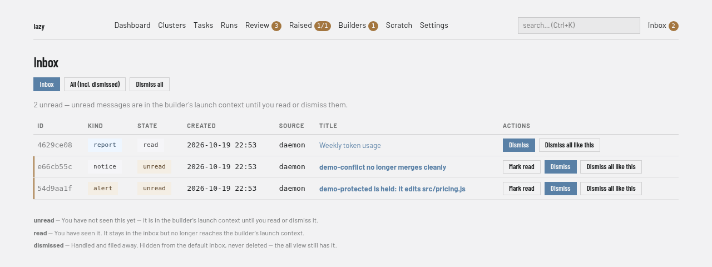

# System messages

System messages are proactive reports the system writes **for the human**: a
first-class inbox that report tasks, the daemon, and the builder file into,
and that every surface can always display.

Lazy should help you unprompted — a task whose job is to produce a report (a
post-mortem, a tool-call pattern analysis, a token usage summary) files its
findings here, and system messages are how those findings reach you. The same inbox is how an agent
tells you that something in your environment is broken and only you can fix it.
You don't have to remember to run anything: unread messages appear in the
builder's launch context, and `lazy messages` shows the inbox at any time.

## What a message is

Each message carries:

| Field | Meaning |
| --- | --- |
| `id` | UUID; any unique prefix works on the CLI and MCP tools |
| `source` | What produced it — a task code, `daemon`, or `builder`. Derived from the producer's identity, never free-form input |
| `title` | One-line headline; compact surfaces render only this. Single-line by contract: newlines and control characters are rejected at the post boundary (unread titles are rendered into the builder's prompt, and the builder is an agent too) |
| `body` | The full report (markdown) |
| `kind` | `report` (a produced analysis), `notice` (a system event worth knowing), or `alert` (needs attention soon) |
| `read_at` / `dismissed_at` | Lifecycle state — see below |

Secret values lazy knows about (a task's secret environment variables and
files) are scrubbed from the title and body when a message is written, so a
report that quotes an agent's error output never shows them in clear.

## Lifecycle: append-only, never deleted

Creation is append-only. Messages are never edited or deleted — reading and
dismissal are state changes on the message, so the record of what the system
told you is permanent:

- **unread** — neither read nor dismissed. Injected into the builder's launch
  prompt (as one-liners; bodies stay on demand) until you deal with it.
- **read** — you saw the full body (`lazy messages read <id>` marks it; the
  first read wins and the timestamp never moves). Read messages stop being
  injected but stay in `lazy messages list`.
- **dismissed** — hidden from default surfaces. `lazy messages list --all`
  still shows it, forever.

**Repeats.** Some events recur — Docker restarting again and again in a
project's machine, for example. Instead of filing a new message each time, lazy
keeps one open message for the event and counts the repeats on it ("happened 37
times, last …"). A different kind of event still gets its own message, and once
you dismiss the message the next occurrence starts a fresh one.

## Surfaces

**Dashboard inbox.** The daemon's built-in dashboard — `lazy daemon dashboard-url`
prints its address — serves the same inbox at `/messages`:



- **`/messages`** — undismissed messages, newest first, with kind, source, date
  and state. Unread rows are marked with a bold title and an edge marker, not
  colour alone.
- **`/messages?all=1`** — everything, including dismissed ones. A dismissed row
  says when it was dismissed and by whom, and that the record is kept.
- **`/messages/<id>`** — one message in full, its body rendered as markdown.
  Opening it marks it read: `read_at` records that you have *seen* the message,
  and the body being on your screen is the most direct evidence of that. This
  matches `lazy messages read <id>`.
- **Dismiss** is a button on both the list and the message itself.
  **Dismiss all like this** files away every open message with the same source
  and title, and **Dismiss all** (on the inbox) every open message — both ask
  first, and nothing is deleted. Lazy Teams' Messages page offers the same
  buttons. **Mark read**
  is offered too, on unread rows, for filing something you have decided about
  from the title alone.
- The nav carries an unread badge and the dashboard shows an unread panel, so a
  new alert is visible without going looking for it. Review, Raised and
  Conversations carry the same badge — see [the nav
  counts](web-review.md#the-nav-counts).

Both actions are ordinary form submissions — the inbox works with scripting
turned off. The dashboard is a loopback surface for the person sitting at the
machine; dismissals from it are recorded as `human`, exactly as the CLI's are.

**Builder launch.** Unread messages are injected compactly into the builder's
system prompt — the same shape as the memory index: title + attribution per
message, bodies on demand via `lazy_messages(id="...")`. The builder is
expected to relay them to you. A storage failure logs loudly and skips the
section; it never blocks the launch.

**CLI.**

```bash
lazy messages                 # the inbox (dismissed hidden)
lazy messages read 3f9a01b2   # full body; marks it read
lazy messages dismiss 3f9a01b2
lazy messages dismiss --source machine-docker   # every open message from one source
lazy messages dismiss --title "restarted"       # every open message whose title contains it
lazy messages dismiss --all                     # every open message
lazy messages list --all      # everything, including dismissed
```

A bulk dismissal shows how many messages match and asks before acting; `--yes`
skips the question (and is required when there is no terminal to ask on).
`--source` and `--title` combine.

**MCP tools.**

- `lazy_message_post(title, body, kind)` — file a message. Open to the builder
  *and* task agents: report tasks run as agents and must be able to file their
  report. The `source` is attributed automatically from the caller's identity
  (its task code, or `builder`) — a producer cannot impersonate another.
- `lazy_messages(id?, include_dismissed?)` — the index, or one message in
  full. A pure read: it never flips read state (read/unread tracks the
  *human* having seen a message, so only `lazy messages read` marks it).
- `lazy_message_dismiss(id)` — **human/builder only.** Rejected server-side
  for task agents: the inbox belongs to the human, and an agent must not be
  able to empty it.

## Why agents may post but not dismiss

Shared memory is agent-read-only because memory records are injected into every
future session as guidance — an agent-writable store would be a prompt-injection
channel. System messages are different: they are attributed data displayed *to
the human*, never injected into agent prompts as guidance, so agent creation is
safe — and necessary, because report tasks run as agents. Dismissal
is the human's (or their builder's) decision alone.

## Environment blockers agents cannot fix

The other thing that lands in your inbox is a blocker an agent hit and cannot do
anything about from inside its task: a wedged CI runner, a stuck process holding
a lock, an expired credential, a broken shared fixture, a machine out of disk.

Agents are told to investigate a failing check on their own branch rather than
call it "out of scope" — and when the cause turns out to be infrastructure
rather than the code, to tell you what is broken, the evidence, the concrete
remedy, and which task hit it. The kind says how urgent it is: `alert` when the
blocker is holding up that task's acceptance, `notice` when it isn't. You are
the only one who can fix these, and you can't fix what nobody reported; a
message is also how a recurring blocker becomes a permanent fix instead of
something every future task works around.

This is distinct from the per-task channel an agent has. A **raised item**
(`lazy raised`) is either a *decision* about that task's own scope or diff — one
that blocks accept until you answer it — or orthogonal *code* work for you to
triage later, which never blocks.
A system message is neither — it's a report about your environment, and it
belongs to the project rather than to one task.

## Boundary: not lazy's own diagnosis channel

`lazy doctor` remains the single diagnosis surface for lazy's *own*
configuration and health — commands print one generic "Run `lazy doctor`"
pointer and doctor owns the details, so other commands do not file
doctor-shaped warnings here. Doctor itself files **one** inbox
alert when a run finds errors, so people who never run `lazy doctor` still
see the findings. System messages otherwise carry things written **for you**:
proactive reports and analyses, and blockers in your project's environment
that only you can clear.

## Built-in producers

- **Doctor findings** (`alert`, source `doctor`): when `lazy doctor` (or the
  daemon's doctor run) finishes with any error-level check, it files one
  alert summarising those failures and their remedies. A still-open
  doctor alert is reused, so re-running doctor does not stack copies.
- **Daemon upgrade notice** (`notice`, source `daemon`): when the daemon starts
  with a different version than the previous start on this project, it files
  one message noting the change.
- **Usage pause** (`notice`, source `daemon`): when new turns on a model
  credential are held because its usage window is nearly spent, one message per
  pause says which credential, until when, and what is held.
- **Accept that could not be finished** (`alert`, source `daemon`): when an
  accept died mid-flight and the daemon's repeated attempts to finish it failed,
  an alert names the task and the last error.
- Report tasks (post-mortems, tool-call patterns, token usage) file their
  findings here as `report` messages.
