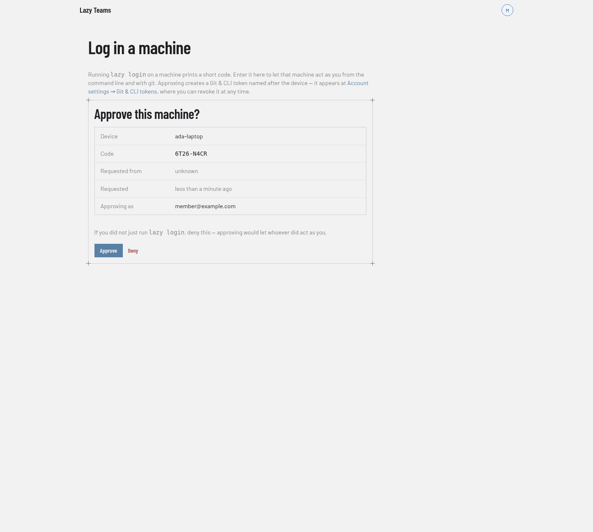

# Logging a machine in to Lazy Teams

`lazy login` connects a machine to a Lazy Teams install. Run outside a
repository, it logs the machine in — after which plain `git clone` of a
repository the install hosts works, the way it does for GitHub after
`gh auth login`. Run inside a clone, it also binds that clone to one project on
the install. Nothing secret is typed, pasted or displayed: you approve the login
in a browser that is already signed in, and the credential travels from the
install to the machine directly.

## Cloning a hosted project

If the install hosts the project's repository, its project page shows the clone
URL and two ways to use it, each with a Copy button:

```
$ lazy login https://teams.example.com
$ git clone https://teams.example.com/git/acme/api-server.git
```

or, in one step — log in if needed, clone, and bind the new clone to the project:

```
$ lazy clone https://teams.example.com/git/acme/api-server.git
```

Use the address your install is served on. lazy uses the scheme you type exactly, as `git` does: `https://` stays `https://`, and `http://` stays `http://`, so installs on a private network or tailnet work over plain http. Only a bare host (`lazy login teams.example.com`) gets `https://`, because nothing was typed. The login is scoped to that exact address and is never sent across a redirect; if the address redirects (say `http://` to `https://`, or to a sign-in page), lazy stops and tells you where it went so you can use that address. `lazy logout` needs no network.

A login is only ever sent over the scheme it was made on. If this machine logged in at `https://teams.example.com`, `lazy clone http://teams.example.com/…` refuses rather than send that login unencrypted; use the `https://` address, or — if the install really is served over plain http — run `lazy login http://teams.example.com` first. lazy also refuses a login that the install you typed did not issue itself (an address relaying another install's approval), and a code-approval page on any address other than the one you typed. A login an older lazy sent to an `http://` address is cleaned up the next time you run `lazy login`, `lazy logout` or `lazy clone`, and lazy tells you to revoke that token.

`lazy clone <clone-url> [dir]` clones into `dir` (default: the
project's name). It checks you are a member of the project before cloning, and
reuses this machine's login for that exact address — same scheme — when it has one that still works. A project whose
repository lives on GitHub or GitLab is cloned from there instead — `lazy clone`
says so; clone it as usual and run `lazy login` inside the clone.

### How git gets the login

`lazy login` adds **one** `include.path` entry to your user-level git config —
the file `git config --global` writes, which it names when it changes it —
pointing at a small file of lazy's own (permissions `0600`). That file sets, for
your install's exact address only:

- an `Authorization: Bearer` header carrying the login's token, and
- `followRedirects = false`, so git never follows a redirect anywhere else.

The token is never written into your `.gitconfig` itself or into any
repository's `.git/config`, and no other host ever receives it. `lazy logout
<teams-url>` removes the entry and the file.

This works behind a sign-in proxy (which accepts the Bearer header and cannot
read a password) and without one: every login's token carries git access,
whether you approved it in the browser or with a code.

## Logging in

Inside a clone of the repository, `lazy login` also binds the clone to a project:

```
$ cd ~/src/api-server
$ lazy login https://teams.example.com

  Open https://teams.example.com/device and enter:  KTPX-9QFD
  (or, with the code already in it: https://teams.example.com/device?code=KTPX-9QFD)

  ✓ Approved as ada@example.com

  Which project is this clone?
    1) acme/api-server
    2) acme/web
  > 1

  Bound to acme/api-server on teams.example.com.
```

What happens, step by step:

1. Lazy asks the install to start a login and prints a short code.
2. You open the URL in a browser — on this machine or any other — and type the
   code. You see a page naming the machine that is asking, where it asked from,
   and who you would be approving as. The second link has the code already in
   it; it is a convenience, and typing the code yourself is the safer habit,
   because it means you know which request you are approving.
3. You approve. The install creates a Git & CLI token named after the machine.
4. Lazy collects the token, asks which project this clone is, and saves both.
   Outside a clone there is no project to ask about: it saves the machine login.

The code expires after 15 minutes. If nobody approves it in time, run
`lazy login` again for a fresh one. Expiry is the whole window, not just the
approval: a code approved but never collected stops working at the same moment.

A brief network or server hiccup while lazy is waiting does not end the login —
it keeps waiting until the code expires. If the install asks it to check less
often, it waits progressively longer between checks, so several people logging in
from one network at the same time do not crowd each other out.

If a login ends after you approved it — you interrupt it, the install becomes
unreachable, or the project you named is not one you are a member of — the token
it created still exists. Lazy says so, and you can retire it at
**Account settings → Git & CLI tokens** (from your avatar menu).

**Only you can approve your own logins.** An administrator viewing the site as
you cannot approve one on your behalf, even with writes enabled — approving puts
a long-lived token on a machine, and that token would keep working long after
they stopped viewing as you. The approval page says so instead of offering the
button.

## What a bound clone can do

Once a clone is bound, the ordinary commands work exactly as they do against a
local project — `lazy list`, `lazy show`, `lazy diff`, `lazy create`,
`lazy edit`, `lazy unblock`, `lazy accept`, and the rest — except they run
through your Teams install instead of a daemon on your machine. Everything you
do is authenticated as you and shows up under your name, the same as if you
had used the browser.

A bound clone has no daemon of its own, so a handful of commands that manage
*this machine* refuse instead of trying to operate infrastructure that was
never there: `lazy daemon start` / `stop` / `status`, `lazy init`,
`lazy doctor` (there is nothing local left to diagnose), and `lazy dashboard`
(there is no local dashboard to open — the install's own web pages are it).
Each one says the clone is bound and points at `lazy logout` as the way back
to working locally.

A bound clone can never do more than the browser can. A few task settings have
no control in the browser, so the command-line options that set them are
refused from a bound clone: `--runner` and the `--review` settings on
`lazy create` / `lazy edit`, and `lazy edit --parent` naming a git branch rather
than a task (use `lazy reparent`, like the browser's "Move under another task").
You can still set a task's parent task, or clear it, the same way the browser's
edit page does.

For the same reason, the options that let a command skip a check the browser
enforces are refused too: `lazy accept --allow-broken` and
`--allow-review-issues`, `lazy start --force-local`, `lazy unblock --agent`,
and `lazy review --auto-fix` / `--model`. The refusal says what was refused, and the
command works without it.

`lazy create --parent` may name a branch: a branch you pushed to the project's
repository is fetched by the install, and the task starts from it. Name the
branch exactly: a name that differs from an existing branch only in letter
case, in whole or in any part (`Main` or `MAIN/x` when `main` exists,
`Release/2.0` when `release/1.0` exists), is refused. Creating a
task from a bound clone is all or nothing — when anything is refused, no task
is created and the command says so.

`lazy stats limits` and `lazy stats budget` work from a bound clone and show
you exactly what the install's Usage page shows you: your own credentials, the
project's shared one, and any not tied to a member — never a colleague's.
The usage-pause check that `lazy start` and `lazy unblock` run before they
open an editor asks the install the same way.

`lazy chat`, `lazy report` and `lazy ask` on a stored conversation work from a
bound clone and spend **your own** Claude credential, exactly as the browser
does — never the project's or a colleague's. `lazy chat <task>` opens the
task's Chat on the install, like `lazy pair` opens its Pair: it runs there, in
an environment of your own, and **ctrl-]** leaves it. As in the browser, you
can chat with a paused task whose agent is Claude Code; `--effort` and
`--override-usage-pause` do not apply, because the install decides how the
session runs. `lazy report` and `lazy ask <conversation>` run their model
calls on the install and print the answer here. `lazy report` reads the project's tasks from the install but its main-branch commits from your checkout, so pull first for an up-to-date report. If you have not connected a
Claude account to the install yet, each of them says so and runs nothing.

## Your builder, from a bound clone

`lazy builder` in a bound clone does not start anything on your machine. Your
builder runs on the Teams install, next to the project, and `lazy builder`
opens a terminal on it. Running `lazy builder` again — from this clone, another
machine, or the **Builders** page in your browser — reaches the same session, so
you can start something on your laptop and pick it up from your phone. Its
conversation is kept with the project, like any other builder conversation.

- **ctrl-]** leaves the terminal. The builder keeps running.
- `lazy builder stop` stops it and keeps its conversation; the next
  `lazy builder` resumes it.
- `lazy builder end` ends it for good.

In the browser, a stopped builder stays on the **Builders** page, marked
"Stopped — resumable". Its page has a **Resume** button, and the Builders page
button reads **Resume your builder**. If a builder stopped on its own (it
crashed, or the machine restarted), its page says so, with the exit code, and
Resume starts it again. If a stopped builder's conversation cannot be picked
up again, starting it opens a fresh conversation instead; the old one stays
readable under **Builders**. If Teams could not check whether your builder is
running, the terminal says so; nothing is stopped, and you can try again in a
moment.

A builder runs until you stop or end it — there is no idle timeout. It runs on
your own Claude account, so connect one in Teams first. Options that choose how
a local builder runs (`--model`, `--effort`, `--resume`, `--no-autonomous`)
are refused from a bound clone: the server decides how its sessions run.

To use a Claude Code you run yourself against the project instead, see
[Claude Code against a Lazy Teams project](teams-bound-clone-agents.md) — it
works, with fewer capabilities than the server-side builder.

Without `--local` (below), `lazy pair` and `lazy shell` likewise go through Teams
rather than opening anything locally. On a Teams install they are refused: a task's
container runs on the account of whoever started the task, so entering it in
your name is not offered.

### Working on a task's branch on your own machine

Some work has to be built and tested locally — a macOS app, say. Every task's
branch (`lazy/<task>`) is on the project's repository (the install's own, or any
other remote that is not GitHub or GitLab), kept current as the
task's turns finish, so `git fetch` in your clone sees all of them. Accepted
work is pushed to the target branch (usually `main`) there too. If someone
pushed to `main` on the install directly, `lazy accept` brings those commits in
first. Lazy never force-pushes: if `main` on the install and the project's own
copy have diverged, the accept is refused before anything is merged.
Likewise, if commits were pushed to the task's own branch (for example from
`lazy shell <task> --local`) and the task does not have them yet, `lazy accept`
is refused and points you at `lazy sync <task>`, so they are never left out. That
answer comes first even when the target is protected, because it is one you
can act on from the clone. Once the task has them, accept it with Accept on the
task in the browser: the project's default branch is protected by default, and
`lazy accept` from a clone is refused there and points you to Teams.

`lazy shell <task> --local` gives you a checkout of one:

```
lazy shell fix-login --local
```

It fetches the task's branch, creates a git worktree of your clone beside it
(`<clone>-<task>`, so your editor and build tools can open it like any other
directory), and opens your shell there. If the branch is already checked out
in a worktree of this clone, that one is used.

From then on it is plain git. The checkout tracks `origin/lazy/<task>`, so
`git push` sends your commits to the task's branch on the install, and the
agent picks them up the next time the task is synced (`lazy sync <task>`) or
unblocked. Any team member may push a task branch; for other branches, see
[who can push what](self-hosting-lazy-teams.md#hosting-repositories-on-the-install).
Lazy never pushes for you — not when you commit, not when you leave the shell.

Running it again is safe: a clean checkout that is behind is fast-forwarded,
and one with commits you have not pushed or changes you have not committed is
left exactly as it is, with a line saying why. `--host` does not apply in a
bound clone — the task's own worktree is on the server — and says to use
`--local` instead.

## Which project this clone is

**Lazy never guesses from the git remote.** Two clones of the same repository can
belong to different projects, so the project is always chosen out loud: from the
list when there is a terminal to ask, or with `--project` when there is not.

```
lazy login teams.example.com --project acme/api-server
```

In a script or anywhere without a terminal, `--project` is required. A login
without it is an error rather than a guess, and it is refused before anything is
created on the install.

**One clone, one project.** Logging in again replaces the binding and says so.
There is no command to switch a clone between projects: if you work on two
projects, you have two clones — which you have anyway, because a clone is a
checkout of one repository.

### When the project or team is renamed

A clone keeps working after its project or team is renamed. It remembers the
project it was bound to by its identity as well as by its name, and keeps
reaching that project under the new name — even after another project takes
the old name. `lazy login` with no arguments still prints the name you bound
by; log in again whenever you like to see the new one.

If another project has taken the old name since a clone logged in, the clone is
refused rather than connected to that other project; log in again with
`lazy login --project <team/new-name>`.

## Seeing where a machine and a clone point

Run `lazy login` with no arguments. It prints which installs this machine is
logged in to and, inside a clone, its binding — and starts nothing:

```
$ lazy login
This machine is logged in to: https://teams.example.com
  git to those installs carries the login; lazy logout <teams-url> ends it
This clone is bound to acme/api-server on https://teams.example.com
  bound 12/03/2026, 09:41:00
  lazy logout unbinds this clone
```

## Logging out

```
lazy logout https://teams.example.com   # this machine, from that install
lazy logout                             # inside a clone: unbind the clone
```

`lazy logout <teams-url>` deletes this machine's login to that install and
removes the git config entry `lazy login` added (it names the file). A bare
`lazy logout` inside a clone deletes the clone's stored login, which is also how
the clone is unbound; outside any clone it logs the machine out of every install.
If a clone
somehow ends up holding more than one login — a state every other command refuses
to act on — `lazy logout` clears all of them and says how many it removed. It stops
*this machine* using the token; it does not retire the token. To end access
altogether, revoke it at **Account settings → Git & CLI tokens** (from your avatar menu) on the install — that takes
effect on the next request, from anywhere.

## Where the login is kept

In lazy's own [credential store](credentials.md) — a clone's login with that
project, and the machine's login in a store of its own that belongs to no
project — split the same way every credential there is:

- the **token** goes to the OS keychain (macOS Keychain, libsecret on Linux, or a
  mode-0600 file on a host with neither), and
- the **binding** — which install, which project, when — sits beside it in the
  non-secret index.

That split is why `lazy login` with no arguments can tell you where a clone
points without unlocking a keychain to do it.

## The tokens this creates

A login creates an ordinary Git & CLI token named after the machine, with
**git, CLI and MCP** access. It appears at **Account settings → Git & CLI tokens** (from your avatar menu) alongside any token you
created by hand, showing when it was last used, and it is revoked there like any
other. Logging the same machine in twice gives the second token a distinguishing
suffix rather than failing.

Tokens carry separate access for git and for the command line, and one is
refused where the other is expected. A login's token has both, and sets git up
for you (see [how git gets the login](#how-git-gets-the-login)); a token you
create by hand for git is described under
[hosting repositories](self-hosting-lazy-teams.md#hosting-repositories-on-the-install).

## Approving from the browser

The approval page lives at `/device` on your install and is also reachable from
**Account settings → Git & CLI tokens** (from your avatar menu). Open it and type the code in — it is case-insensitive
and the dash is optional. The prefilled link lazy prints underneath works too,
and is a convenience rather than the mechanism.



If you did not just run `lazy login`, **deny it**. Approving would let whoever
did act as you.

## Human-only, deliberately

There is no MCP tool for logging in or out. Connecting a machine to an install is
a decision a person makes at a keyboard, in a browser they are already signed in
to; an agent must never do it. See
[surface asymmetries](surface-asymmetries.md).

## Display name

In **Account settings → Profile**, set the name you want shown beside your actions — sign-offs, turn bylines and
comments. Leave it blank to be shown by your email address. The name applies to entries written after you save it;
entries already written keep the name they were recorded with.

Your email address is always shown next to your name, so nobody can pass for you. A name (or a rename) is refused if
it looks like an email address, is a reserved word such as admin, god, lazy, system or support, or matches — ignoring
case and spacing — another member's name or email in a team you share. If your name later matches a teammate's (for
example, when someone with the same name joins), the Profile page warns you, and new entries show only your email
until one of you changes it.

## Alternative email addresses

In **Account settings → Email addresses**, add an alternative email and open the
verification link sent to that inbox. Confirm while signed in to your existing
member account. The link expires after one hour. Your installation must have
outgoing email configured.

Once verified, the address signs in to the same account with your existing
password or through a trusted sign-in proxy, including one using a different
OAuth account. Your primary email remains your notification address and account
identity. An address cannot belong to two members. Remove alternatives from the
same settings page when you no longer want to use them.

If your installation cannot send email, a site administrator can add an
alternative email to a member as already verified: in God mode, open the
member's page, enter the address under **Alternative emails** and confirm. No
email is sent, the address works for sign-in immediately, and the member's
settings page shows it as verified by an admin.
