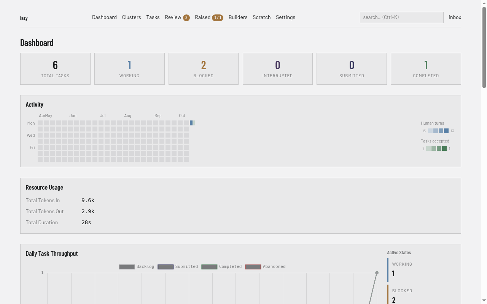
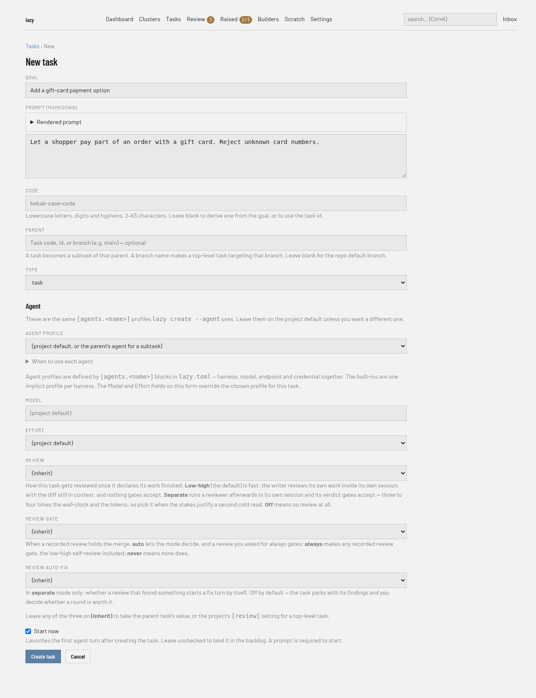
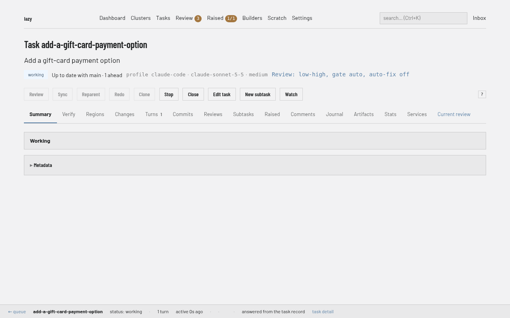
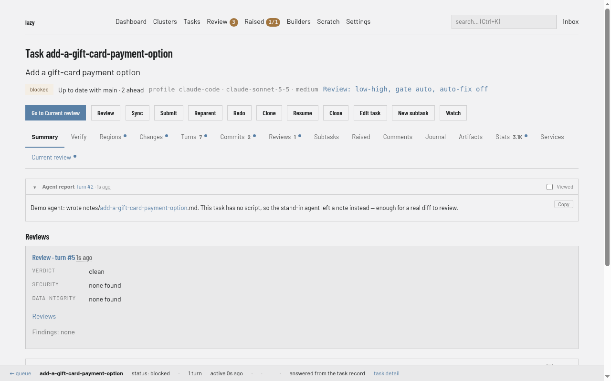
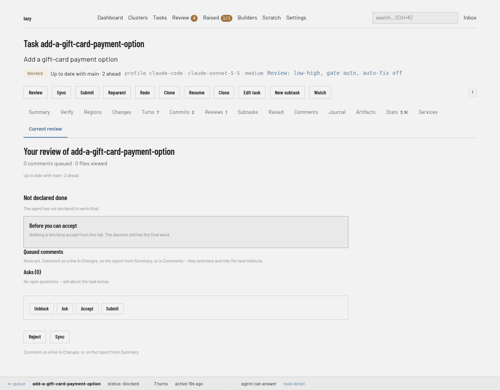
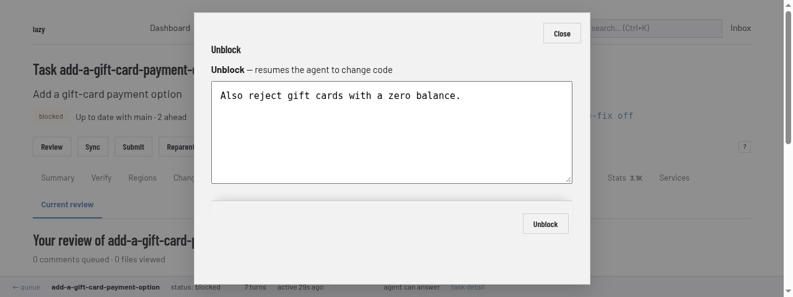
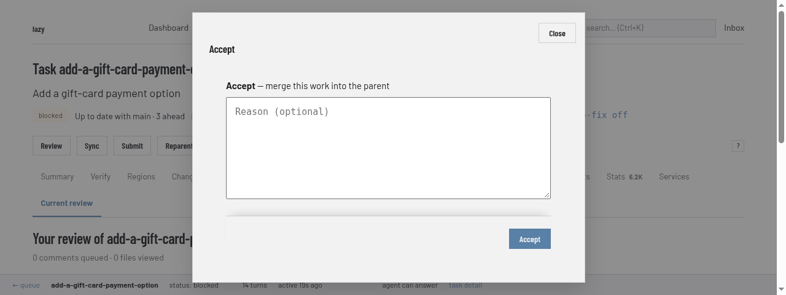
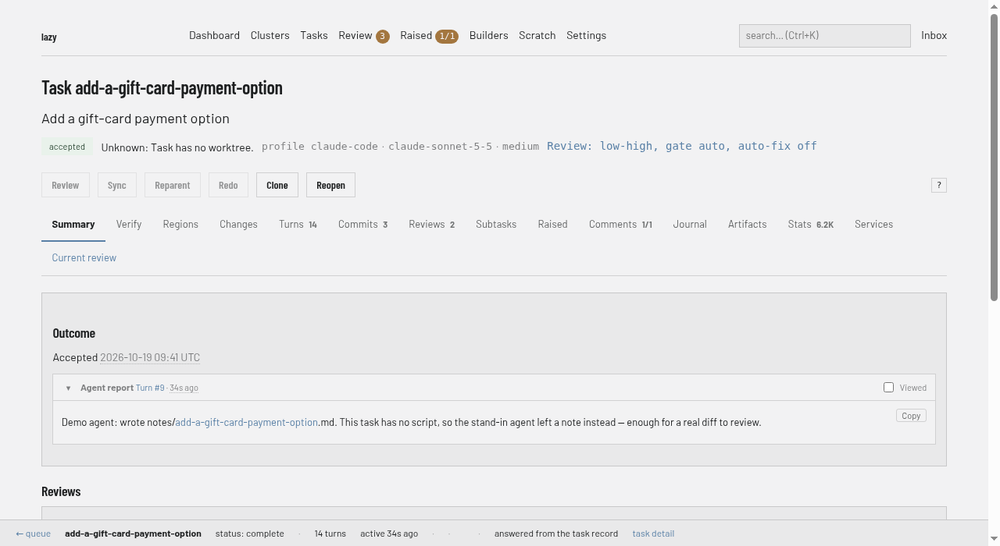

# Take your first task from creation to accept in the dashboard

By the end of this tutorial you will have created a task in lazy's browser dashboard, watched an agent do the work, and accepted it, all without leaving the browser. The screenshots come from a small sample project, so your task's name and the agent's report will differ.

## Prerequisites

- lazy installed and set up in a repository, as in [Getting started](../getting-started.md) steps 1 and 2 (`lazy init` has been run).
- A model credential; see [Credentials](../credentials.md).

## 1. Open the dashboard

From your repository, run:

```bash
lazy dashboard
```

lazy asks the daemon for a one-time login link and opens it in your browser. You should land on the dashboard, with a navigation bar that includes Dashboard, Clusters, Tasks, Review, Raised, Builders, Scratch, Settings and Inbox.



If no browser can be opened (for example over SSH), lazy prints the link instead. Open it yourself; it works once. Run `lazy dashboard` again for a new one, or `lazy dashboard --print` to print one deliberately.

## 2. Create and start a task

A top-level task merges into your repository's default integration branch (`origin/HEAD`, or `main` if that is not set), not the branch you happen to have checked out. A subtask merges into its parent task. In the New task form, the **Parent** field sets this: leave it blank for the default integration branch, enter a task code to make a subtask, or a branch name to target that branch. From the command line the same choice is `lazy create --parent <branch>`.

1. Click **Tasks** in the navigation bar, then **New task**.
2. Fill in **Goal**, for example `Add a gift-card payment option`, and **Prompt**, for example `Let a shopper pay part of an order with a gift card. Reject unknown card numbers.`.
3. Leave **Parent** blank and the other fields on their defaults. **Code** is filled in from the goal if you leave it blank.
4. Tick **Start now**. Without it the task lands in the backlog, and you start it later with **Start** on its page.
5. Click **Create task**.



You should see a dialog titled "Starting task" narrating the launch, and then the task's page.



## 3. Watch it work

The task's page shows its status; while the agent works it reads `working`. You can leave the page open or come back later: the task shows up under **Tasks**, and under **Review** once it needs you. While it works, **Stop** halts it.

## 4. Look at what it did

When the agent finishes its turn the status becomes `blocked`, meaning it is waiting for you. Open the task. Its **Summary** tab shows the agent's report.



Click **Current review** (or **Go to Current review**). The review page lists what stands between the task and accept, any comments you have queued and questions you have asked, and the buttons to act on it. The agent's report is on the **Summary** tab and the diff on the **Changes** tab.



Read the changes. If you want to understand a choice, click **Ask** and type a question; the agent answers without changing any code.

## 5. Give feedback (optional)

If something needs changing, click **Unblock**, type what the agent should do next in the box, and click **Unblock** in the dialog. The agent resumes and carries your feedback; when it finishes, review again.



## 6. Accept

When you are happy, check that the destination is the one you chose in step 2: the Accept dialog says only that it merges into the parent, and for a subtask the task's **Parent** link shows which task. Then click **Accept**. A dialog asks for an optional reason; click **Accept** to confirm. If your project protects the target branch, the dialog also asks for your approval passphrase (see [Protected branches](../protected-branches.md)). The work is merged into the task's target (here, the default integration branch you left **Parent** blank for), and the task's status becomes `complete`.





## What next

- [How to review and accept a task](../how-to/review-and-accept.md) — every way to inspect, send back and accept work.
- [How to give feedback](../how-to/give-feedback.md) — feedback, comments and questions.
- [Reviewing in the browser](../web-review.md) — the review page in detail.
- [Review and accept](../explanation/review-and-accept.md) — why accept works the way it does.
- [Tasks and turns](../explanation/tasks-and-turns.md) — what a task is and how it moves through statuses.
