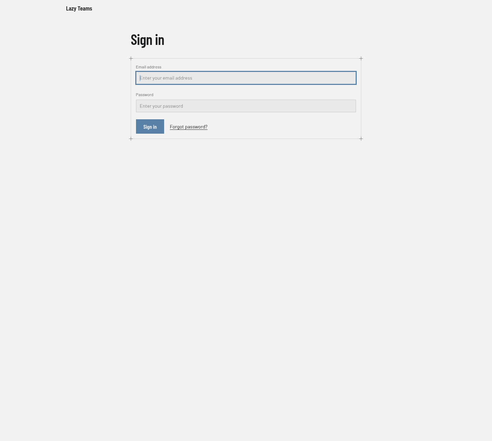
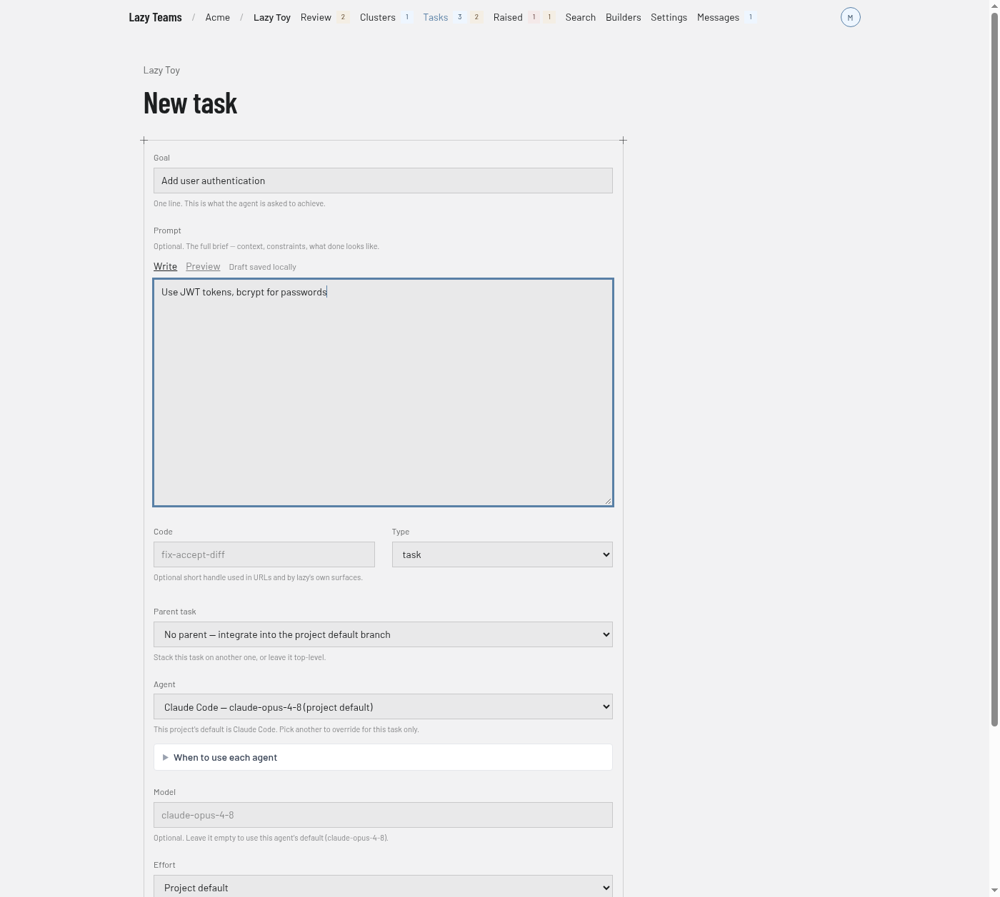
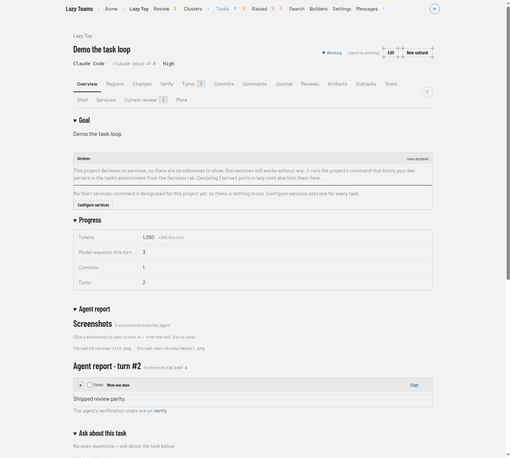
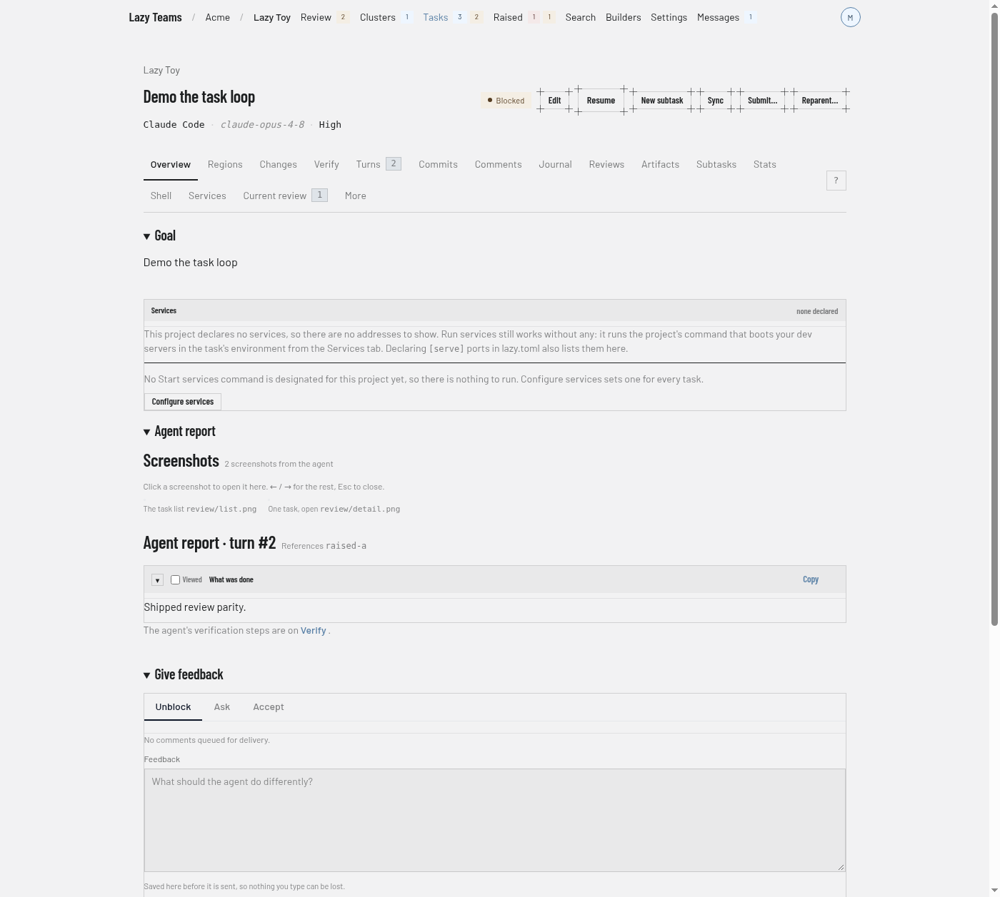
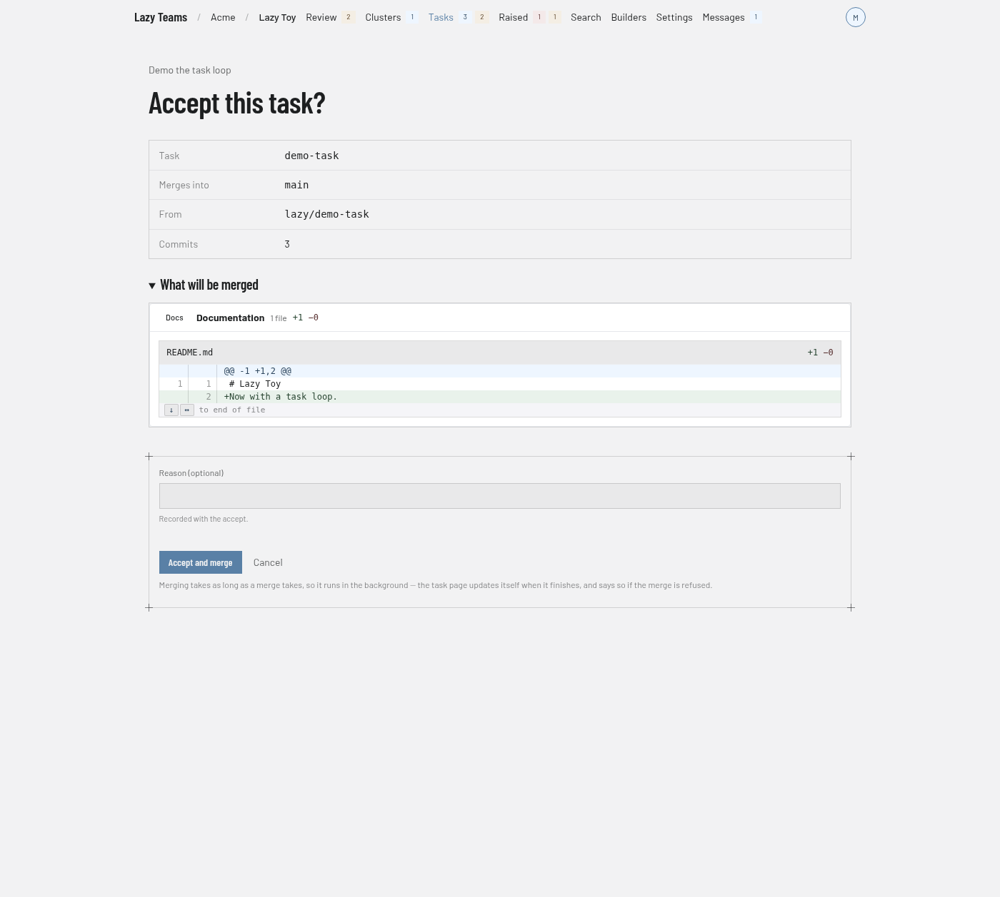

# Take your first task from creation to accept in Lazy Teams

> **Lazy Teams is in private alpha.** It is not generally available, screens and behaviour may change, and you need an installation that someone has set up for you or that you have set up yourself.

The screenshots show sample data, so your project's names and the agent's report will differ.

By the end of this tutorial you will have signed in to Lazy Teams, created and started a task on a project, and reviewed and accepted its work in the browser.

## Prerequisites

- A Lazy Teams installation you can reach. To run one yourself, see [Lazy Teams first-run setup](../lazy-teams-setup.md) and [Self-hosting Lazy Teams](../self-hosting-lazy-teams.md).
- An account on it: either the administrator account created during setup, or one you were invited to.
- A project already registered on your team. Your administrator adds projects; this tutorial does not cover that.
- A model credential connected for your account. Every task you start runs on your own account. If you have none, the Dashboard and your team's page show a **Connect a model credential to run tasks.** notice with a **Connect →** link; follow it before starting a task.

## 1. Sign in

Open your installation's address in a browser. On the **Sign in** page, enter your **Email address** and **Password** and click **Sign in**.

If you were invited and have no account yet, open the invitation link and use **Create account and join** (or **Email me a link**, if it asks you to confirm your address first). If you already have an account, the link offers **Sign in to answer**, then **Accept invitation**.

## 2. Open a project

After signing in you land on the **Dashboard**. Under **Your projects**, click the project you want to work on. (You can also open your team and use its **Projects** section.) You should see the project's page, with a **New task** button.

## 3. Create and start a task

The **Parent task** choice on the form sets where the work lands. Left on "No parent — integrate into the project default branch", the task merges into the project's default branch; choosing a task makes it a subtask that merges into that task. The accept page in step 6 shows the destination as **Merges into**.

1. Click **New task**.
2. Fill in **Goal**, for example `Add user authentication`, and the prompt for the agent. Leave **Parent task** on "No parent" and the other fields, such as **Agent**, **Model** and **Effort**, on their defaults.
3. Click **Create and start**. (**Add to backlog** creates the task without running it; you can start it later with **Start** on its page.)

You should land on the task's page, with its status showing that the agent is working.

## 4. Review the work

When the agent finishes its turn, the task is waiting for you. Stay on the task's **Overview** or **Current review** tab: the feedback form and the Accept button appear only there. On the task's page:

- **Overview** shows the goal, progress and the **Agent report**.
- **Changes** shows the diff.
- **Current review** shows what stands between the task and accept.

To ask a question without changing anything, open the **Ask** tab in the **Give feedback** section and type it there.

## 5. Give feedback (optional)

If the work needs changes, stay on the **Unblock** tab of **Give feedback**, type what the agent should do differently in the **Feedback** box, and click **Send feedback and resume**. The agent continues; review again when it finishes.

## 6. Accept

Click **Accept**. A page titled "Accept this task?" shows the branch the work merges into (**Merges into**; check it before you continue) and how many commits it carries, with a preview of the changes. If the agent left a question that blocks accept, you decide it on this page first.

Click **Accept and merge**. The task is merged into that branch and finishes.

## What next

- [Lazy Teams](../explanation/lazy-teams.md) — what Lazy Teams is and how it relates to the command line.
- [Reviewing tasks in Lazy Teams](../lazy-teams-task-review.md) — the review screens in detail.
- [How to review and accept a task](../how-to/review-and-accept.md) and [How to give feedback](../how-to/give-feedback.md).
- [Tasks and turns](../explanation/tasks-and-turns.md).
